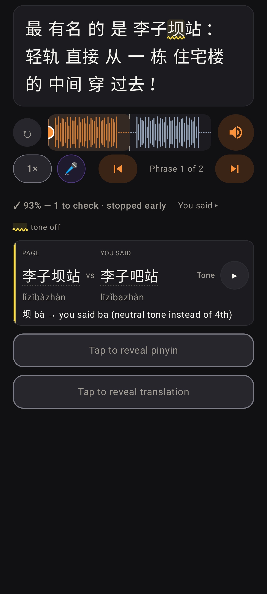
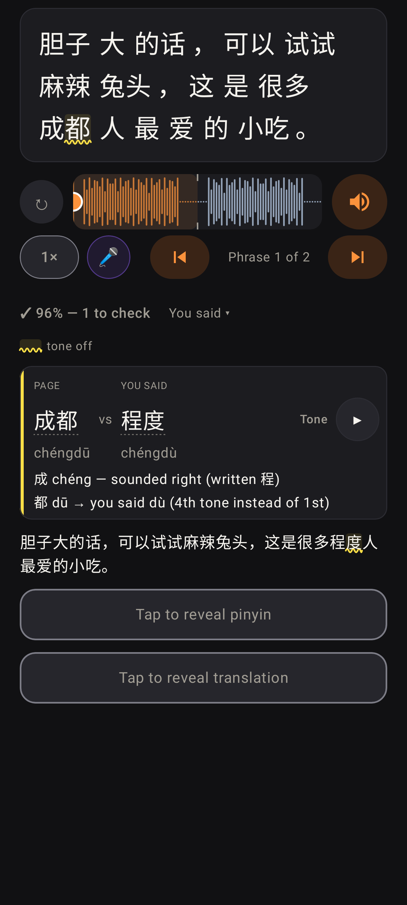

# 🎤 Read it aloud — stopping early, words into the explorer

Lab app, dark: he stopped after 从一栋 — the rest of the page has no marks and no rows, the line says "✓ 93% — 1 to check · stopped early" (the % is over the part he read), and only his one tone slip (坝 → 吧) is listed.

Lab app, dark: Jerome's 成都 → 程度 take. Both words in the row now have a quiet dotted underline: a tap opens the language explorer (source `read_aloud`). A tap on the marked 成都 on the page opens the explorer too, as it did before read-aloud.
