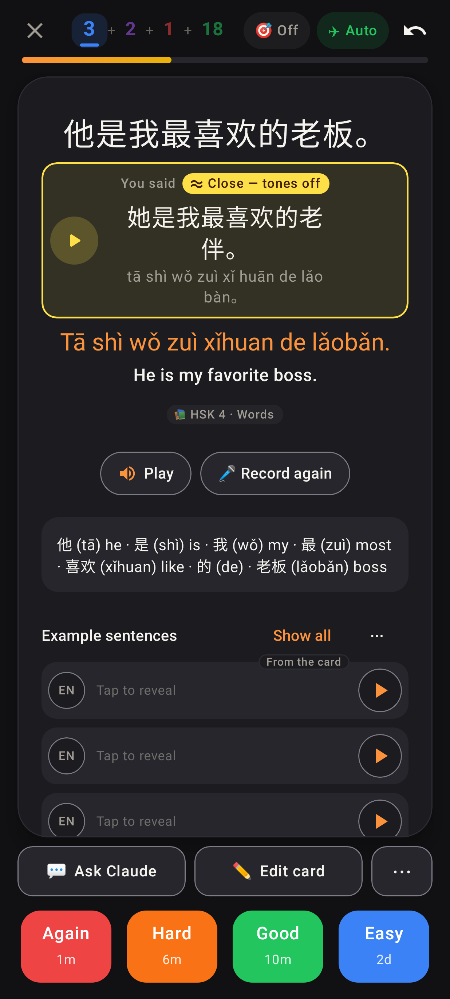

# Read card: "≈ Close — tones off"

Lab app, dark theme — Jerome's sentence heard as 她…老伴 (lǎobàn for lǎobǎn) is now the yellow "≈ Close — tones off" box instead of the red "Didn't match" (他 / 她 are one sound). The web's `YouSaid` box gets the same state and the same yellow (`.you-said--close`).
