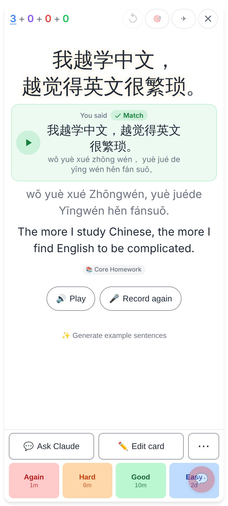
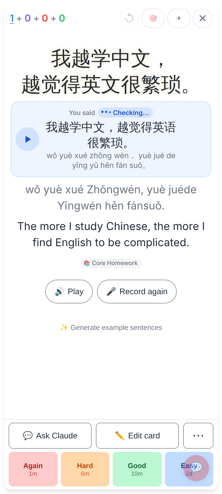
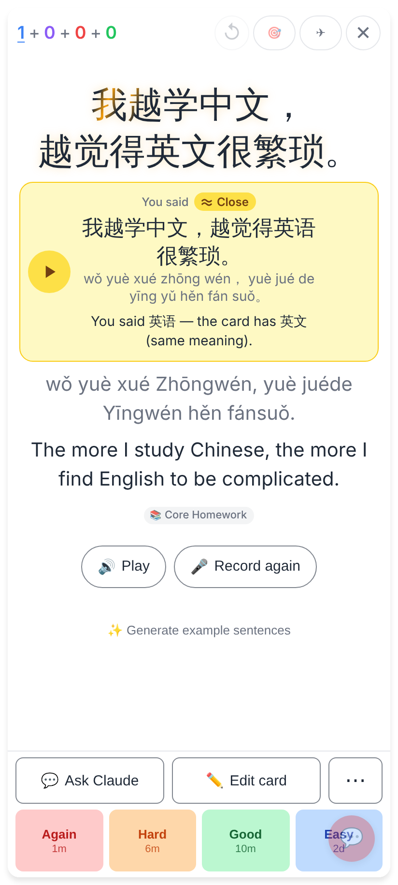
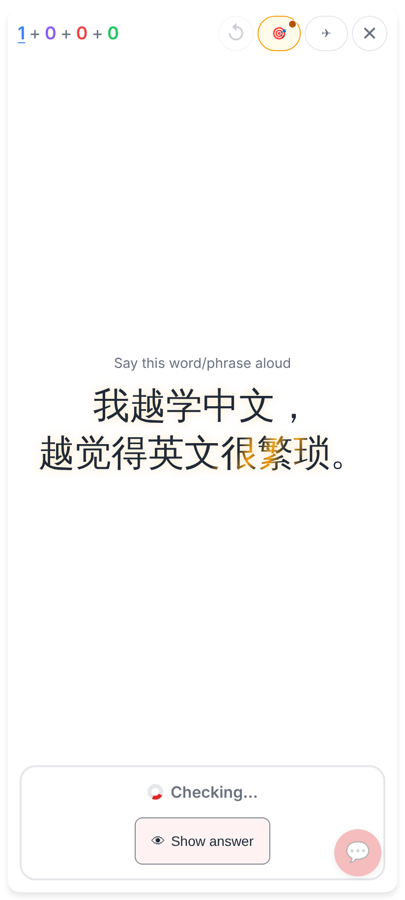
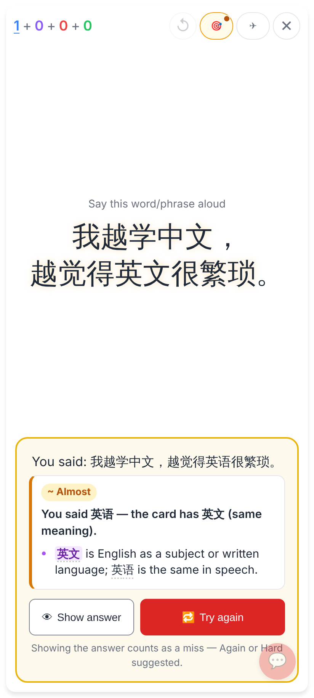
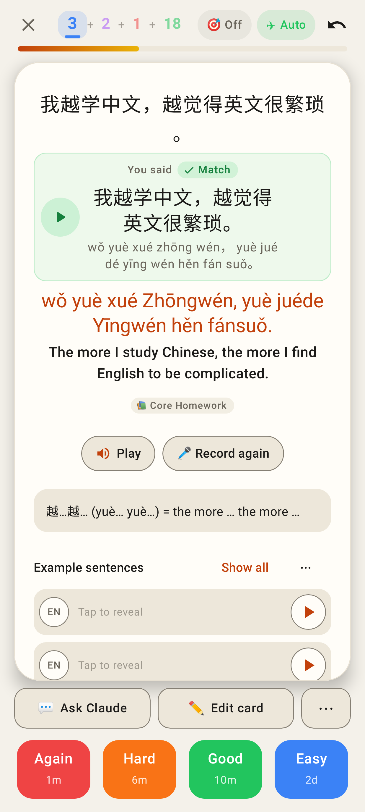
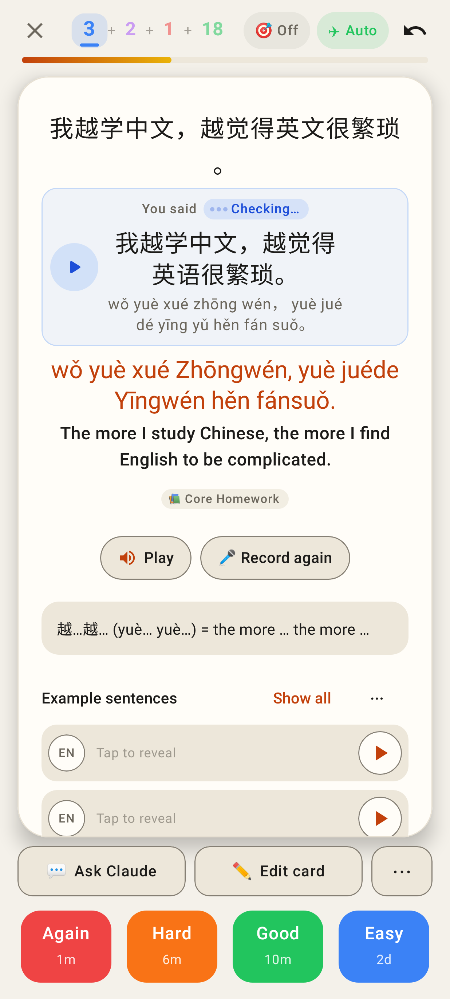
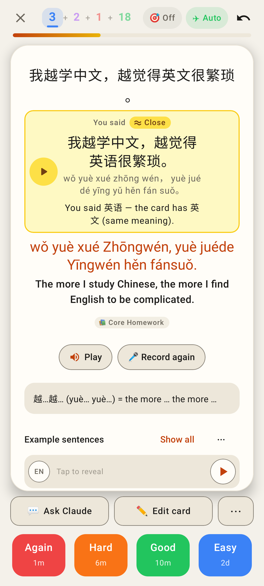
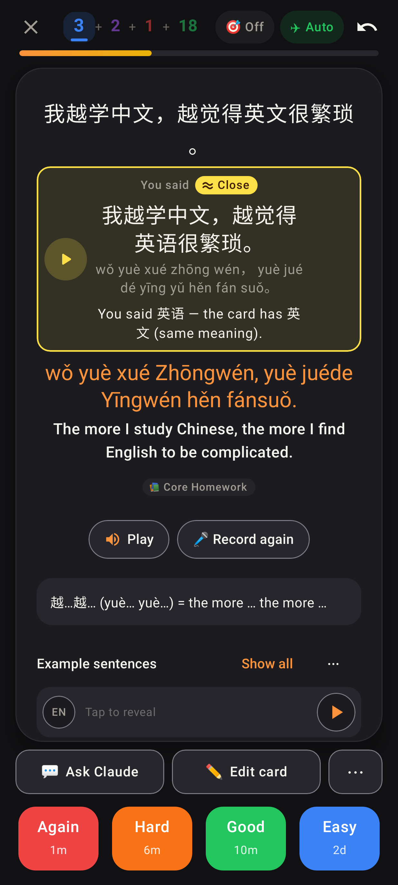

# Read card takes: punctuation never matters, then Claude's read-aloud check

Jerome's card 我越学中文，越觉得英文很繁琐。 (Hard mode, "Core Homework"), read aloud and heard as
我越学中文，越觉得英语很"繁琐"。 — it used to say a flat "✕ Didn't match". Phone viewport 412×915 @2x.

## Web

Only the recogniser's quote marks differ: ✓ Match on the device, the quotes not shown, no Claude call.

英语 for 英文: the device can't accept it, so the box says "Checking…" (blue) instead of ✗ while Claude reads it.

Claude's read-aloud check lands: ≈ Close with its one-line reason — "You said 英语 — the card has 英文 (same meaning)."

Hard mode's check on the question: "Checking…" while Claude reads the take.

Hard mode: ≈ Nearly with Claude's card (~ Almost, the reason and a tip), 🔁 Try again / 👁 Show answer.

## Lab app

Only the quotes differ: ✓ Match, no call.

英语 for 英文: "Checking…" while Claude reads it.

≈ Close with Claude's reason.

The same in the dark theme.
