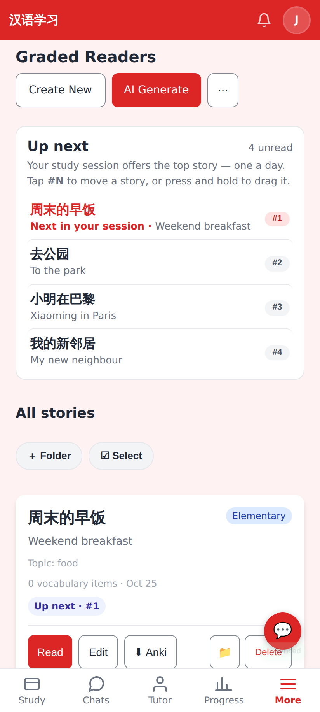
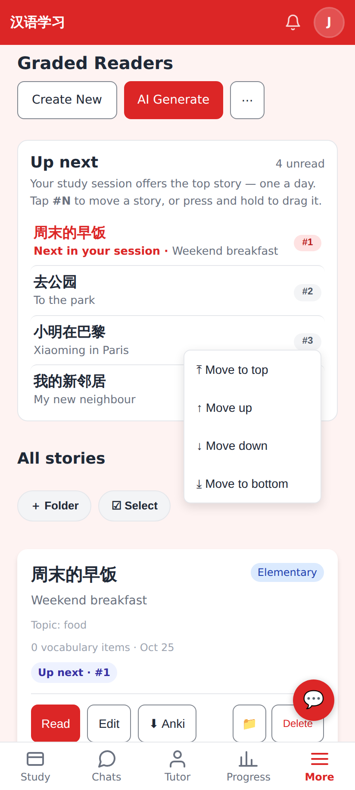
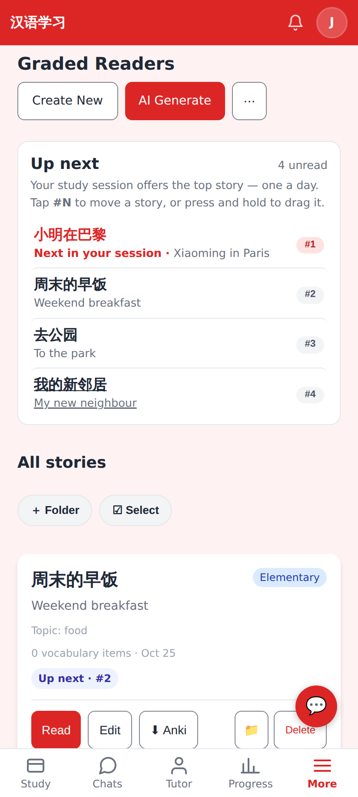
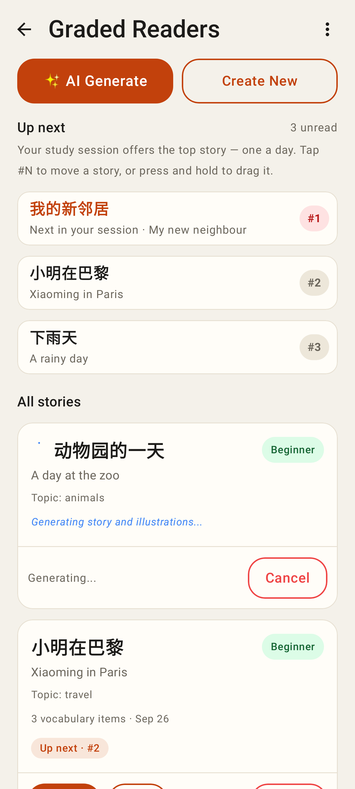
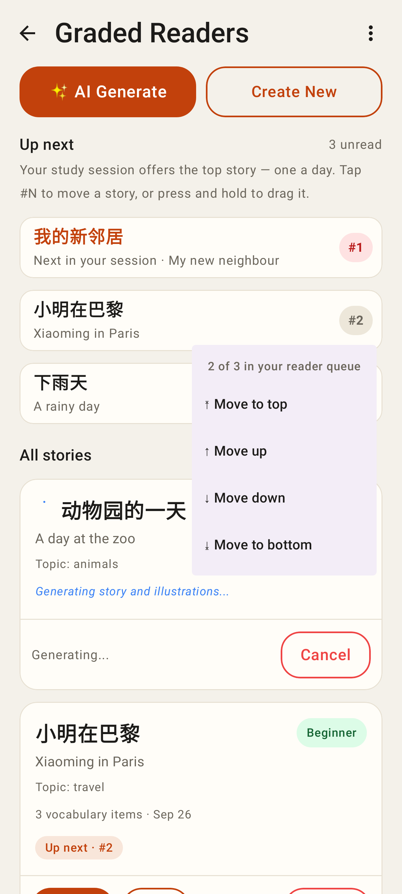
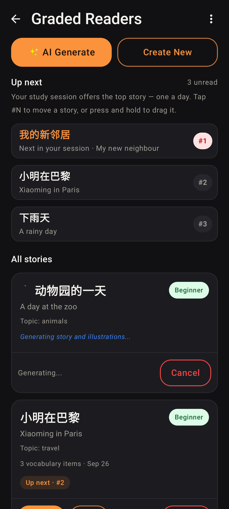

# Reader queue — "Up next"

Web (412×915 @2×):

The Readers list opens with **Up next**: unread stories in the order the study session offers them (one a day, #1 first). Nobody had reordered yet, so it is newest first, as before.

Tap **#N** → Move to top / up / down / bottom (press and hold a row to drag it instead).

小明在巴黎 moved to the top: it is now "Next in your session"; the card below says "Up next · #2" for 周末的早饭.

Lab app (Roborazzi):

Same section in the Lab app, with "Up next · #N" on the cards.

The #N dropdown (the Decks tab's QueueBadge).

Dark theme.
