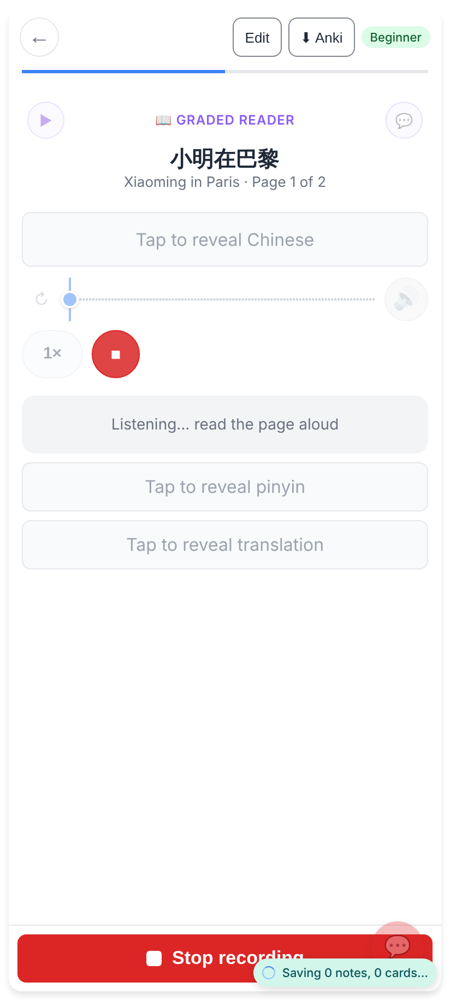
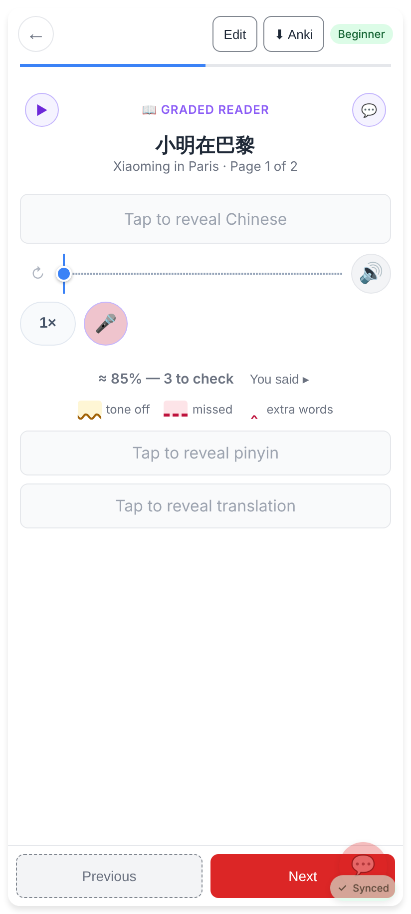
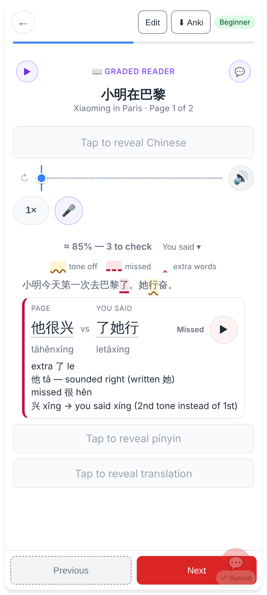
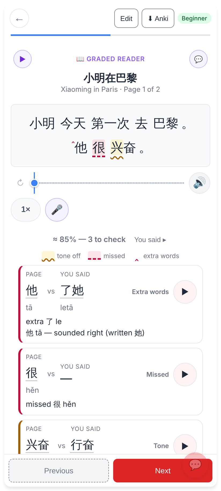
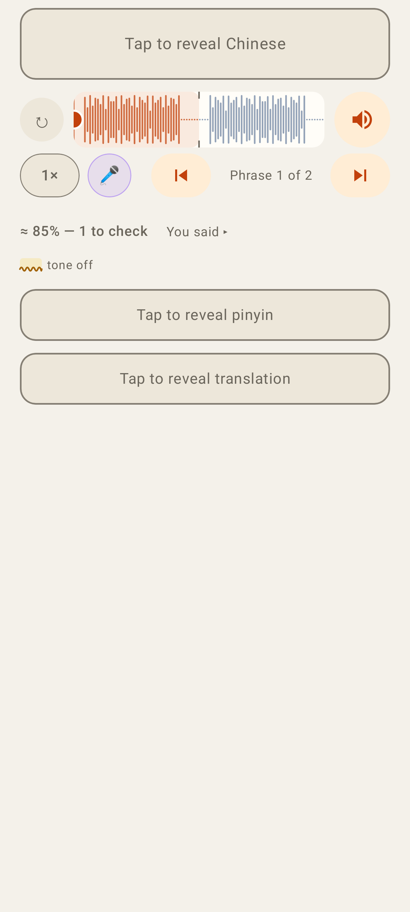
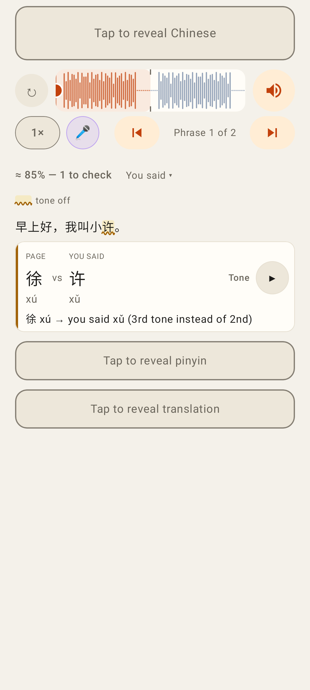
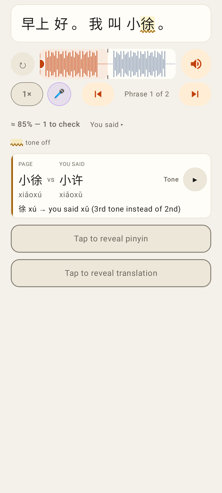

# 🎤 Read it aloud keeps the Chinese hidden

Jerome: "When I'm in a graded reader and I record with the Chinese hidden, it shows the Chinese." A take now
leaves the page's reveal as it was. While the Chinese is hidden, the result is the score line, the legend and
"You said ▸". The "what it heard vs the page" rows print the page's Chinese, so they only appear when "You said ▸"
is opened. Once the Chinese is revealed, the marks show on it.

## Web (412×915 @2×)

Recording: the Chinese stays behind "Tap to reveal Chinese".

The result: the score line, the legend and "You said ▸". No page Chinese is shown.

"You said ▾" opened: the transcript and the difference rows. The page itself stays hidden.

Tap to reveal: the page's own Chinese, marked in place. The difference rows are back under the line.

## Lab app (Roborazzi, phone)

The result with the Chinese hidden.

"You said ▾" opened: the transcript and the difference row.

Revealed: 徐 is marked tone off in place.
