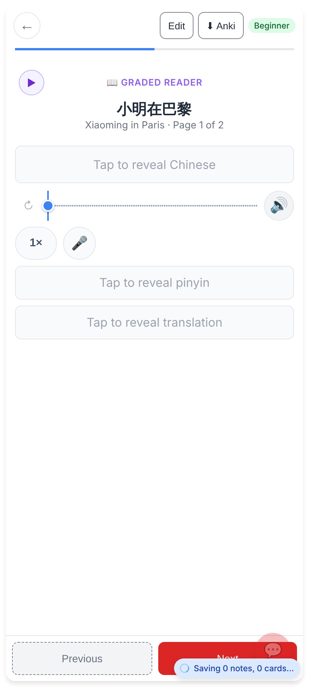
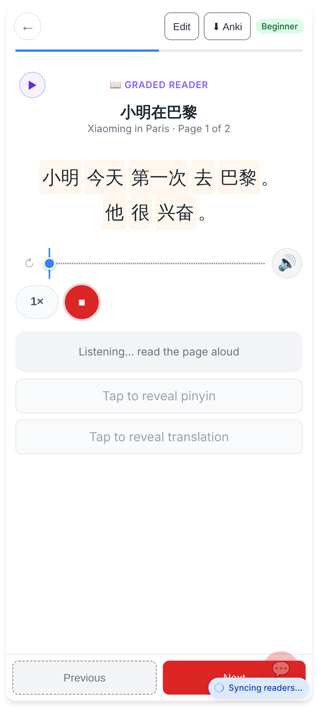
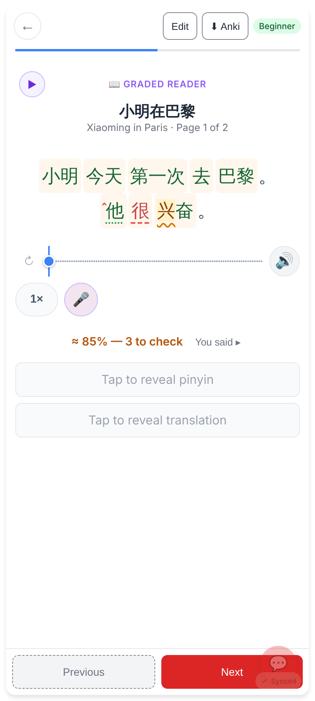
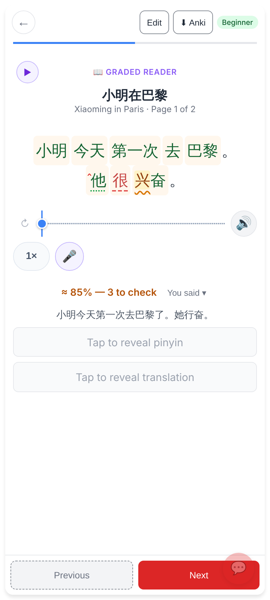
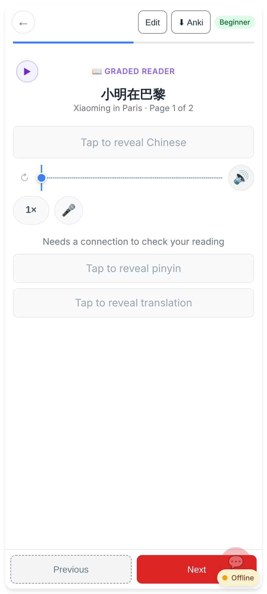
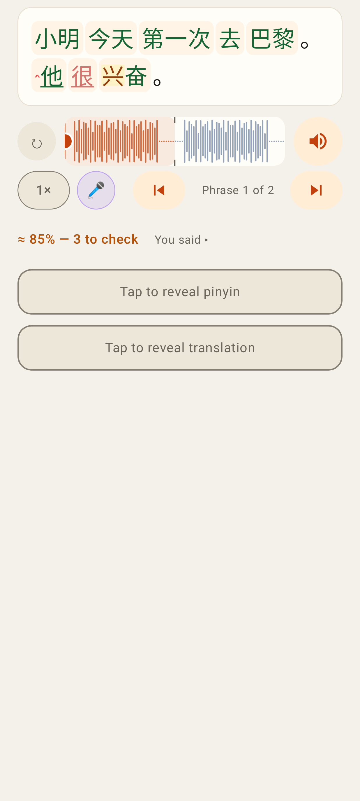
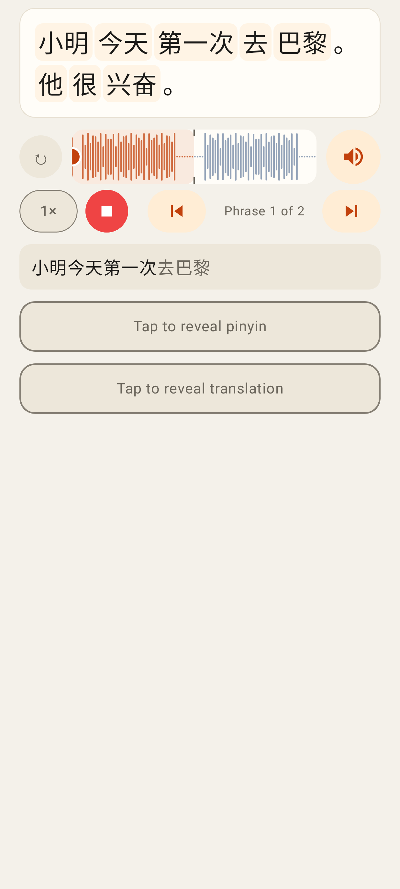
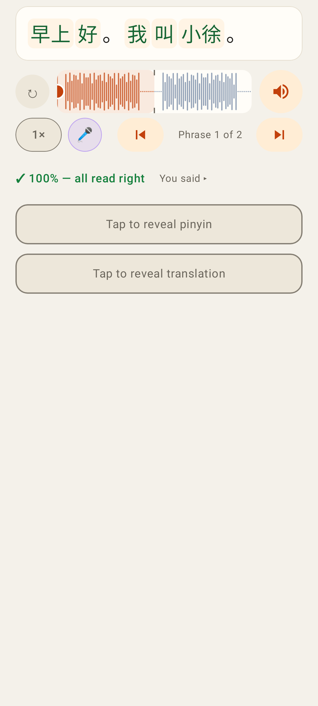
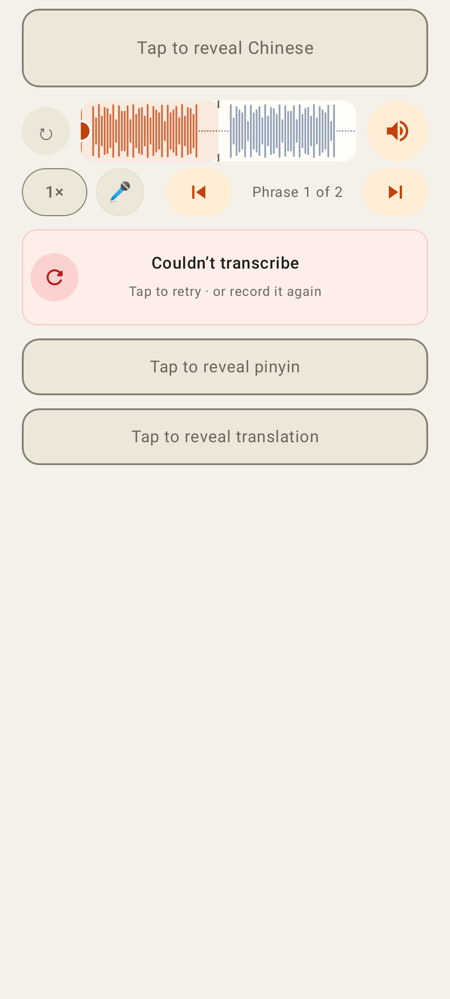

# 🎤 Read it aloud on reader pages

Web (412×915, 2×, from `e2e/tests/reader-read-aloud.spec.ts` with a fake microphone and a mocked transcription):

The page: 🎤 sits right after the speed chip in the audio row.

Recording: the Chinese is shown, ⏹ stops, the live transcript appears under the audio row.

The page's own Chinese marked in place: 他 heard as 她 (sounded right, dotted), 很 missed (red dashed), 兴 tone off (amber, wavy), ‸ = an extra 了. One line: "≈ 85% — 3 to check".

"You said ▸" opens the transcript, small.

Offline: "Needs a connection to check your reading" (nothing recorded or queued).

Lab app (Roborazzi, `ReadAloudTest`):

Marked page + the one line; 🎤 between the speed chip and the phrase steps.

Listening, with the live transcript (grey = still provisional).

Everything read right: "✓ 100% — all read right".

A take that couldn't be transcribed: "Couldn't transcribe — tap to retry".
