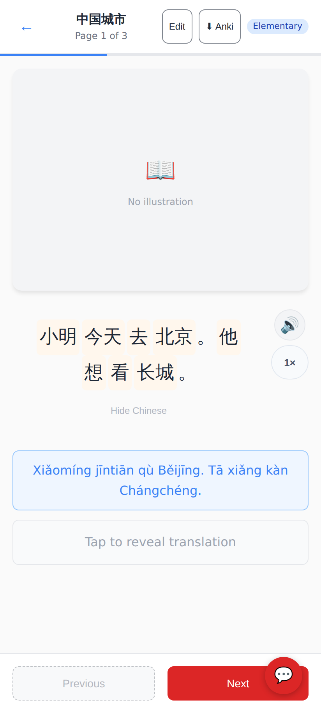
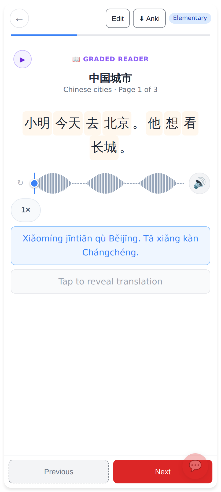
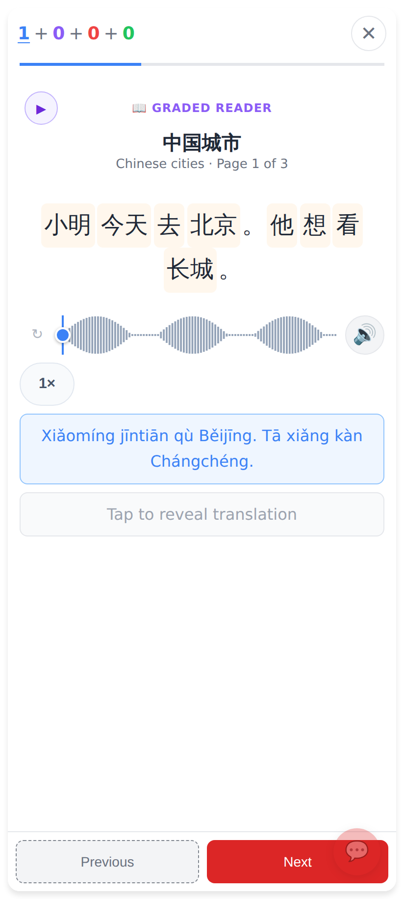
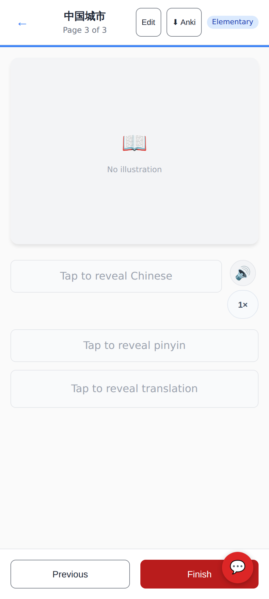
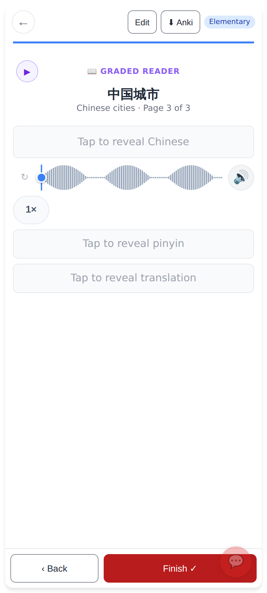
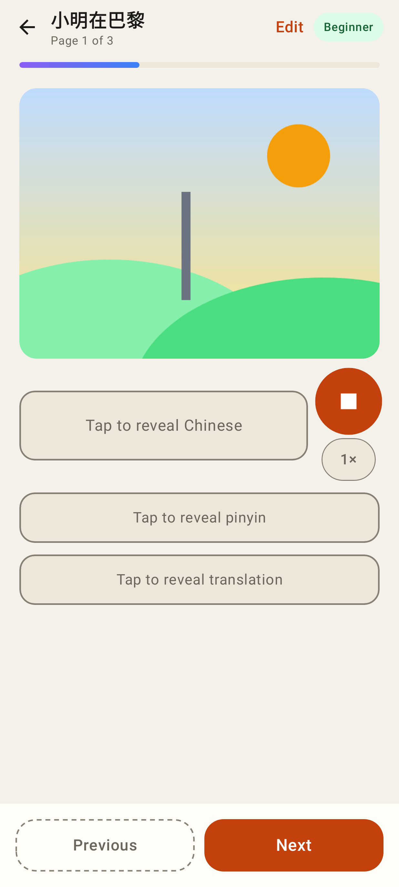
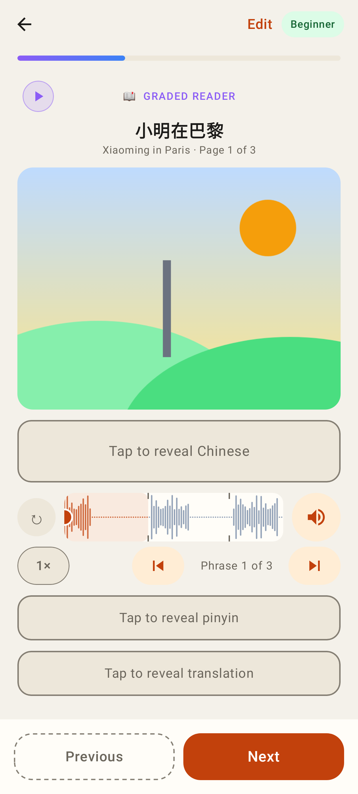
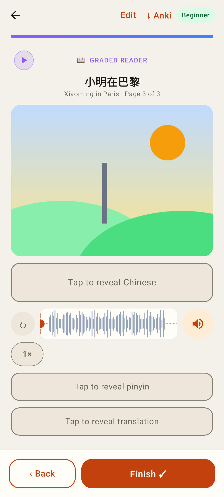

# One reading view for graded readers

Phone viewport (web 412×915 @2×; Lab Roborazzi at 412dp).

## Web

Before — a story opened from the Readers list: its own layout (no scrubber, no ▶ Play whole story, big 🔊 beside the Chinese).

After — the same story from the Readers list: the session's reading view (phrase-block scrubber, speed chip, ▶ Play whole story), with ← · Edit · ⬇ Anki · difficulty in the top bar.

For comparison — the study session's daily reader (only the top bar differs).

Before — last page: Previous / Finish (only marked the day).

After — last page: the session's ‹ Back / Finish ✓ (records the read, like the session).

## Lab app

Before — Lab `/readers/:id`: big ⏹ / 🔊 button + 1× chip beside the Chinese, no scrubber, no ▶ Play whole story.

After — Lab `/readers/:id`: the session's `StudyReaderView` (scrubber with phrase blocks, speed chip, ▶ Play whole story) under ← · Edit · difficulty.

After — Lab last page: ‹ Back / Finish ✓, with ⬇ Anki in the top bar.

For comparison — the Lab study session's reader.
