# 📝 Reader word recap

Words tapped or read aloud wrong while reading a graded reader → an optional one-off recap after the
story, each word's "Add to my long-term review" switch OFF by default. Story: 成都的一天 (成都 · 春熙路 ·
采耳 · 麻辣兔头). Phone size (412 × 915).

## Web

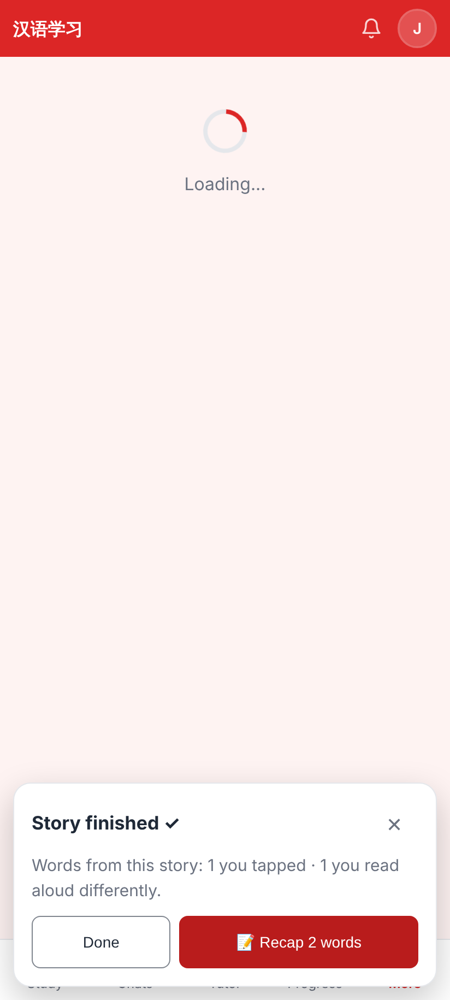
"Story finished ✓ — 📝 Recap 2 words · Done", over whatever comes next (here the Readers list); never forced.

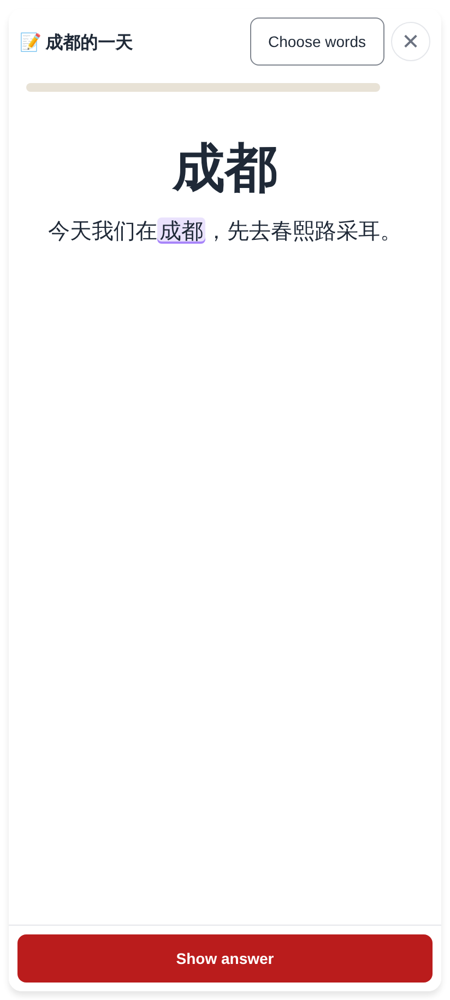
The word + the story sentence it came from, the word marked; Show answer.

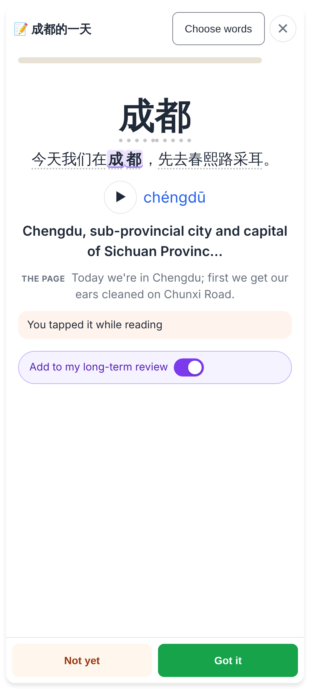
▶, pinyin, the meaning, the page in English, why it's here, and the switch (switched on here); Not yet / Got it.

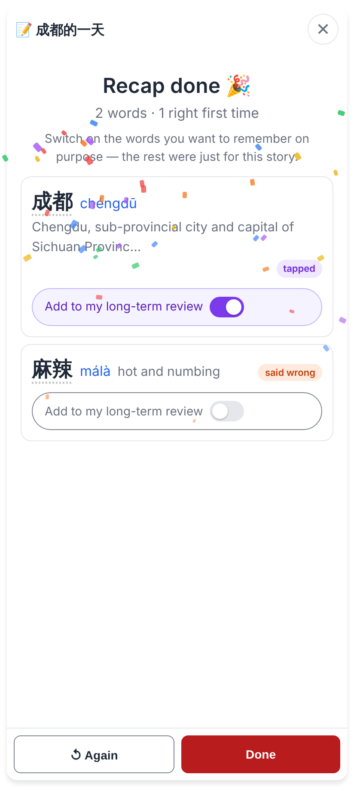
Every word with its switch — 成都 on, 麻辣 off — and Done.

## Lab app

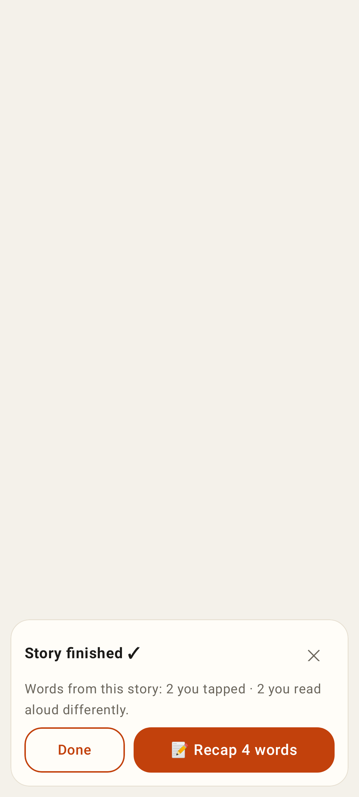
The offer card (light).

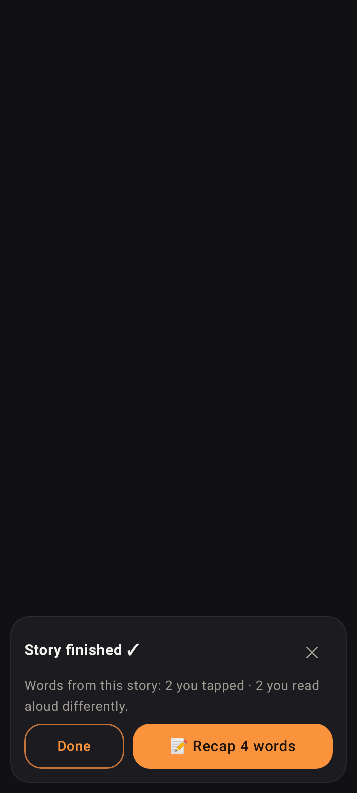
The offer card (dark).

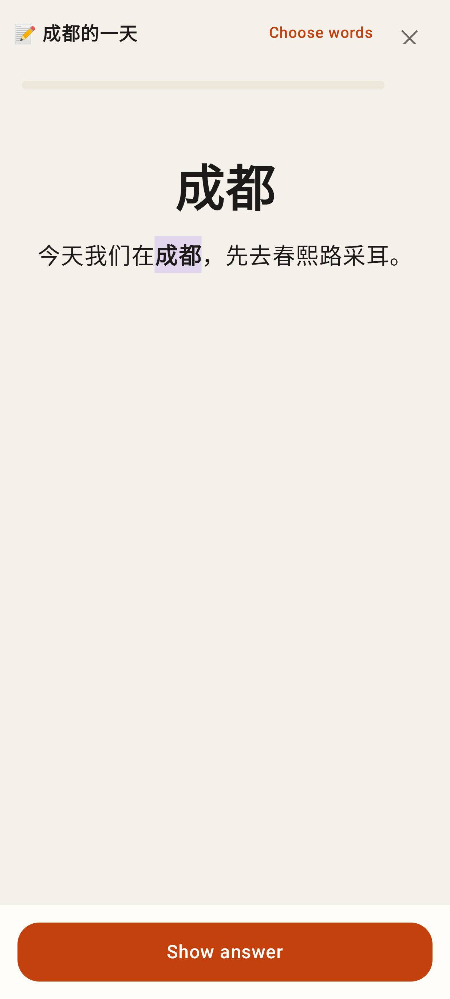
A card's front: 成都 and its sentence, the word marked.

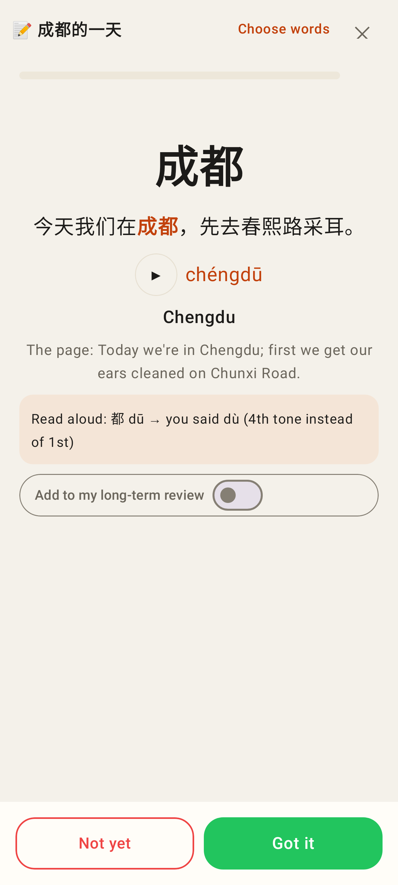
A card's back: "Read aloud: 都 dū → you said dù (4th tone instead of 1st)", the switch OFF by default.

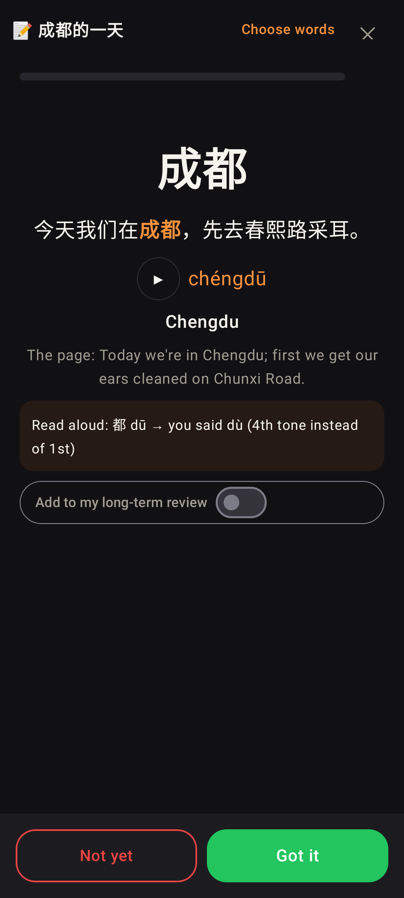
The same, dark.

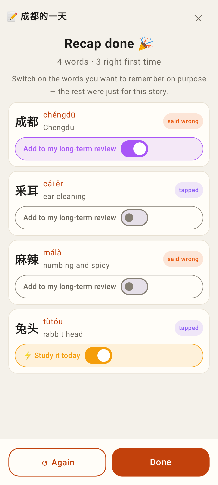
Recap done: 成都 switched to long-term, 兔头 (already a card) switched to ⚡ Study it today, the rest off.

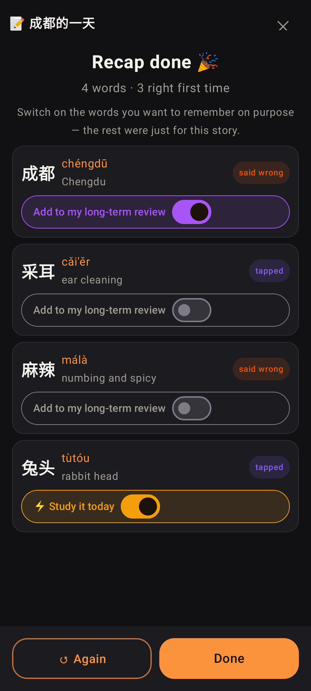
The same, dark.
