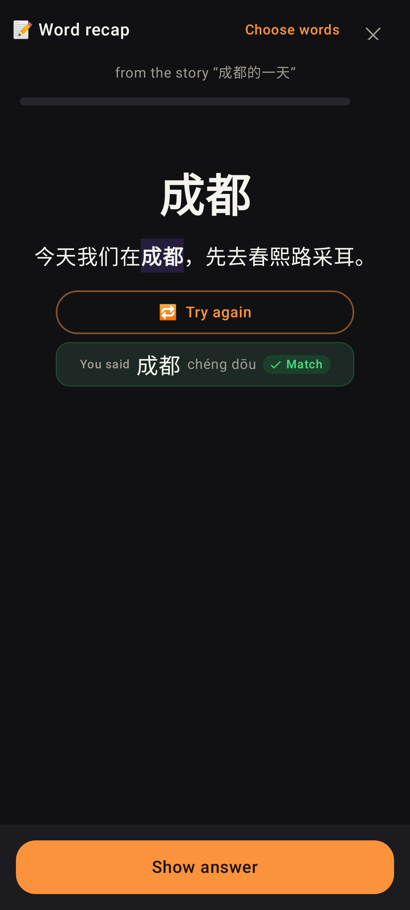
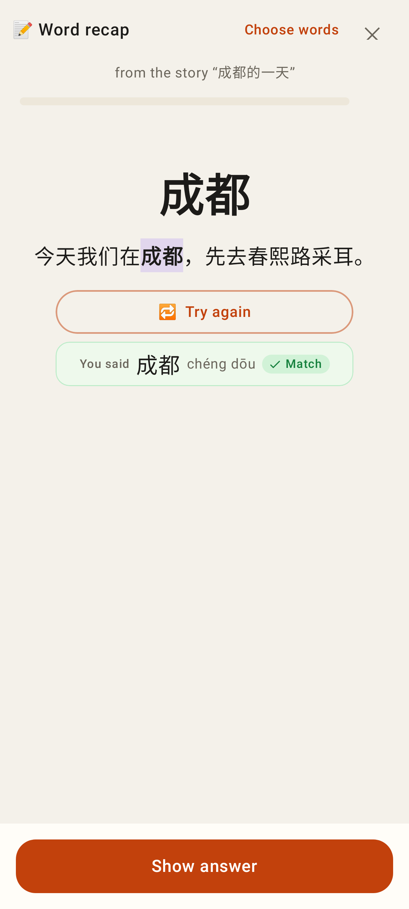
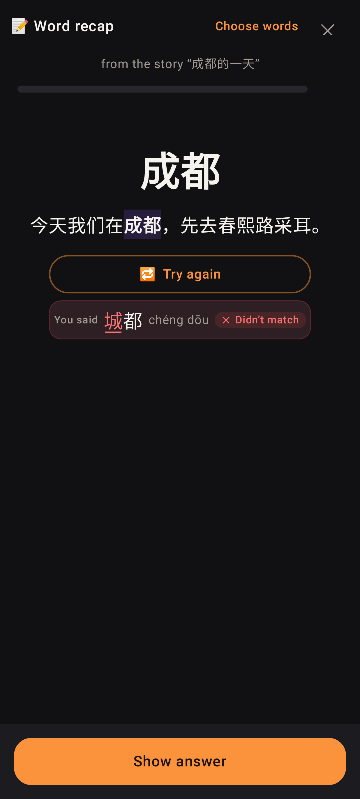
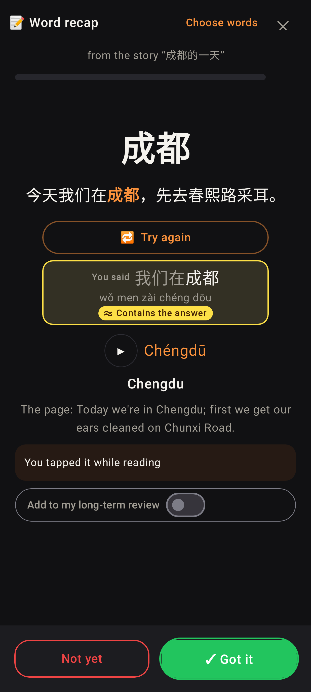
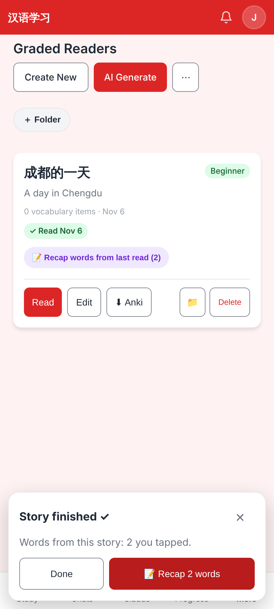
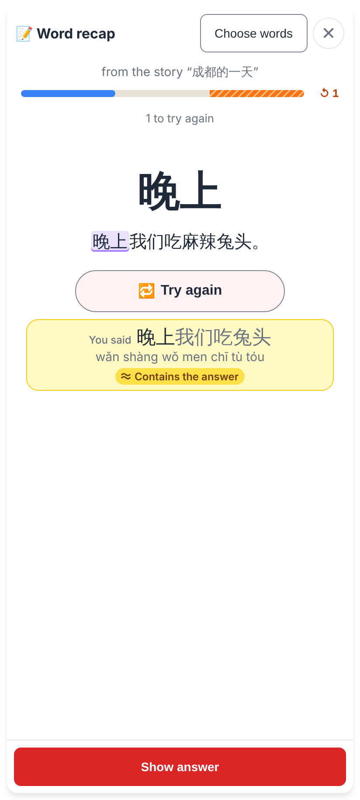
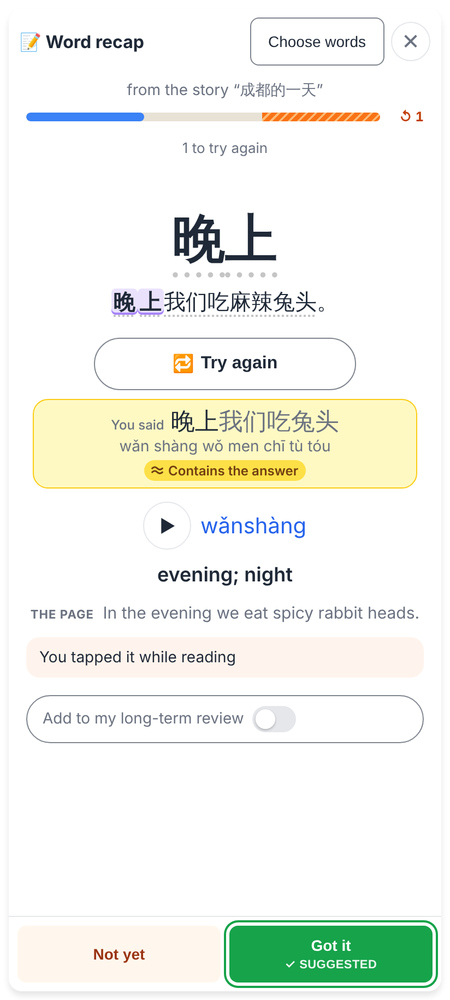

# Word recap: 🎤 Say it + tapped words only

Phone viewport (Lab: Roborazzi, 412dp; web: Playwright 412×915 @2x from `e2e/tests/reader-word-recap.spec.ts`).

## Lab app

The question side: 🎤 Say it under the story sentence (no ▶ — it would give the word away); the take said right → the compact "You said" row, ✓ Match, then 🔁 Try again.

The same in light.

Other tones → ≈ Close — tones off (no suggestion).

After Show answer: the word said inside a phrase counts ("Contains the answer"), so Got it is ringed "✓ Got it" (suggested — he still chooses); "You tapped it while reading" only.

## Web app

The end-of-story offer counts the tapped words only ("2 you tapped") — the word read aloud wrong (麻辣) is not in it.

🎤 Say it on the question side, the take checked against 晚上: "Contains the answer".

After Show answer: the result stays, Got it ✓ SUGGESTED.
