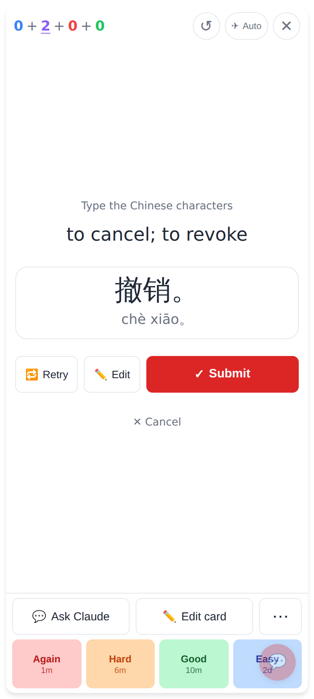
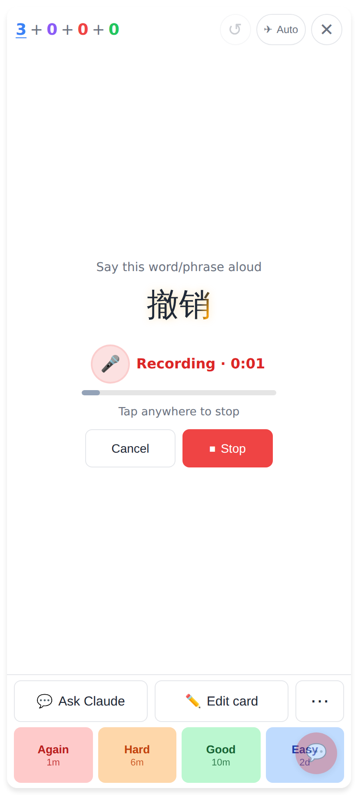
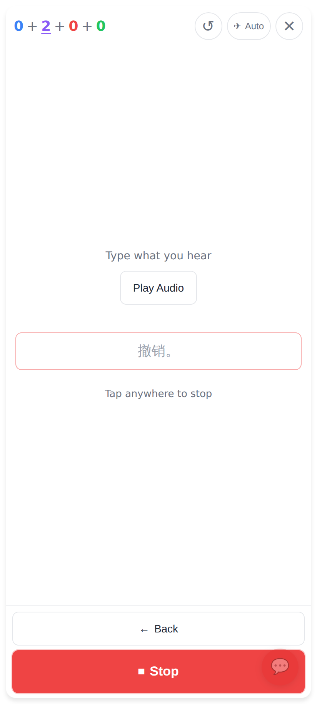
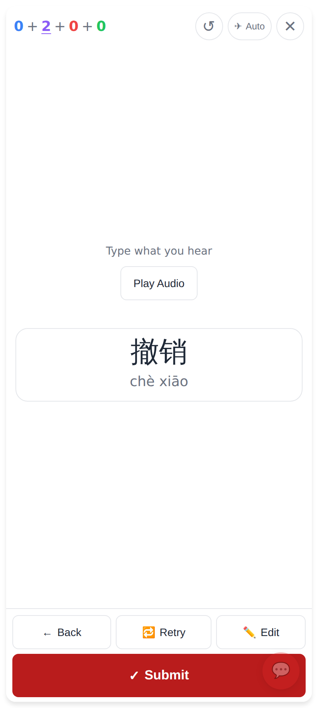
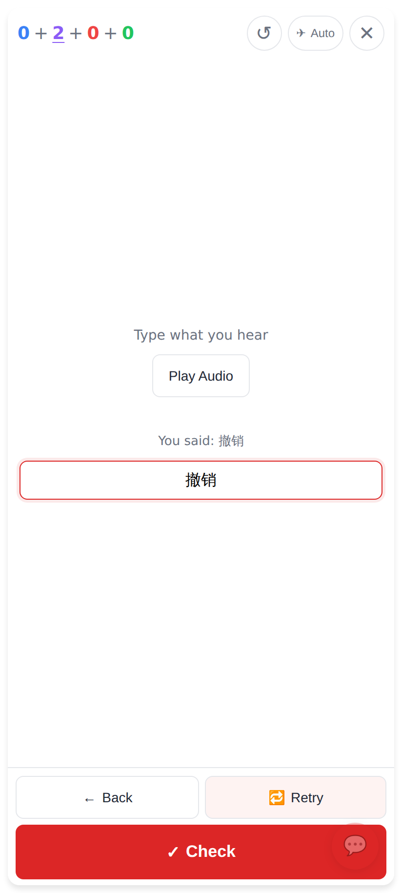
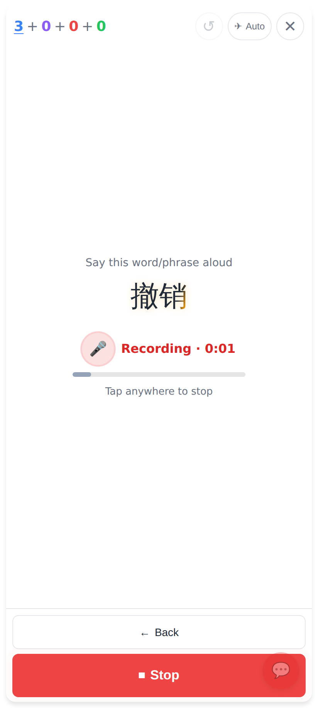
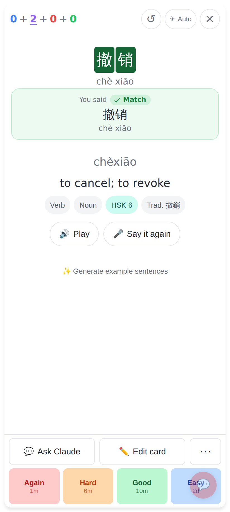
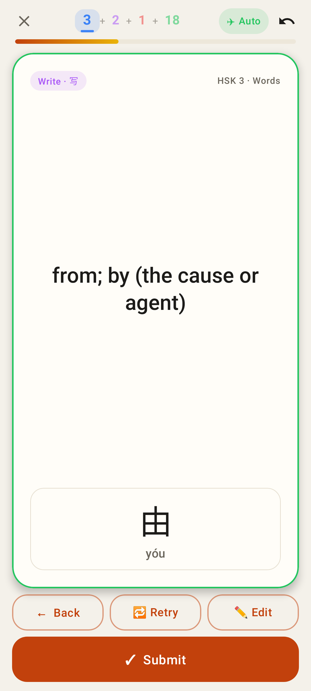
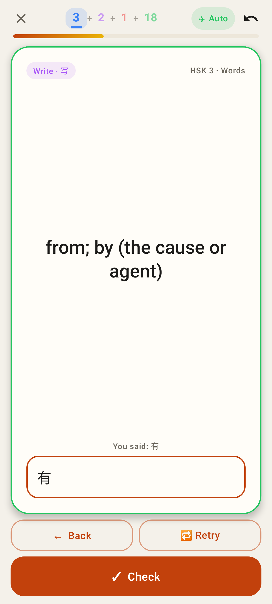
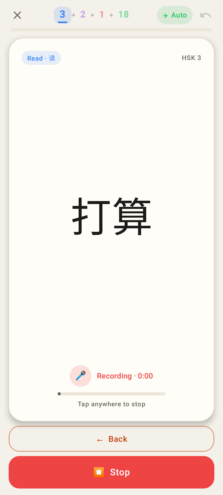

# No ratings while re-recording

Web shots at the phone size (412×915, 2×); Lab shots from Roborazzi.

## Web: before

Before: the Say it again review sat inside the card (撤销。 / chè xiāo。 with a trailing 。), and the ratings and the Ask Claude row were still at the bottom.

Before: Record again on a read card, with the ratings still at the bottom.

## Web: after

Say it again, listening: no ratings; ⏹ Stop where the ratings were, ← Back above it.

The review: 撤销 / chè xiāo with no 。; ← Back · 🔁 Retry · ✏️ Edit, and one big ✓ Submit at the bottom.

✏️ Edit: the box stays on the card, ✓ Check is in the bar (the bar sits above the keyboard).

Record again on a read card: ⏹ Stop and ← Back instead of the ratings.

After Check: back on the answer side, and the ratings come back.

## Lab app

Lab, Say it again review: ← Back · 🔁 Retry · ✏️ Edit, then ✓ Submit.

Lab, ✏️ Edit: the box on the card, ✓ Check in the bar.

Lab, Record again: ⏹ Stop and ← Back instead of the ratings.
