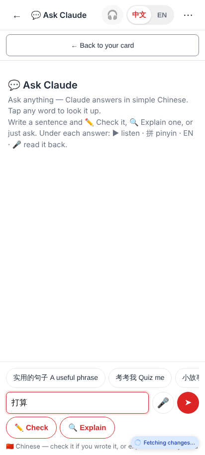
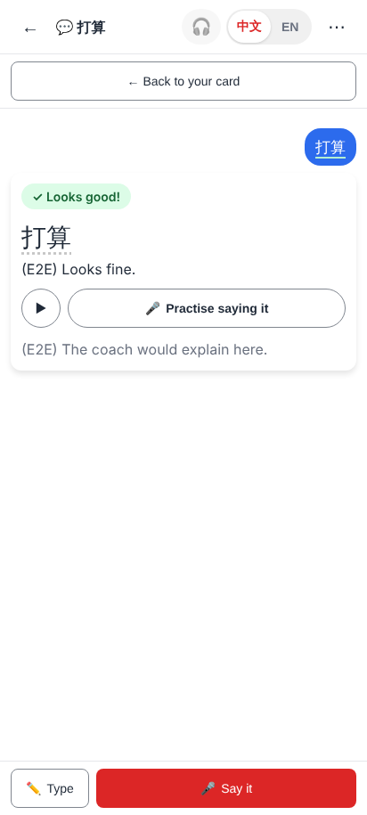
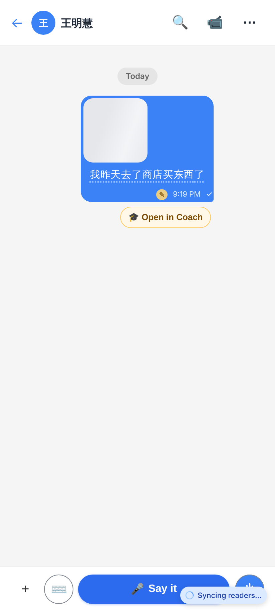
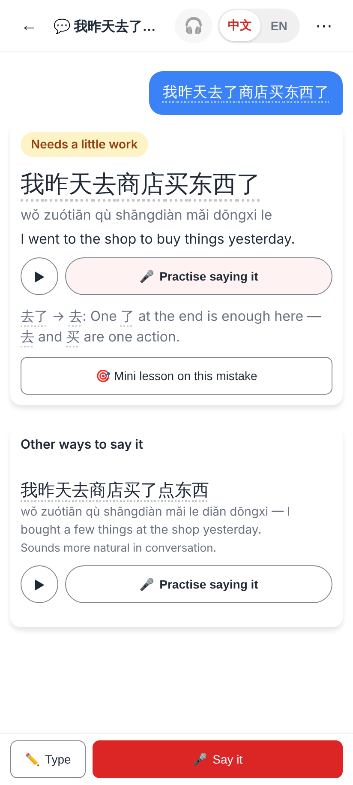
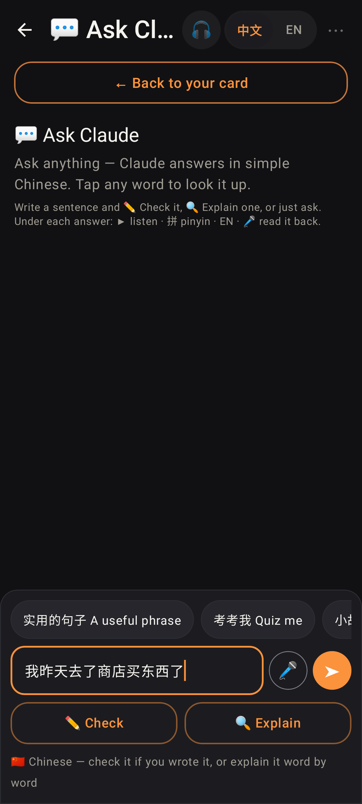
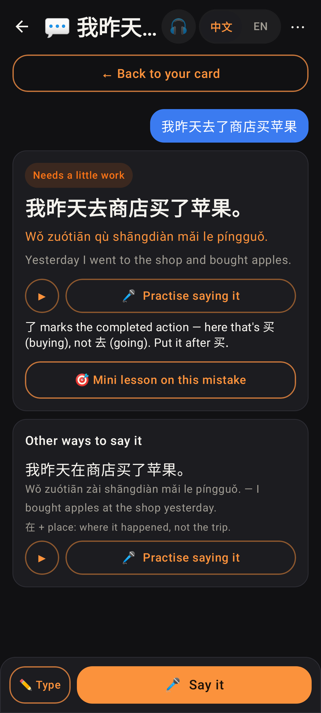

# Retire the Coach page: Open in Coach and the study card's Coach are Claude threads

Phone viewport (412 × 915, 2×). Web light from the e2e specs (`study-resume.spec.ts` with `RETIRE_COACH_SHOTS=…`,
`chat-coach.spec.ts` with `SHOOT=1 SHOOT_DIR=…`); Lab dark from Roborazzi (`StudyCardCoachTest`).

Web — study card ⋯ → Sentence coach: a new Claude thread, the card's word waiting in the box on ✏️ Check / 🔍 Explain,
"← Back to your card" under the header.

Web — ✏️ Check runs in the thread (the Coach's result card, ▶ / 🎤 Practise saying it); "← Back to your card" returns
to the same card, still revealed.

Web — "🎓 Open in Coach" under my checked message in the chat (unchanged).

Web — it opens a Claude thread started from that message: the stored auto-check IS the analysis (no Claude call),
🎯 Mini lesson on this mistake right there; back returns to the chat, and the same message reopens the same thread.

Lab (dark) — the same from the Lab study card: the thread with "← Back to your card" and the draft in the box.

Lab (dark) — the check's result in the thread, "← Back to your card" above it.
