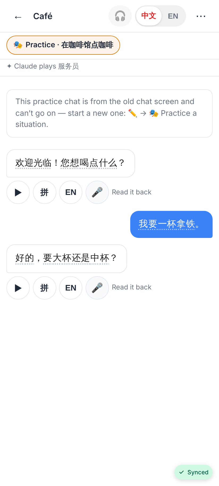
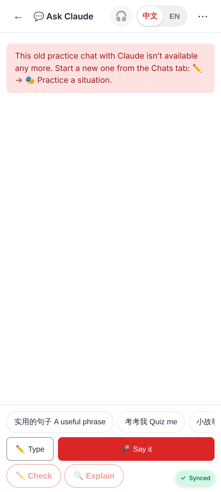
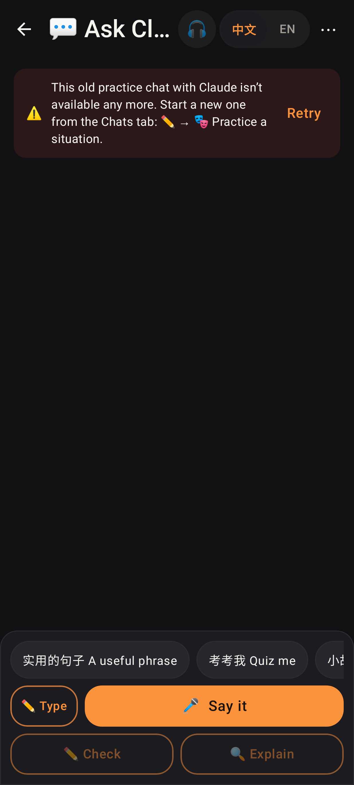

# Retire the old Claude practice chat — screenshots

Web, 412×915: `/connections/:relId/chat/:convId` of an old practice chat lands in its Claude thread `/chats/claude/pc-<id>` (read-only, its messages copied on demand).

Web: an old practice chat whose thread can't be had (deleted) says so instead of "Couldn't load this chat".

Lab app, dark: the same line in the Claude thread screen.
