# Pause new cards on heavy days — screenshots

Web (412×915 @2x, local worker with seeded data: 124 reviews due, limit 100):

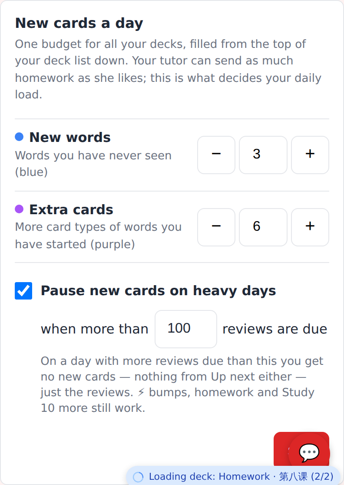
Settings → New cards a day: "Pause new cards on heavy days", when more than [100] reviews are due.

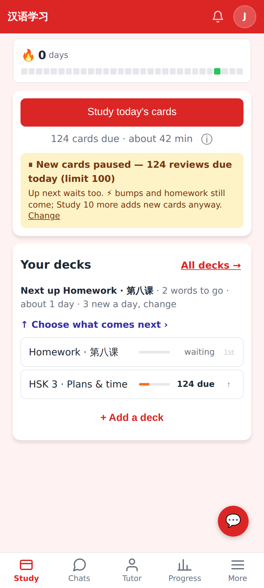
Home: "⏸ New cards paused — 124 reviews due today (limit 100)" — 0 new cards, only the reviews.

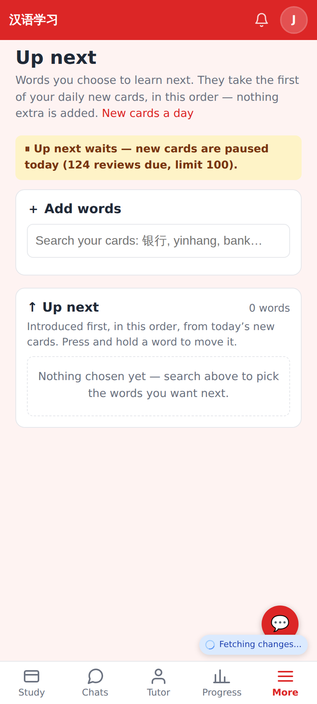
Up next says it waits too.

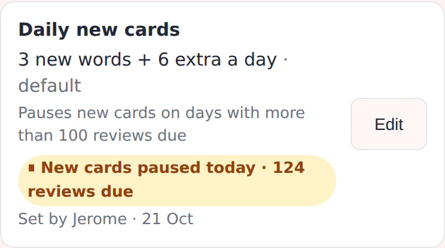
The tutor's "Daily new cards" row: the student's limit and "⏸ New cards paused today · 124 reviews due".

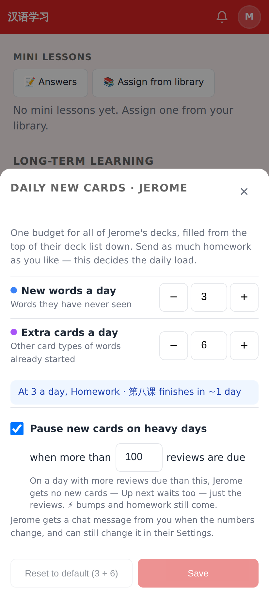
The tutor's sheet has the same field (the pause alone posts no chat message).

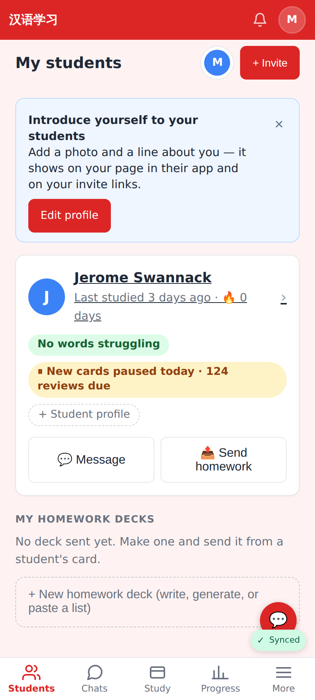
The student card on the tutor's dashboard.

Lab app (Roborazzi, `ReviewLoadScreenshots`):

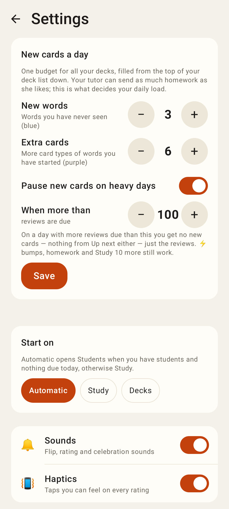
Settings: switch + "When more than [− 100 +] reviews are due" (steps of 10).

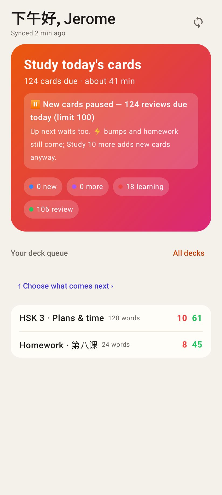
Home hero on a paused day.

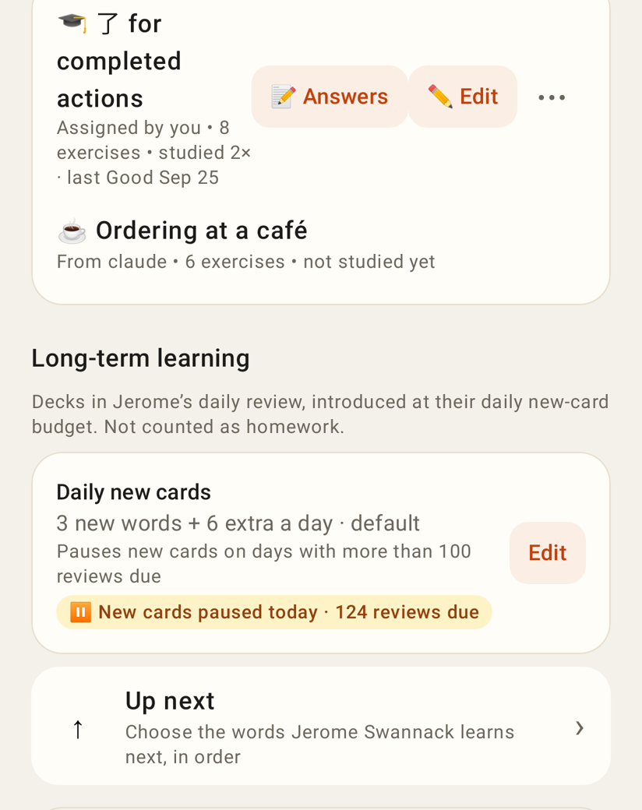
Student page → Long-term learning → Daily new cards.

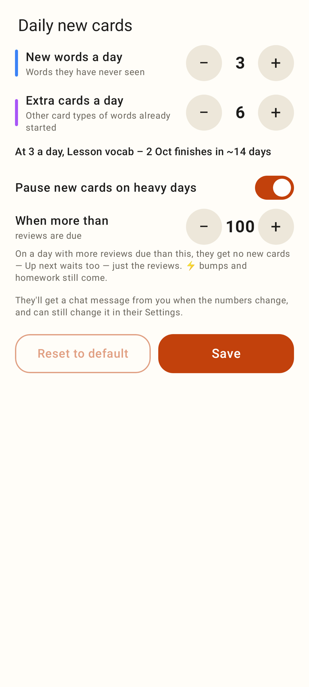
The tutor's sheet with the pause field.

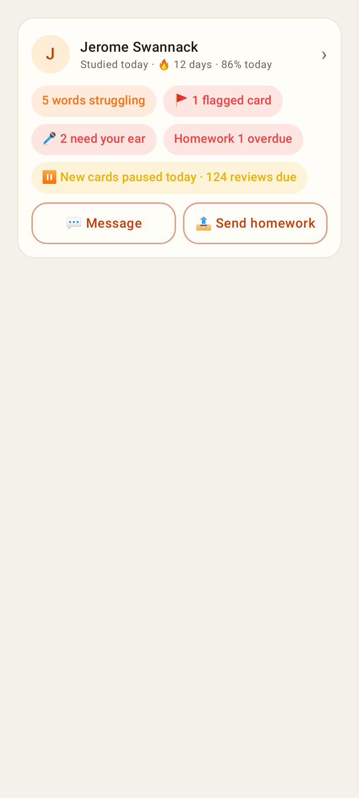
The dashboard card's paused pill.
