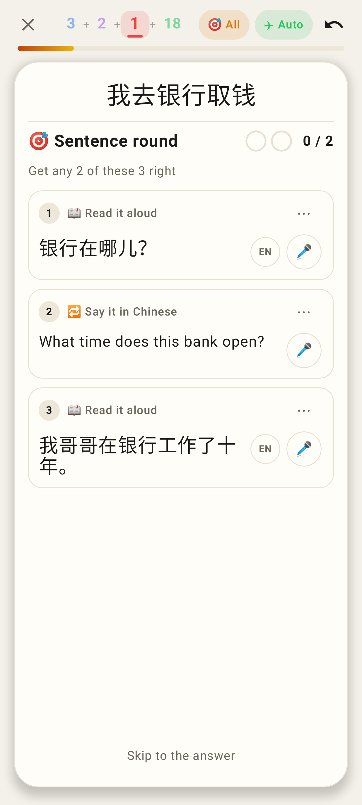

# Sentence round: never the card's own sentence

A sentence card (我去银行取钱) whose clue is that same sentence (我去银行取钱。). Before, row 1 of the round was
"📖 Read it aloud" of the question he had just answered; now the round has the other three sentences only
("Get any 2 of these 3 right"). The web app picks the round with the same shared rule (`isCardHanziSentence` in
shared/study/sentenceRound.ts), covered by `SentenceRound.test.tsx`; its round UI is unchanged apart from the row set.

