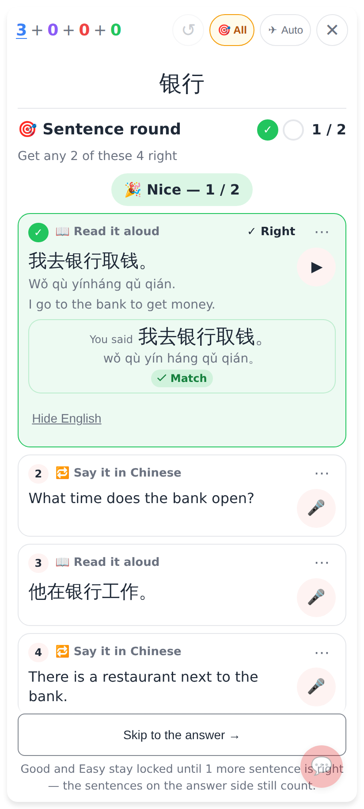
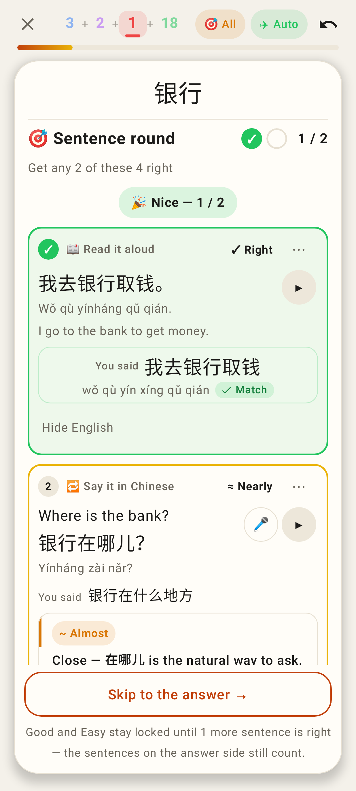
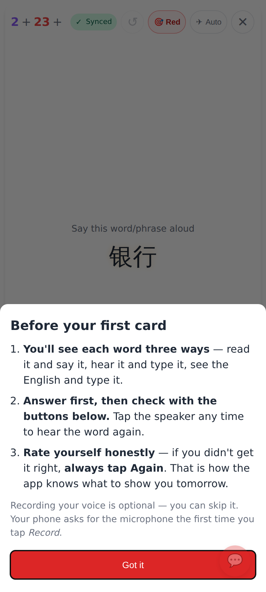
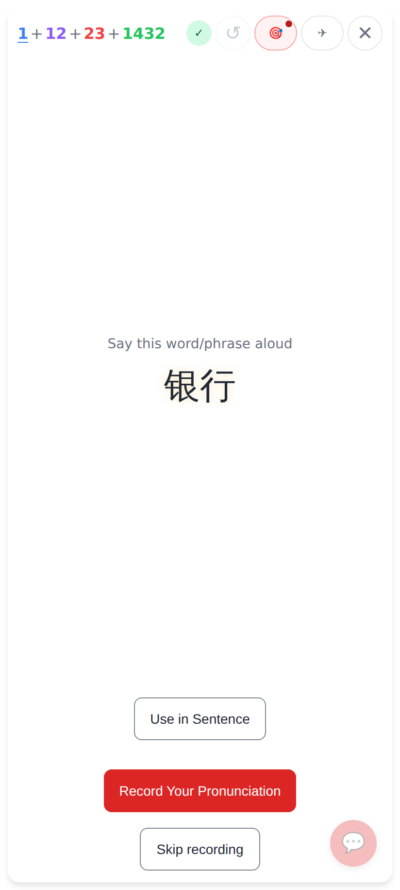
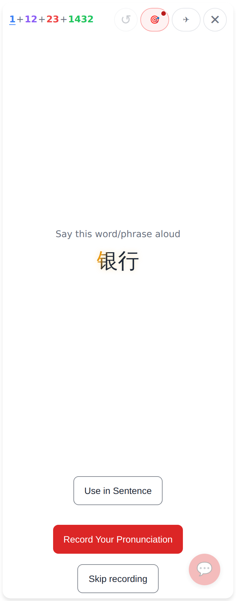
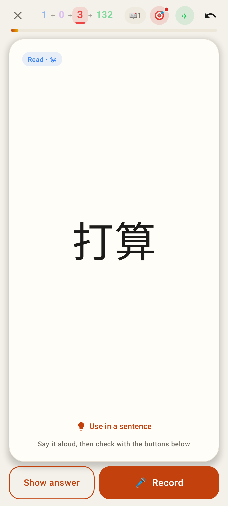
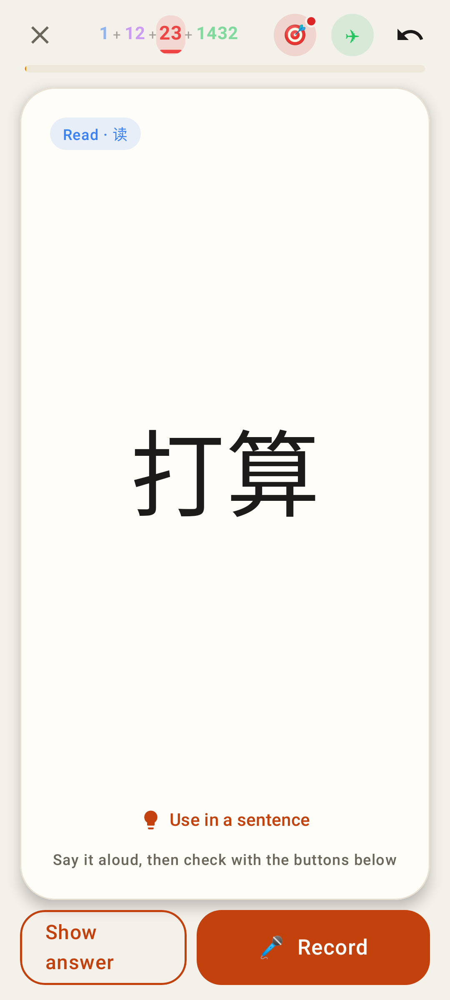
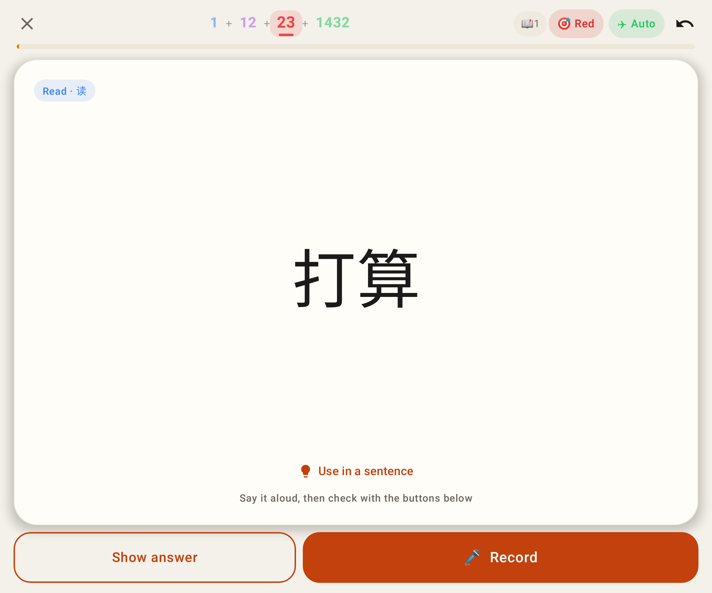
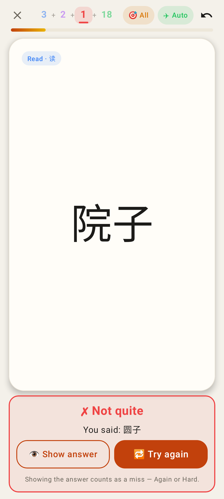

# Round polish — screenshots

Phone shots: 412×915 at 2× (Pixel Fold folded); one at 360 dp, one unfolded.

Web — 📖 Read it aloud ✓ Right: the English is up at once, with "Hide English".

Lab — the right read shows its English; "≈ Nearly" exercises keep their toggle.

Web before — 1 + 12 + 23 + 1432 next to "🎯 Red" / "✈ Auto" at 412 px: the counts are clipped (the review count is gone).

Web after — the chips go icon-only (🎯 with a red dot = Red cards only, ✈), every count on one line. (Long counts set in the page for the shot.)

Web after at 360 px — smaller numbers, the passing "Synced" badge steps aside.

Lab — Jerome's case (1 + 0 + 3 + 132 with 📖 1, 🎯 Red, ✈ Auto): "132" on one line.

Lab — 1 + 12 + 23 + 1432 at 412 dp: 🎯 / ✈ as 44 dp icon buttons, the state as a dot / colour.

Lab at 360 dp — smaller numbers; the "📖 1" chip steps aside.

Lab unfolded — room for the full "🎯 Red" and "✈ Auto" chips.

Lab — "✗ Not quite" on the question: no "Use in a sentence" link under the card any more (as on the web).
