# Sentence round: a compact take, and the English

Phone, 412×915. Web shots from the E2E flow (faked recogniser); Lab shots from Roborazzi (`SentenceRoundUiTest`).

## Web

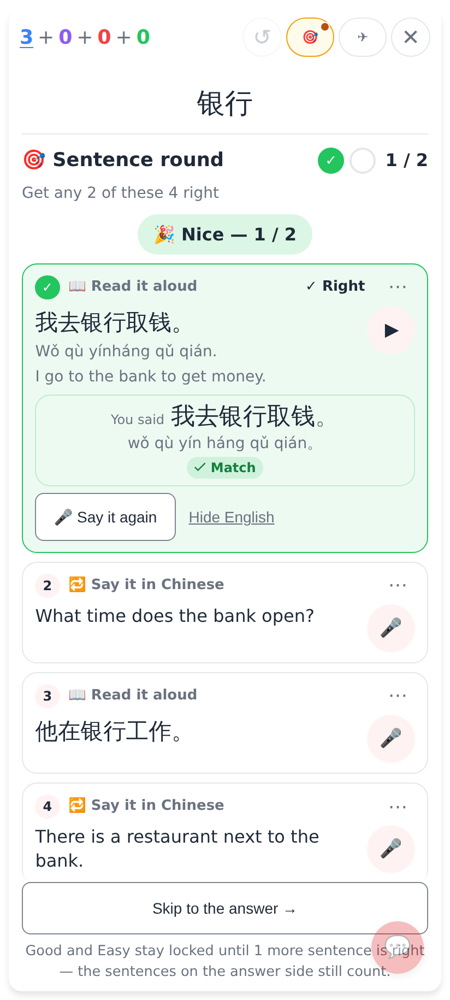
Before: a 📖 Read it aloud said right — the "You said" box repeats the sentence big and its pinyin under the sentence.

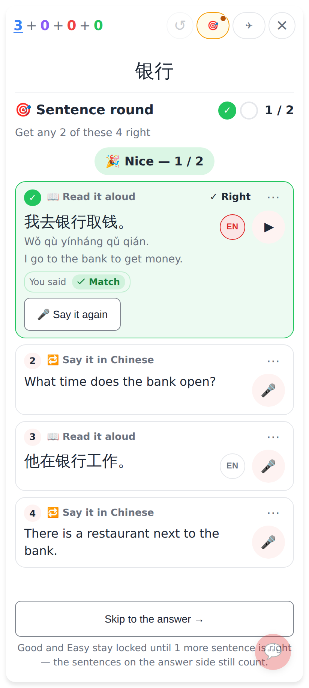
After: the sentence and its pinyin once, the English under them, then one short "You said ✓ Match" row and 🎤 Say it again. The small EN beside ▶ hides the English.

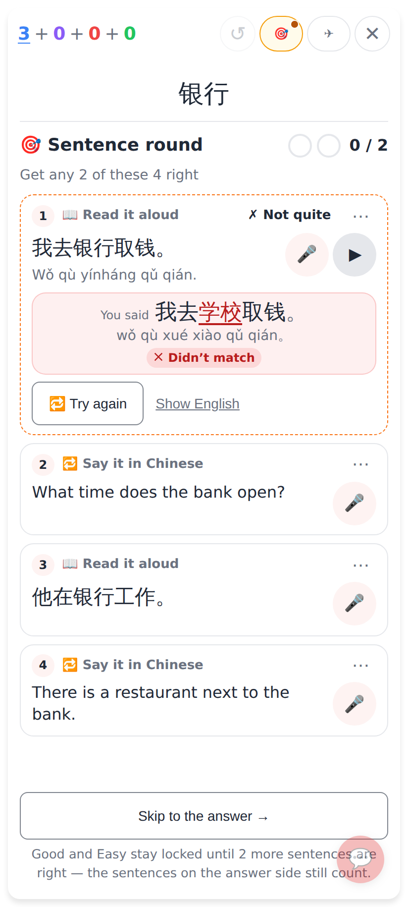
Before: a take that didn't match — the English hidden behind "Show English".

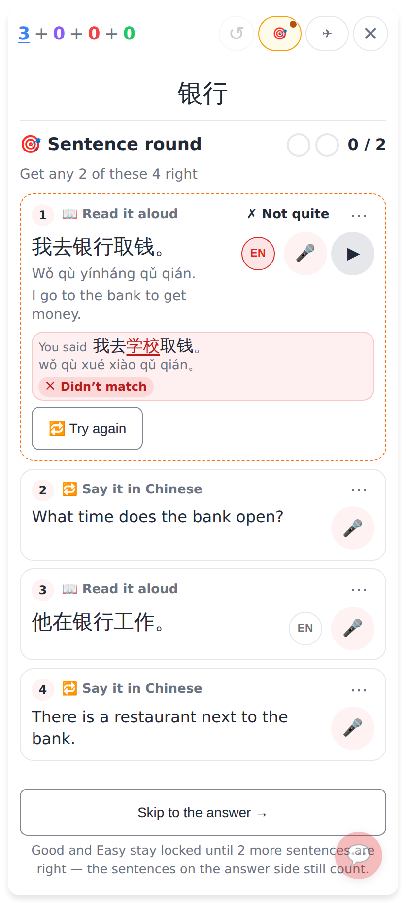
After: the English shows once the take is judged, right or not. The take row is smaller and shows only what was said, the differing characters marked (学校), with its pinyin because it sounded different.

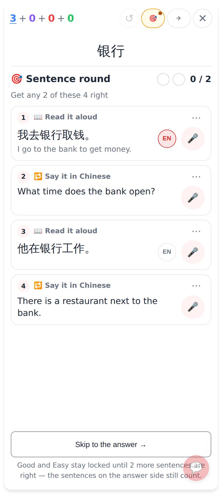
Before reading, the English stays hidden (it's a reading exercise); the small EN shows it on demand.

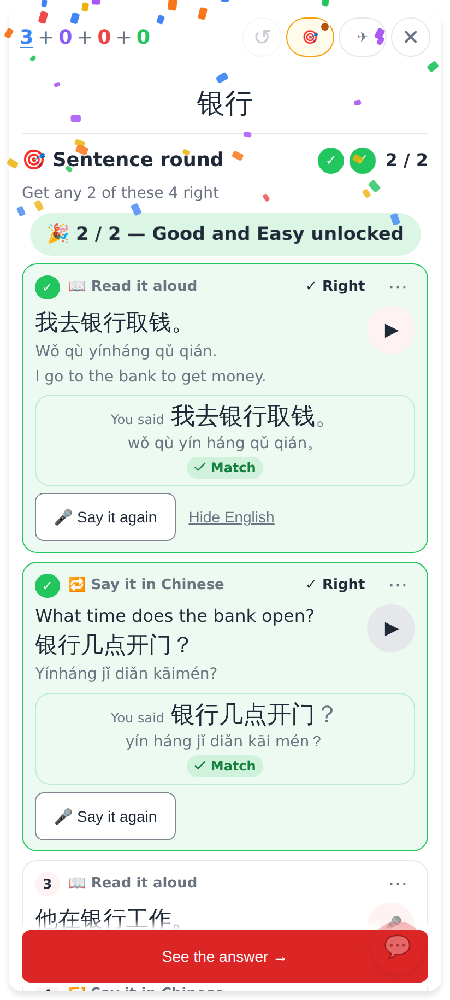
Before: a 🔁 Say it in Chinese said exactly — the sentence shows twice.

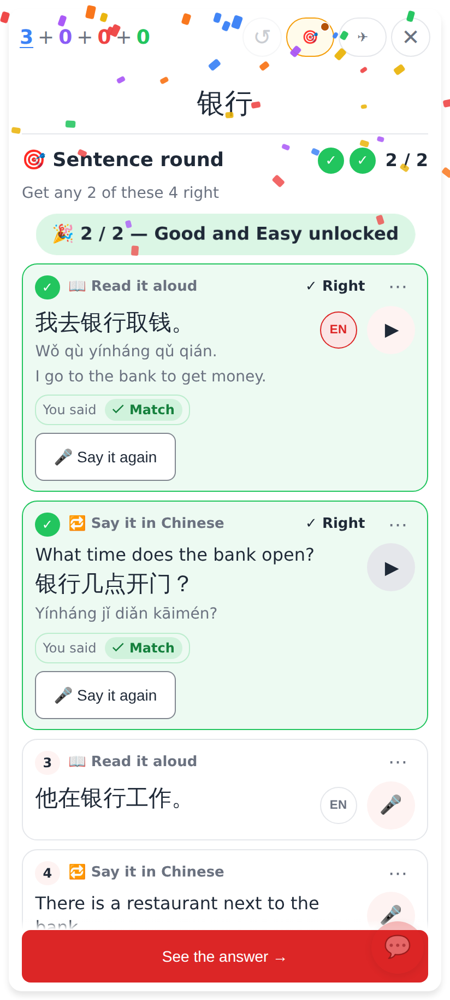
After: the same compact "You said ✓ Match" row on translate exercises.

## Lab app

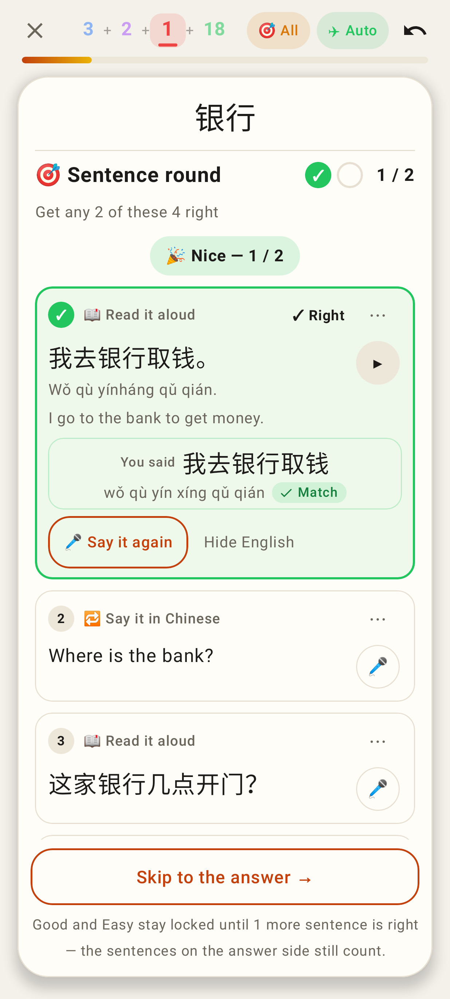
Lab before: the matched take repeats the sentence and its pinyin.

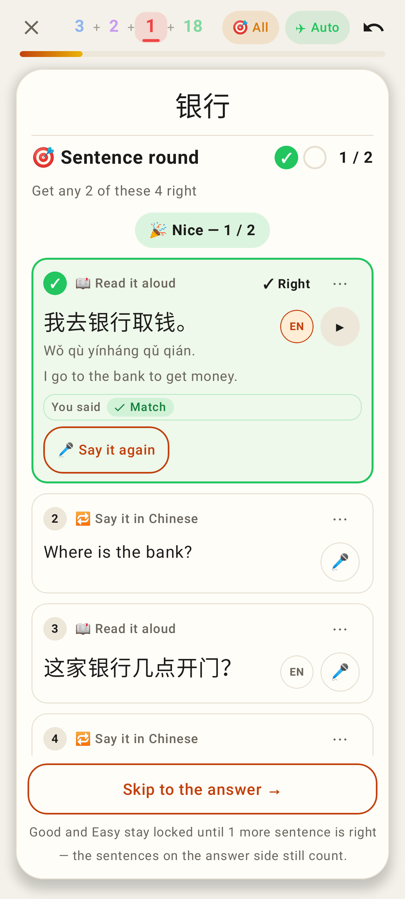
Lab after: the sentence, pinyin and English once, then "You said ✓ Match" on one line, EN beside ▶.

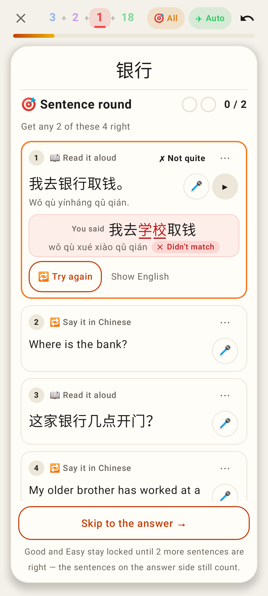
Lab before: a take that differs — no English.

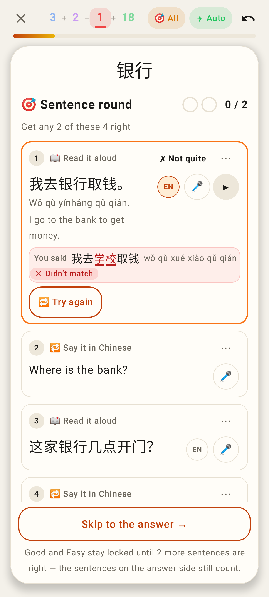
Lab after: the English shows, and the take row shows only what was said, marked, with its pinyin.

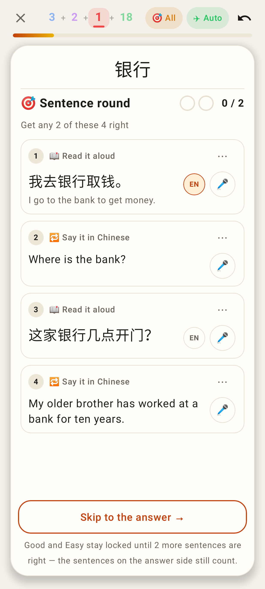
Lab: EN reveals the English before reading.

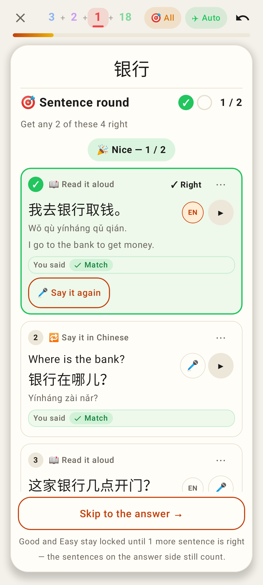
Lab: a translate exercise said exactly — compact too.
