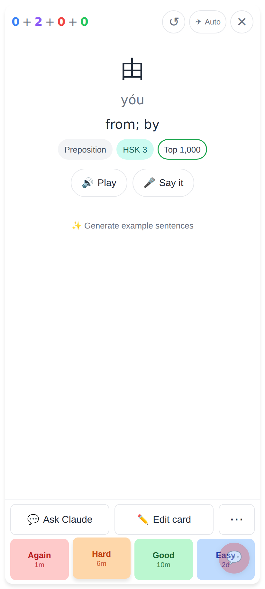
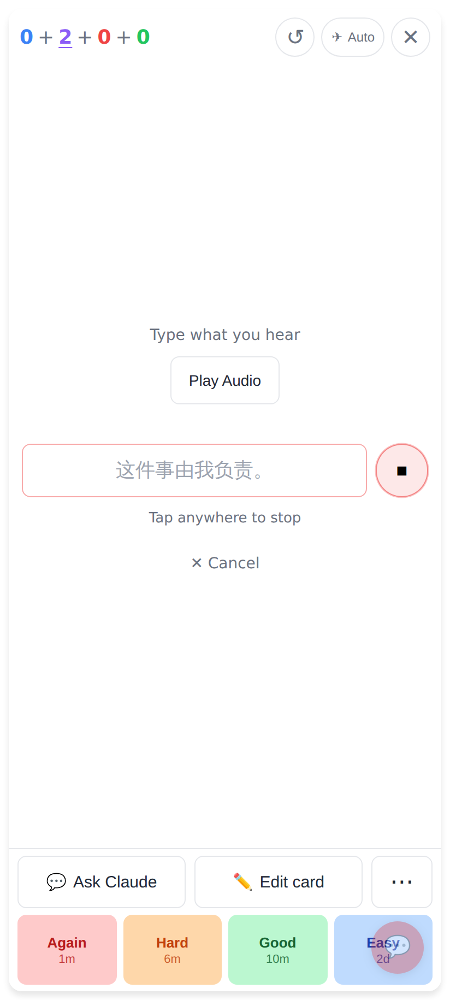
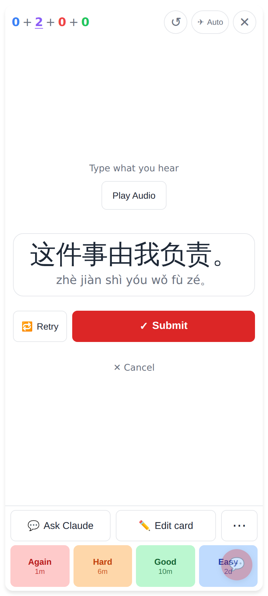
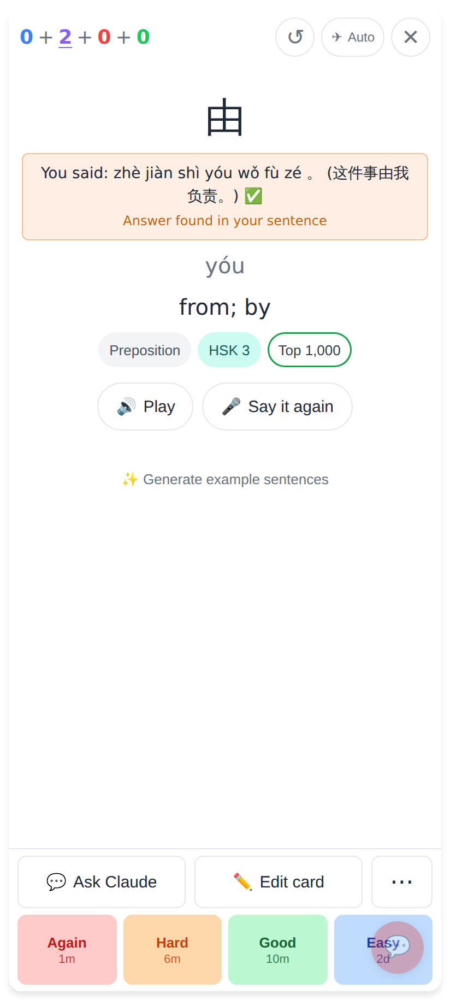
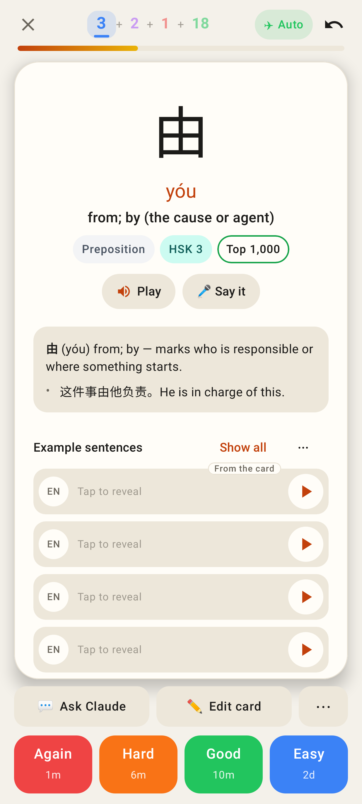
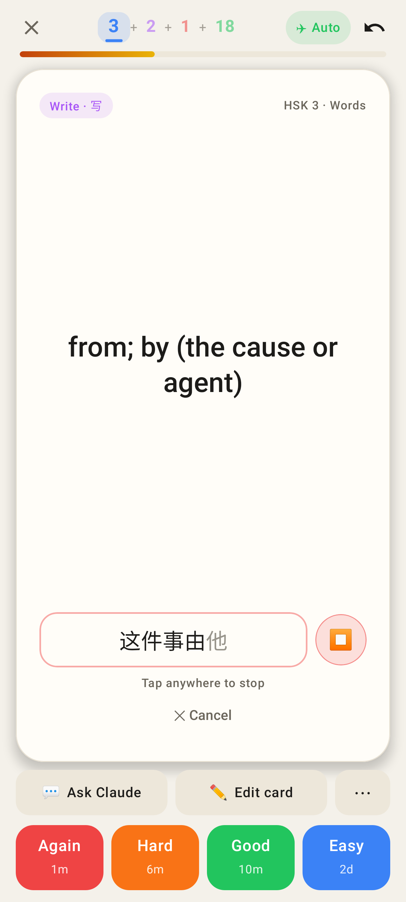
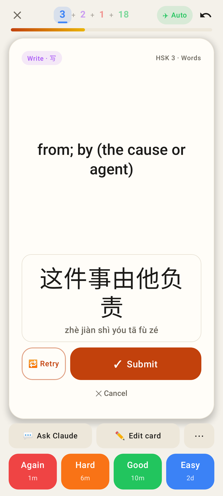
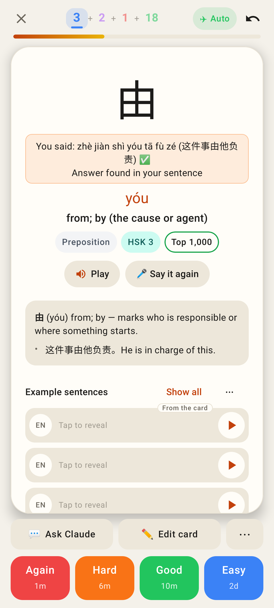

# 🎤 Say it — practice after Show answer

Before: on a meaning → hanzi / audio → hanzi card, 👁 Show answer with nothing typed or said left the
answer side with only 🔊 Play — no way to say the word. Now there is a 🎤 Say it pill beside Play.

## Web (412 × 915, 2×)

After 👁 Show answer with no attempt: 🎤 Say it beside Play.

Tapped: the question side with the live transcript streaming in, ⏹ / tap anywhere to stop, ✕ Cancel.

The review: 🔁 Retry · ✓ Submit (no ✏️ Edit — practice is shown as said).

Back on the answer: the read card's "You said" box, orange "Answer found in your sentence" (the
contains-match). No answer diff, the rating works as usual, the pill now says "Say it again".

## Lab app (412 × 915 dp, Roborazzi)

Lab: 🎤 Say it beside Play after Show answer.

Lab: the question side with the live transcript.

Lab: the review — Retry · Submit, no Edit.

Lab: "You said" with the orange "Answer found in your sentence"; the pill now says "Say it again".

Lab, dark: the same.
