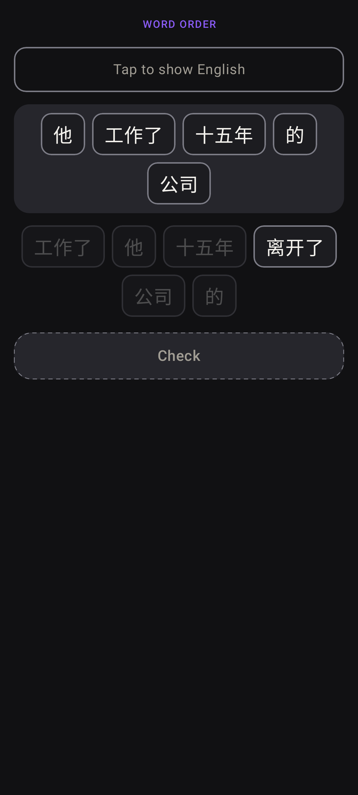
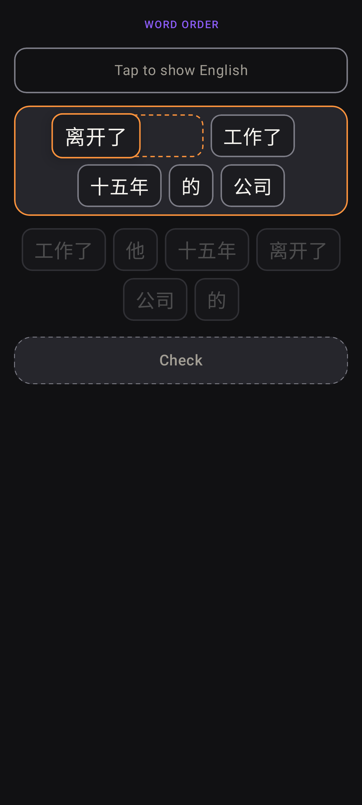
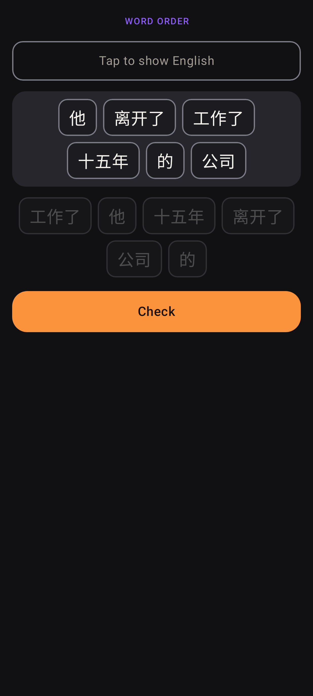
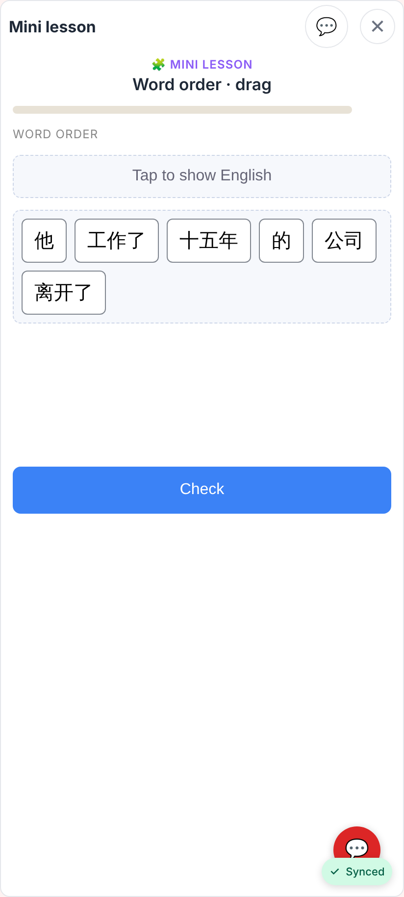
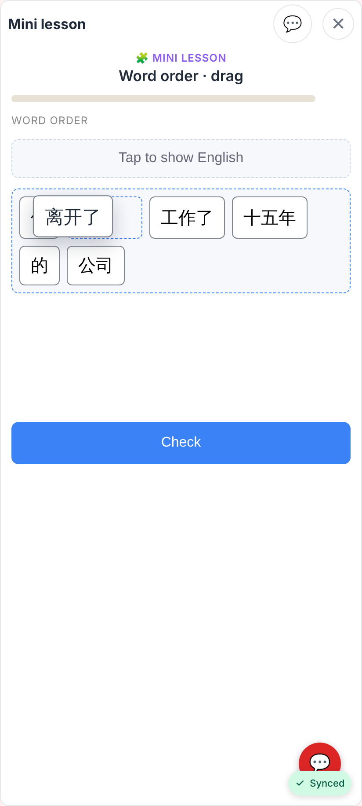
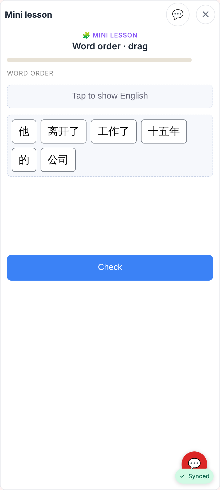
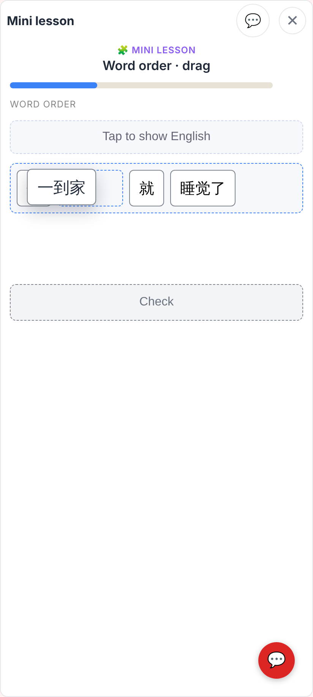

# Word order: drag to rearrange

Jerome: "it would be nice if I could click and drag and rearrange stuff so that the order that I click them in isn't final."

## Lab app (dark, Pixel Fold folded)

Five tiles tapped in; 离开了 is still in the pool.

离开了 dragged in from the pool: a copy under the finger, a dashed gap where it will land, the other tiles moved round it, the answer outlined.

Let go: 他 离开了 工作了 十五年 的 公司.

## Web (phone, 412×915)

All six tiles tapped in the order he thought of them.

离开了 dragged back to after 他: the gap shows where it will land.

The new order. Check grades it.

一到家 dragged in from the pool, between 他 and 就.
