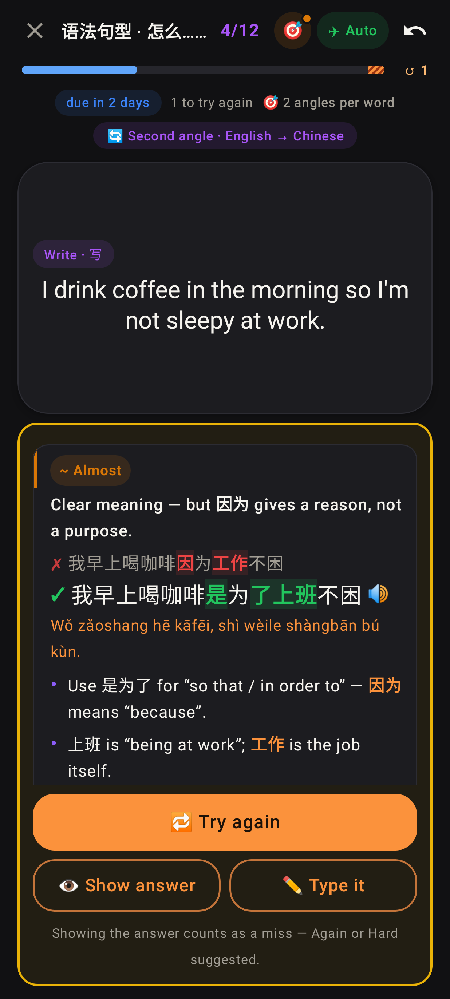
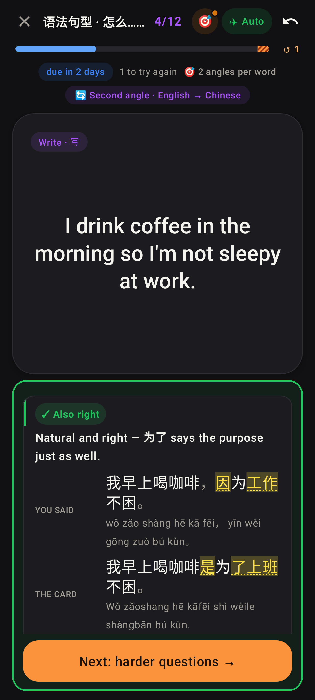
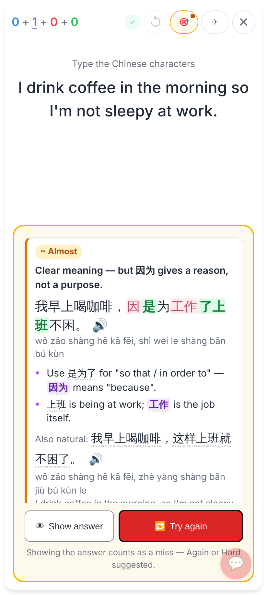
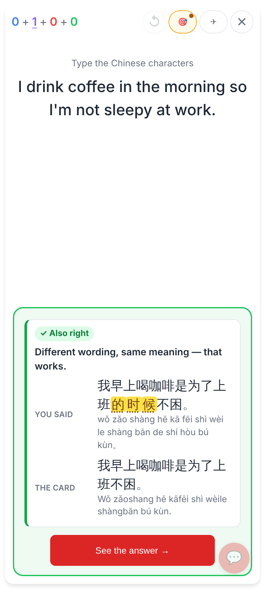

# Sentence answers checked by Claude (Hard mode's question)

Jerome's homework card: Hard mode, "Second angle · English → Chinese", the card 我早上喝咖啡是为了上班不困。,
answered 我早上喝咖啡，因为工作不困。. Phone viewport (412 wide).

Lab (dark): "~ Almost" with the headline, his sentence red-penned to the fix + pinyin, two tips, then 🔁 Try again · 👁 Show answer · ✏️ Type it. Still the question — the answer isn't shown.

Lab (dark): another answer Claude calls acceptable → "✓ Also right", held with You said vs the card, then Next: harder questions (no give-up; the pass suggests Got it).

Web (typed answer, against the local worker's E2E check): the same card on the question with Show answer / Try again.

Web: after 🔁 Try again a new answer (是为了上班的时候不困) is checked afresh → "✓ Also right", You said vs the card, then on.
