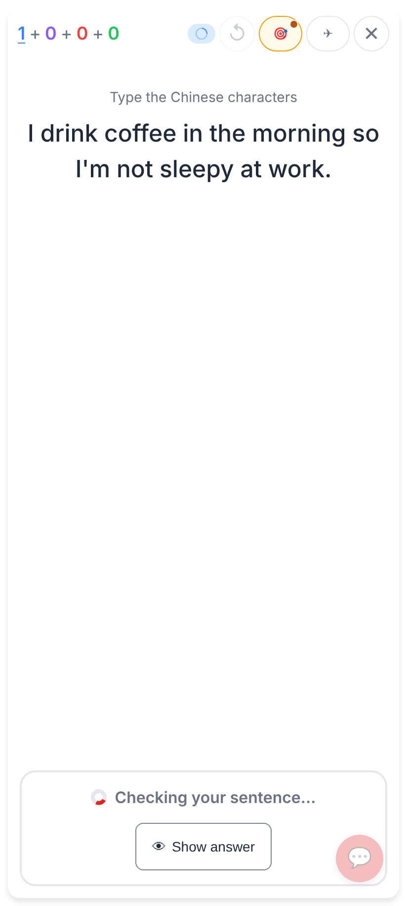
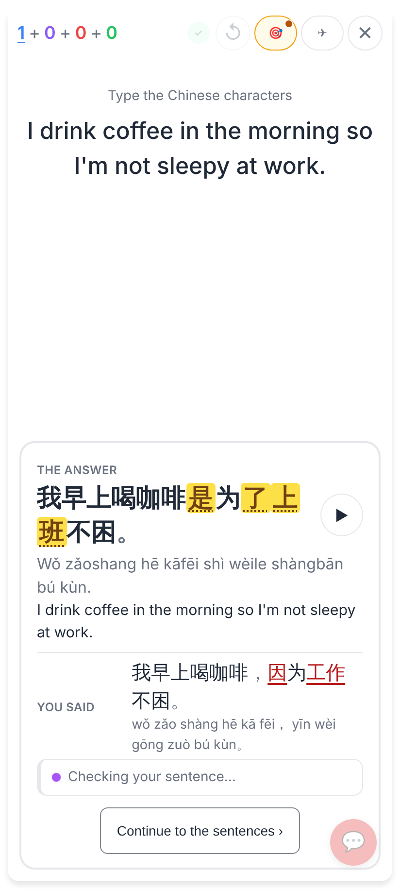
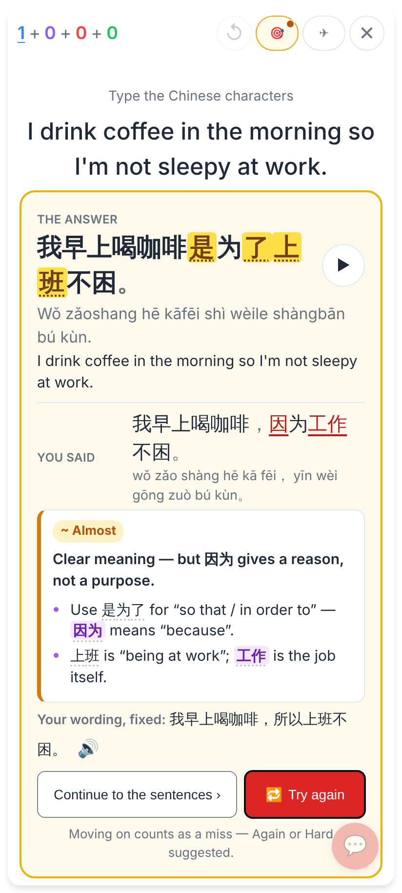
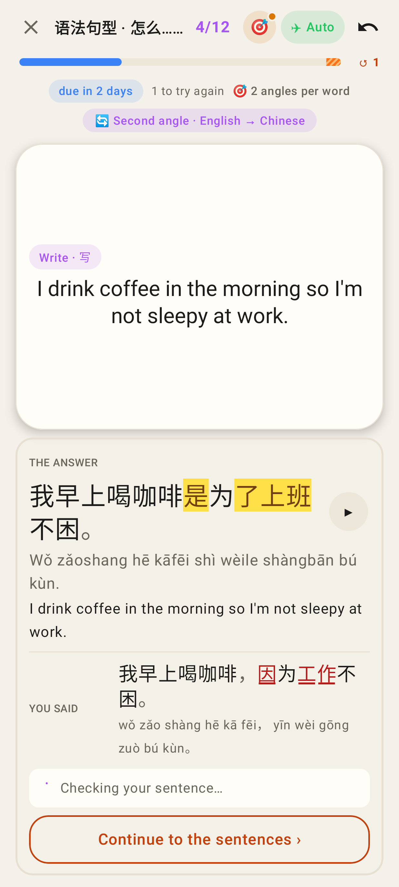
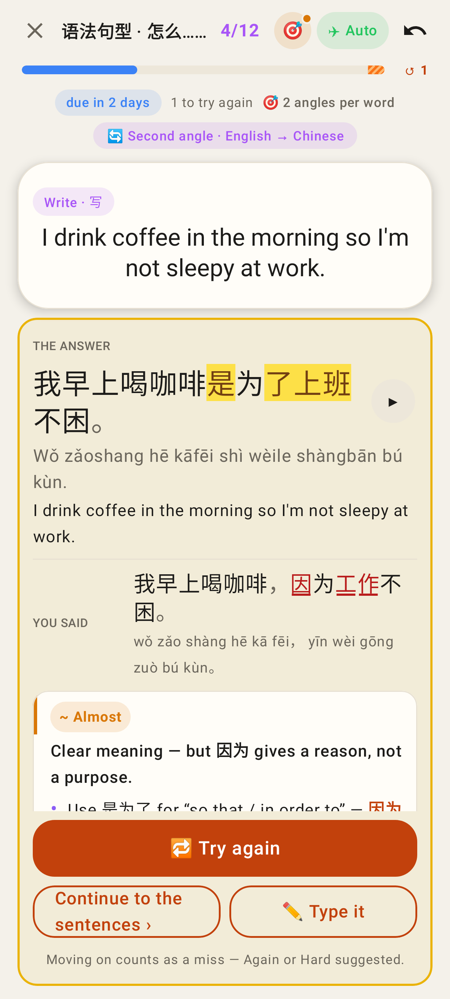
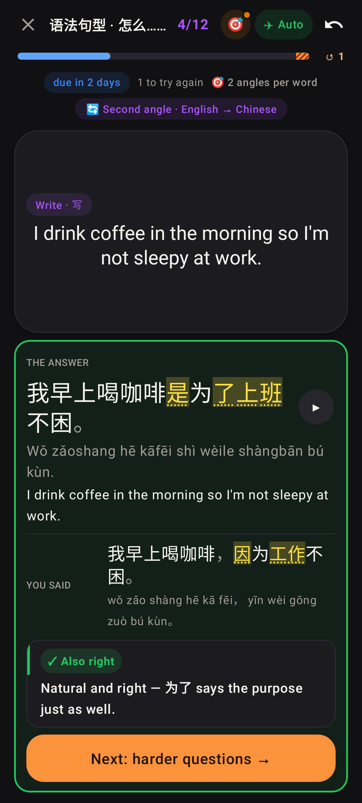

# Sentence check: the answer first, the verdict after

Hard mode, English → Chinese, a sentence card: 我早上喝咖啡是为了上班不困。, answered 我早上喝咖啡，因为工作不困。.
Phone viewport 412 × 915 at 2×. The web shots come from the real app against the local worker, with Claude's
check held back by the test so the "checking" moment can be photographed. The Lab shots are Roborazzi
screenshots of the homework pass card ("Second angle · English → Chinese").

Before (web): only a spinner, "Checking your sentence…" and 👁 Show answer until Claude replied.

After (web), straight away: the card's answer (hanzi with ▶, pinyin, English) and "You said" marked against it,
with a slim "Checking your sentence…" row underneath.

After (web), once Claude replies: "~ Almost", its headline and tips appear under the answer. Claude's corrected
version of his own sentence is only a small "Your wording, fixed:" line, never in place of the card's answer.
Continue to the sentences (moving on, which counts as a miss) and 🔁 Try again.

Lab, homework pass: the same answer-first view while Claude checks.

Lab: "~ Almost" lands under the card's answer. Here Claude's fix is the card's own sentence, so no extra line is
shown. 🔁 Try again · Continue to the sentences · ✏️ Type it.

Lab (dark): an answer Claude calls acceptable. The marks turn yellow ("worded differently") and it shows
"✓ Also right" then Next: harder questions.
