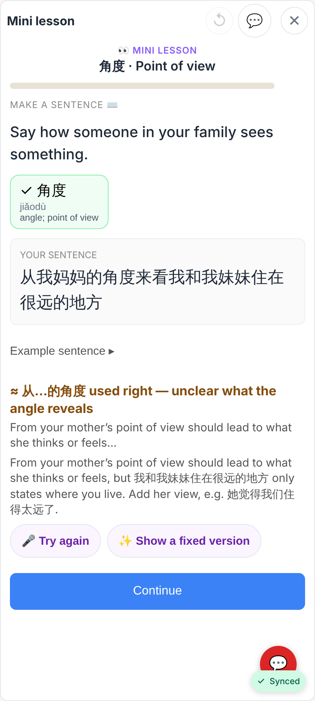
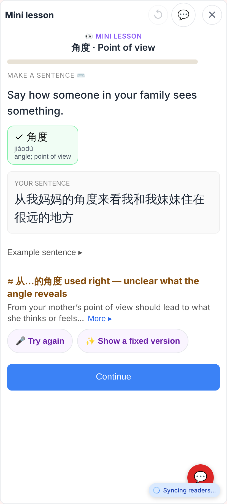
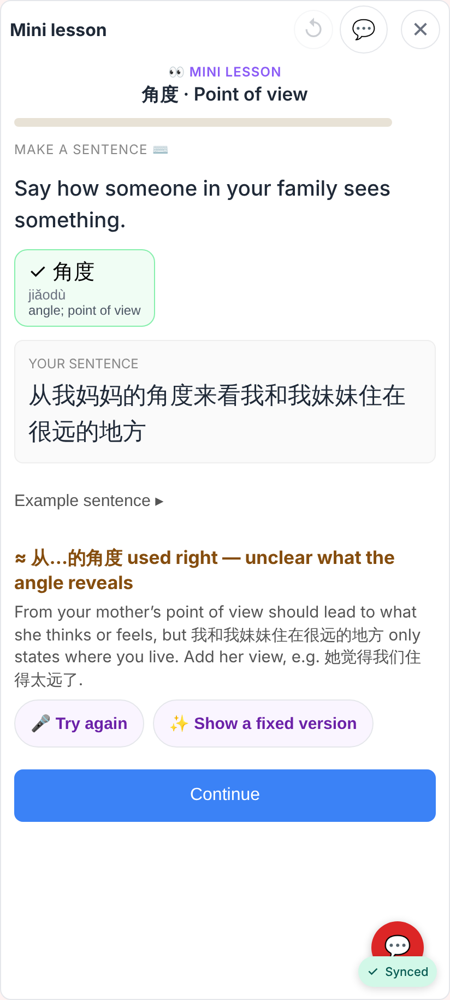
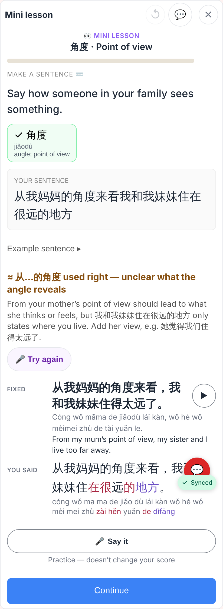
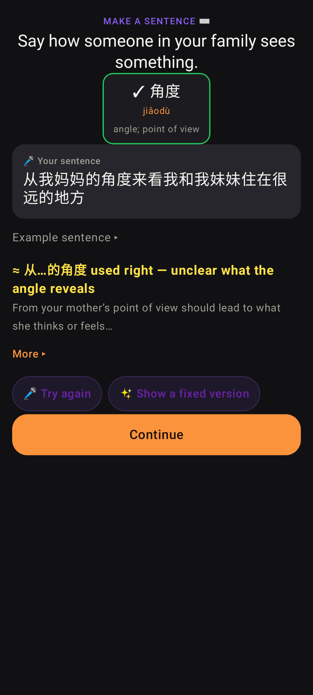
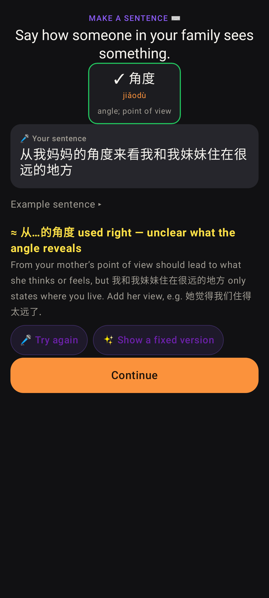
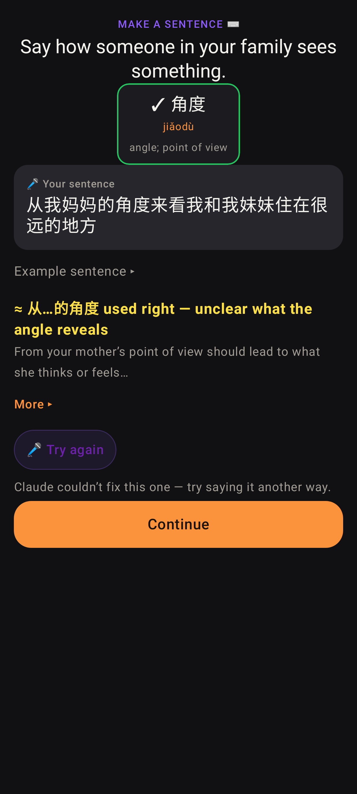

# Sentence making: a fix that works, the reason read once

Jerome's 从…的角度 sentence (从我妈妈的角度来看我和我妹妹住在很远的地方), graded needs work for meaning. Phone viewport
(412×915 @2x), web app with the E2E stand-in.

Before — the reason line is cut with "…", and More ▸ shows the whole reason again underneath it.

After — collapsed: the headline, the cut reason line, More ▸.

After — More ▸ opens the whole reason in place of the cut line: read once.

After — ✨ Show a fixed version is told the problem and adds his mother's view: 从我妈妈的角度来看，我和我妹妹住得太远了。

## Lab app (Roborazzi, dark)

Collapsed: the headline, the cut reason line, More ▸.

More ▸ opens the whole reason in place of the cut line.

The server answered 502 (Claude couldn't fix it): "Claude couldn't fix this one — try saying it another way." Before,
this showed "A fixed version needs a connection — try again when you're online." because HttpException is an IOException.
