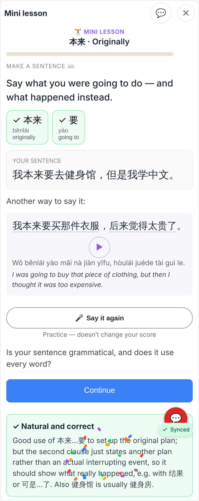
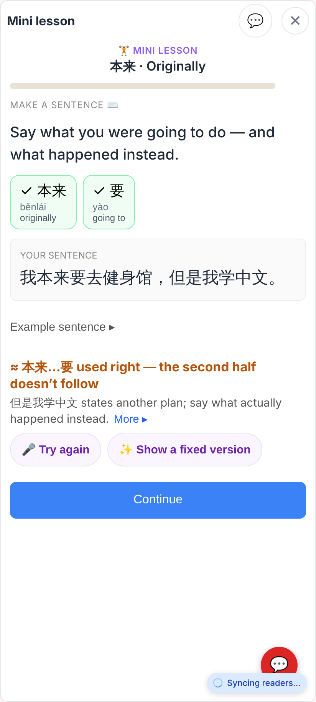
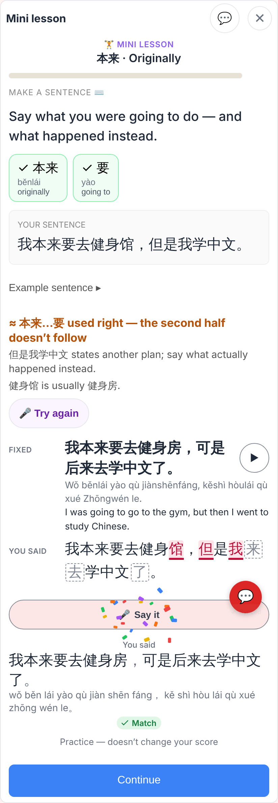
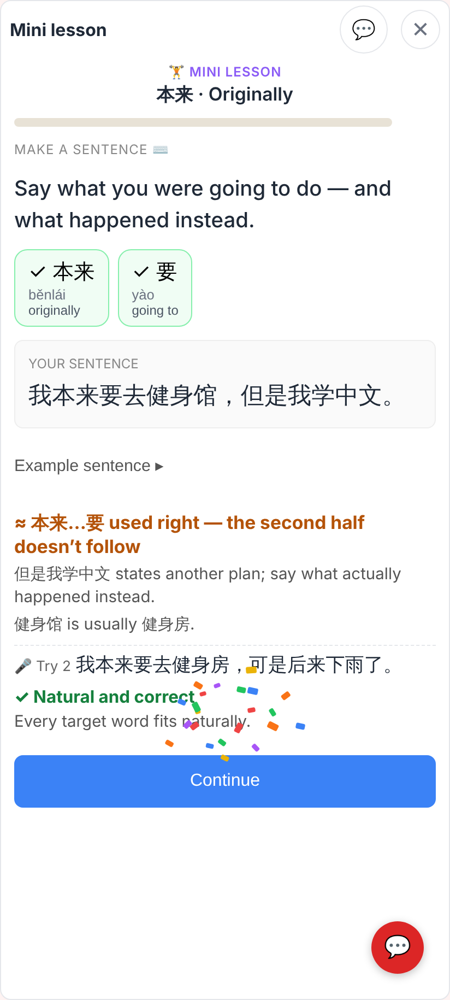
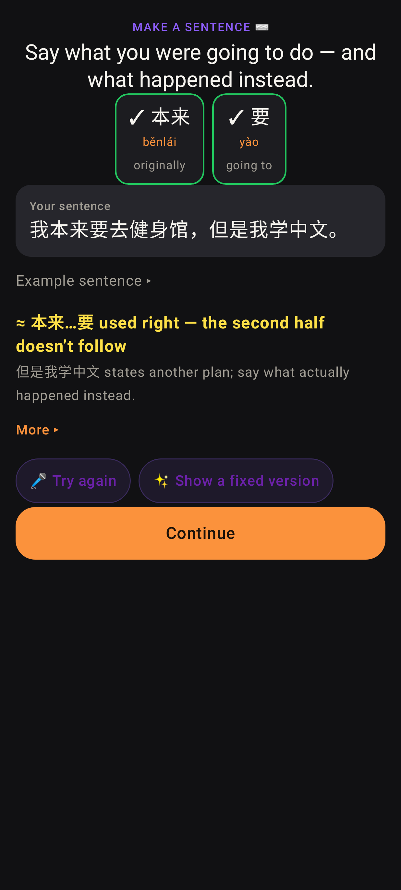
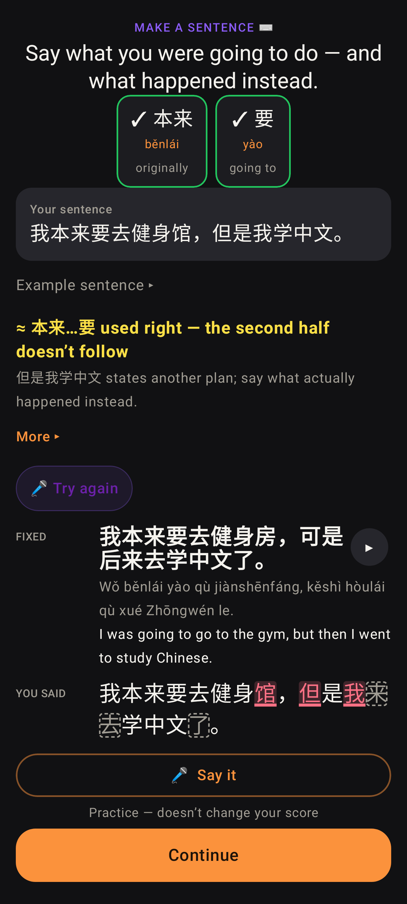
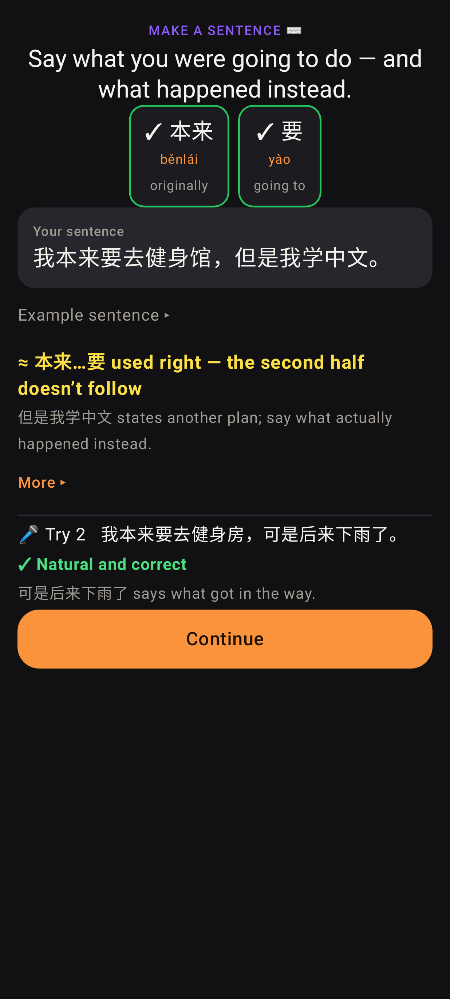
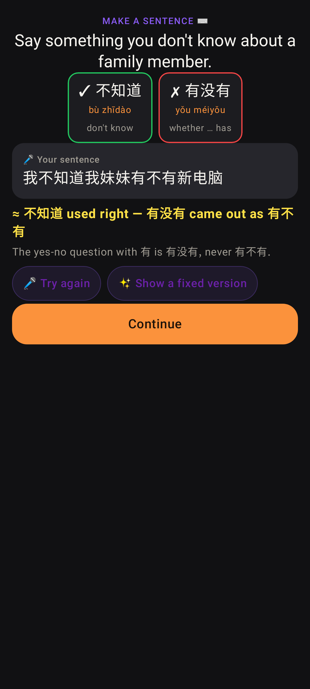

# Sentence making: an honest verdict

Jerome's sentence for 本来 + 要: 我本来要去健身馆，但是我学中文。 All shots are 412×915 phone viewports. Web is light; the
Lab app is dark.

## Before (web)

Before: the old check gave a green "✓ Natural and correct" while its own explanation said the second half didn't follow.
The unrelated model sentence, its Say it again, and the self-check line also sat above it.

## After (web)

≈ needs work in orange: one headline and one reason. The example is folded under "Example sentence ▸", the self-check
line is gone, and the two actions appear only for a sentence that isn't right.

✨ Show a fixed version, on tap: his sentence lined up with the fix (▶, pinyin, English), then 🎤 Say it, checked on the
device. "More ▸" was opened in this run.

🎤 Try again: a new sentence is checked in place and comes back ✓ right, with a small burst. The first grade still counts.

## After (Lab app, dark)

Lab: ≈ needs work, with More ▸, 🎤 Try again, ✨ Show a fixed version and Continue.

Lab: the fix lined up with his sentence, then 🎤 Say it.

Lab: Try 2 comes back ✓ Natural and correct.

Lab: the take 我不知道。 我妹妹有，不有新电脑。 is scrubbed and checked as one utterance. Only 有不有 is flagged, never the split.
