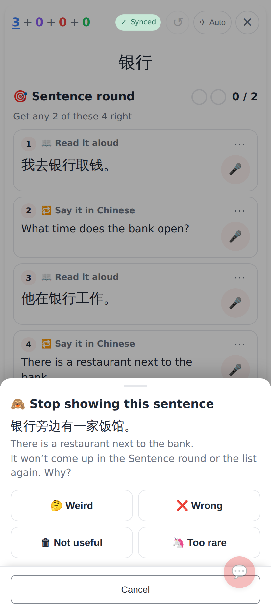
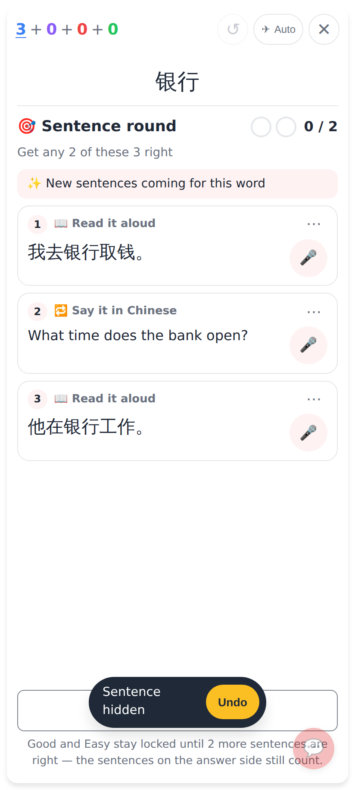
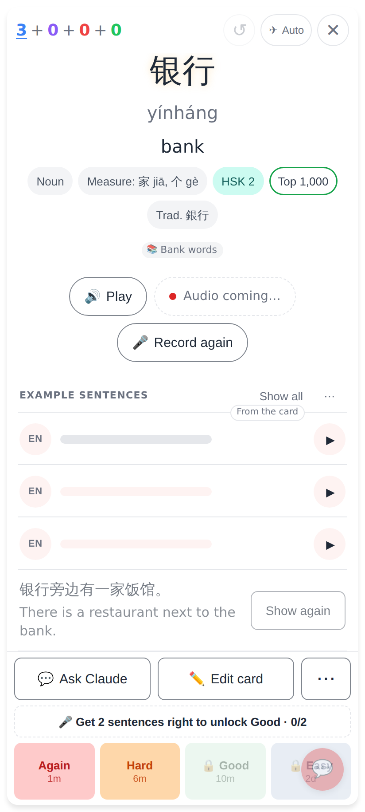
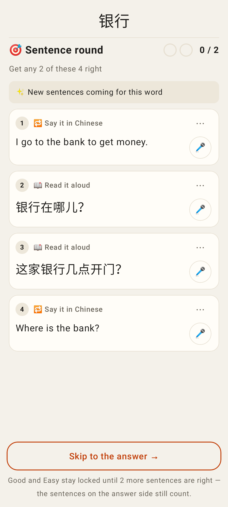
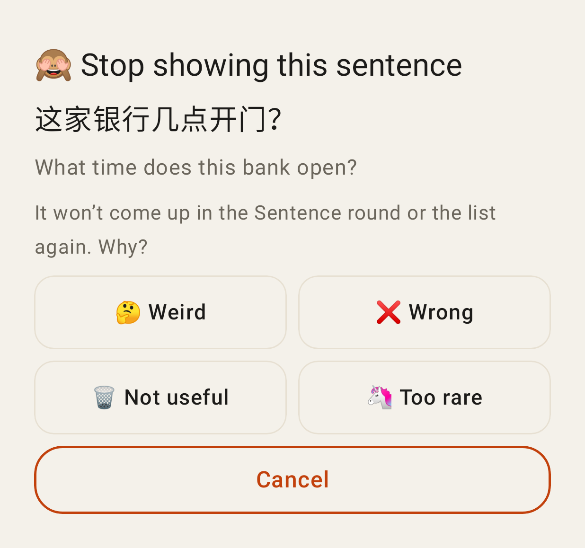
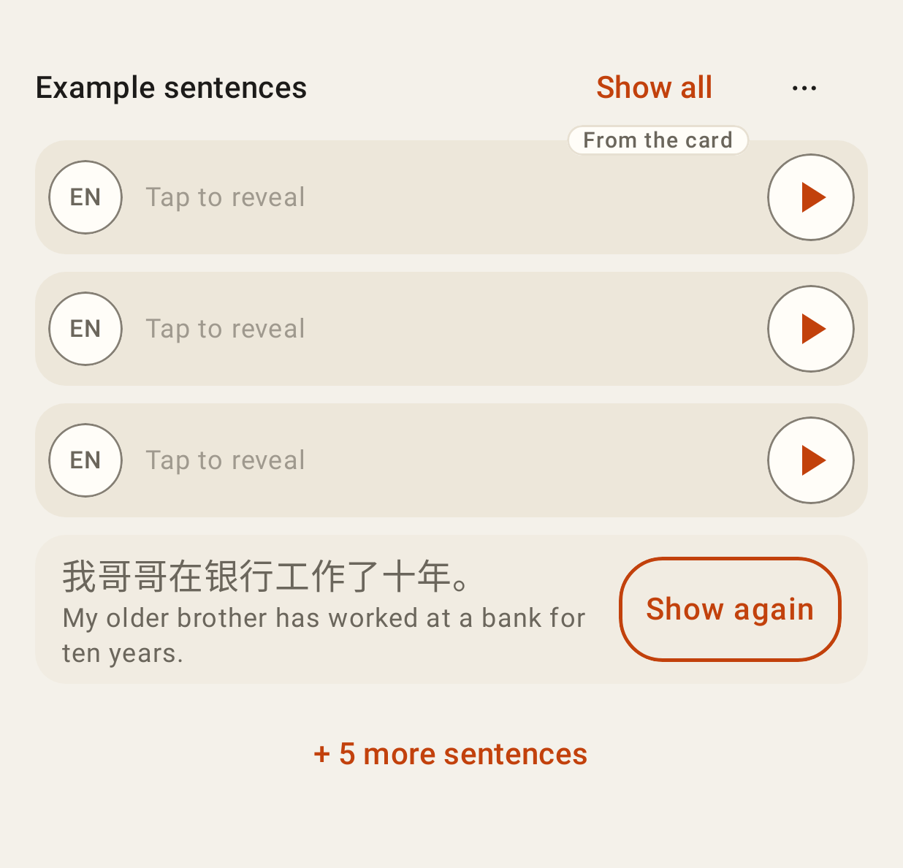

# Sentence practice history — screenshots (412×915 phone, 2×)

## Web

⋯ (or long-press) on a round exercise → "Stop showing this sentence" with the four reason chips.

After hiding one: the round has three left, "✨ New sentences coming for this word" (fewer than four in rotation → the top-up was asked for), the Undo toast.

The answer side lists three; ⋯ → Show hidden (1) → the hidden sentence with Show again.

## Lab app

The round with the least-known sentences first (the hidden one left out) and the "new sentences coming" note.

The sheet (⋯ or long-press on an exercise): the sentence and the four reason chips.

The answer side's list: ⋯ → Show hidden (1) → Show again.
