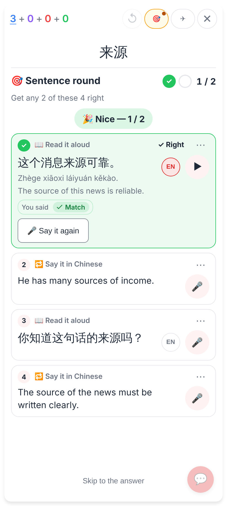
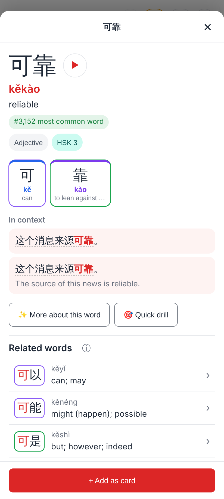
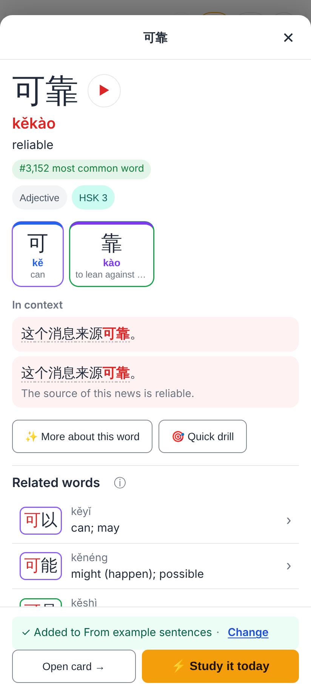

# Sentence round: tap a word to explore it

Phone viewport 412×915 at 2×, from the E2E spec `e2e/tests/study-sentence-gate.spec.ts` (Hard mode, the card 来源).

"Read it aloud" judged ✓ Right: 这个消息来源可靠。 looks exactly as before, but every word can now be tapped. The rows below (not answered yet) stay plain.

Tapping 可靠 opens the language explorer's Word view, with "+ Add as card".

One tap on "+ Add as card" puts the card in "From example sentences".
