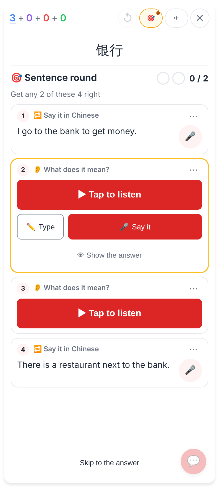
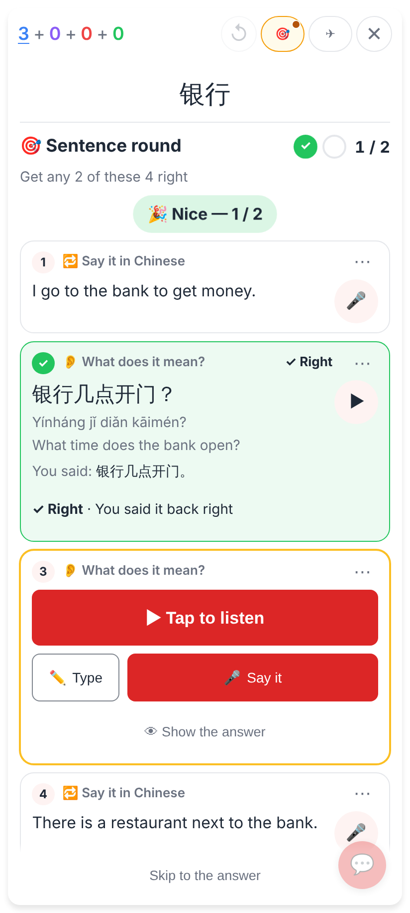
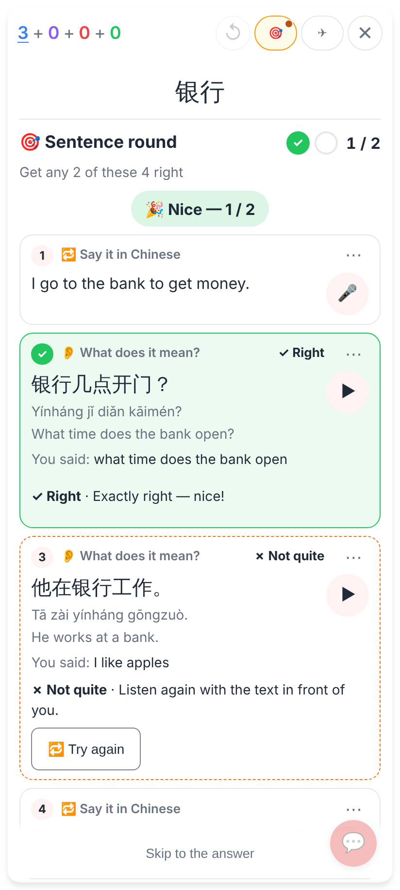
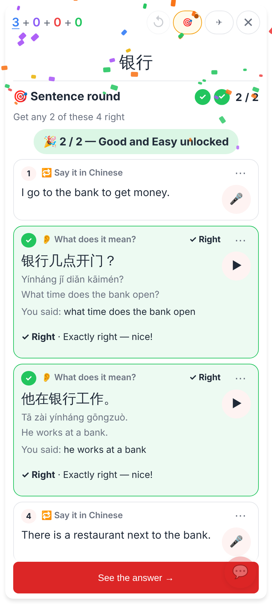
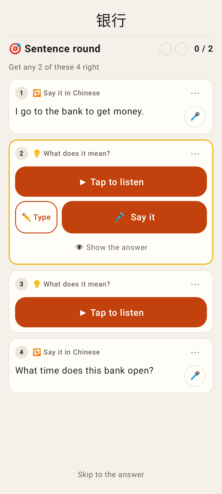
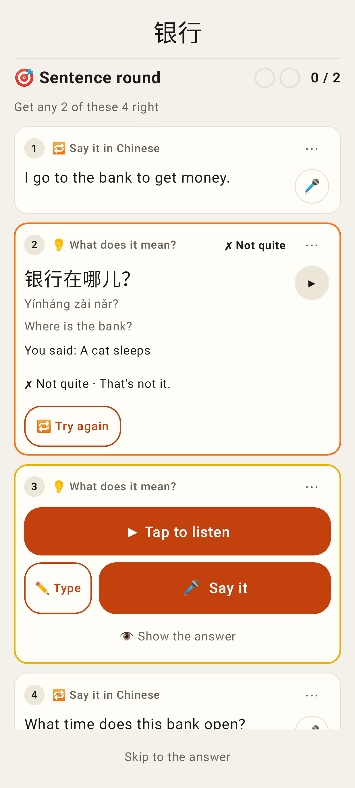
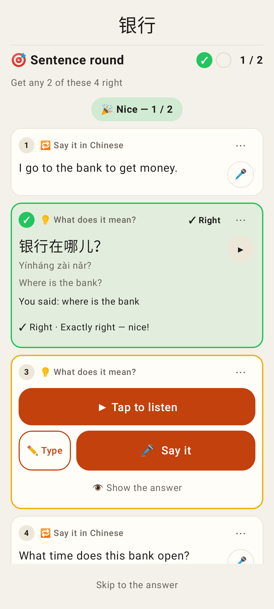

# Sentence round: lenient spoken checks, Try again after the answer, tap to listen

Phone viewport (412×915 @2×). Web shots from `e2e/tests/study-sentences-by-ear.spec.ts`, Lab shots from `SentenceListenUiTest` (Roborazzi).

## Web

Listen exercises never play by themselves: one big ▶ Tap to listen per row.

Said back in Chinese with a pause (the recogniser's 。 in the middle): ✓ Right · You said it back right, no Claude call; "You said" reads like the sentence.

A wrong answer, the answer shown: 🔁 Try again.

The retry said right counts: 2 / 2, Good and Easy unlocked.

## Lab app

The same ▶ Tap to listen in the Lab app.

✗ Not quite with 🔁 Try again after the reveal.

The retry said right counts (1 / 2).
