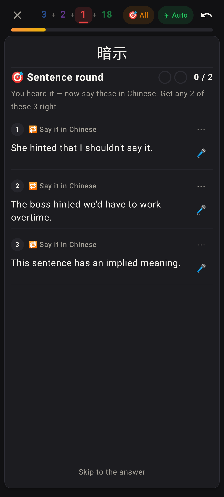
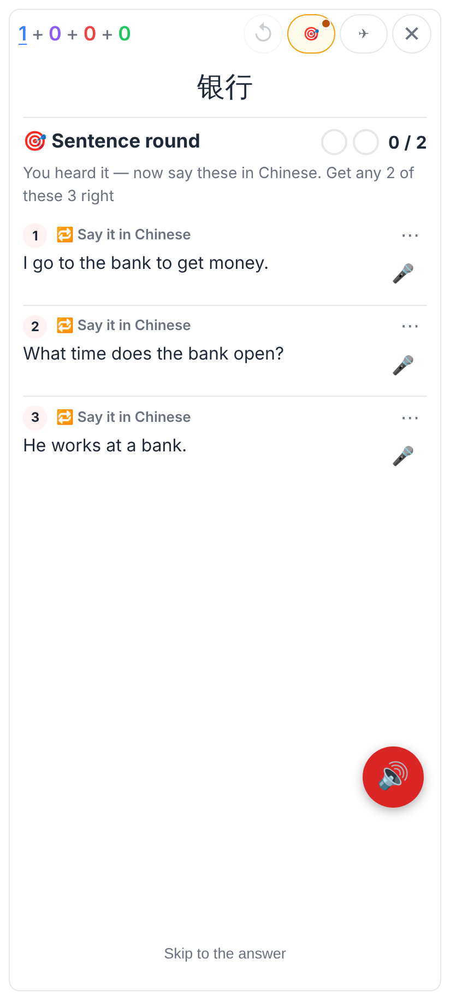

# Sentence round: no blank beat

Before: on a Hard-mode listening card, the Lab app's round showed only "You heard it — now say these in Chinese.
Get any 0 of these 0 right" for ~1 s, the length of the English fetch for the card's own sentence. After: the
exercises are there on the round's first frame.

Lab (Roborazzi, dark): the round of 暗示 is complete on its first frame, even with the English fetch of the card's
sentence still pending (`SentenceRoundNoBlankTest.shotListeningRoundFirstFrameDark`).

Web (412×915 at 2×, E2E `study-sentence-gate.spec.ts`): the same round. The E2E now also checks that
"of these 0" never reaches the page.
