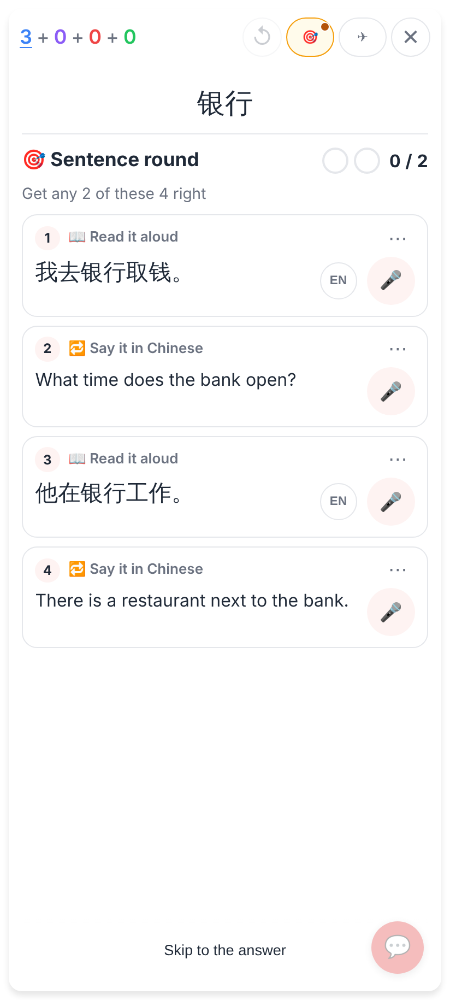
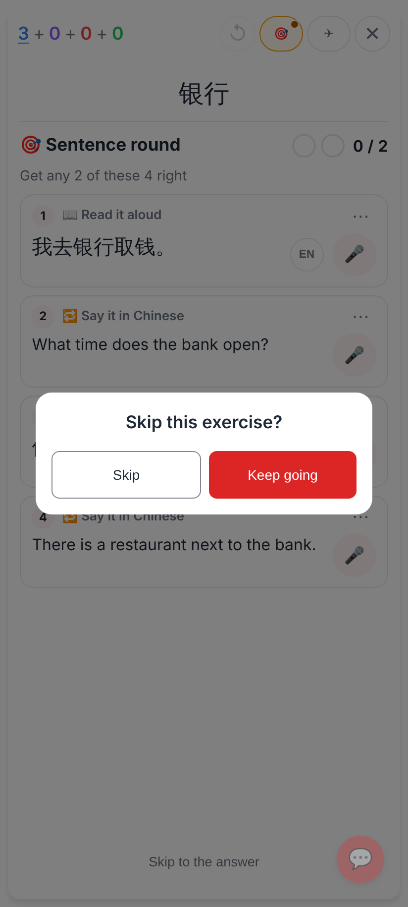
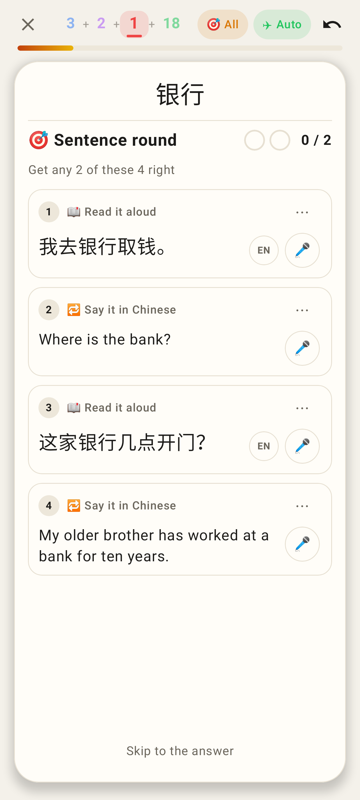
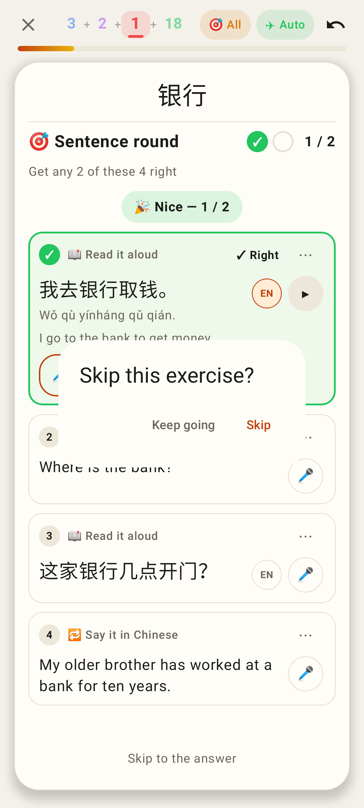

# Sentence round: a quiet Skip that asks first

Jerome: "this text at the bottom of the screen is not super helpful … That button should be kind of grayed out and not look clickable, but you can click it, and there should be a little pop up saying 'Do you want to skip this exercise?'"

Web (412×915 @2x): the explanatory line under Skip is gone; "Skip to the answer" is muted text, no outline (still a 44 px button).

Web: tapping it opens "Skip this exercise?" with Skip / Keep going (Keep going is the default; Escape or a tap outside = Keep going).

Lab app (Roborazzi): the same quiet Skip, no line under it.

Lab app: the kit's ConfirmDialog — Keep going / Skip (Robolectric's capture leaves out the dialog's dimmed backdrop).
