# Sentence round — screenshots (412×915 phone, 2×)

## Web

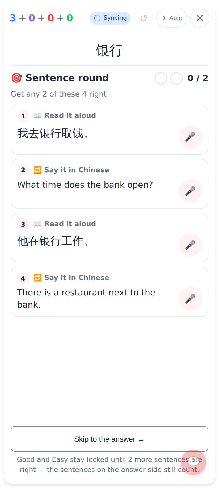
The reveal opens the Sentence round: the question small at the top, four exercises (read / say it in Chinese, easiest → harder), Skip with its one-line note.

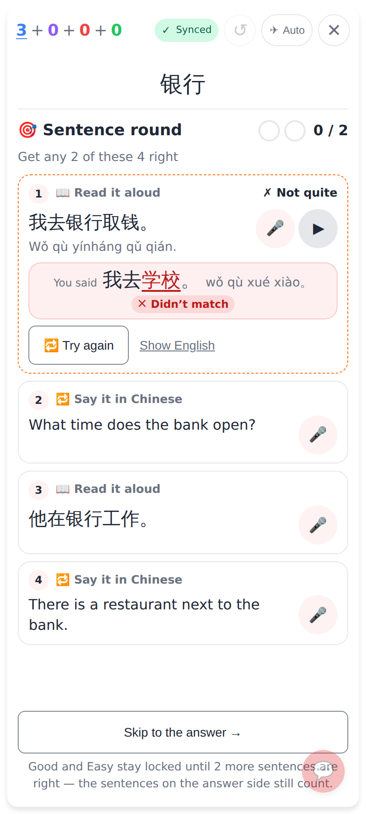
A miss: ✗ Not quite (dashed border + words), "You said" diff, 🔁 Try again.

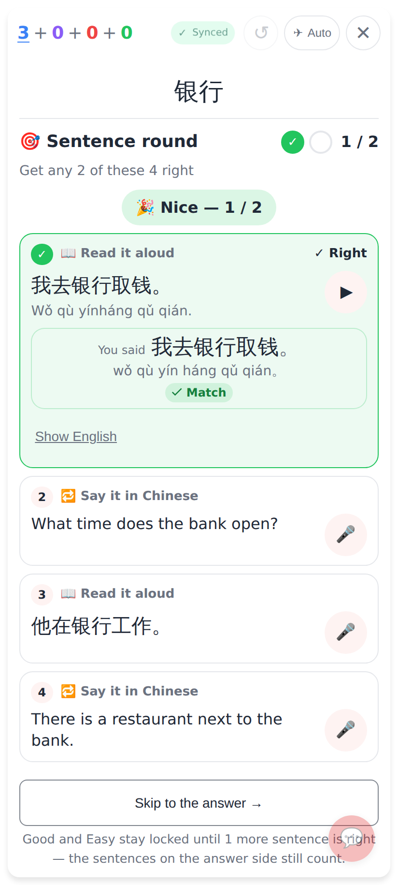
Read right: ✓ Right, the cheer "🎉 Nice — 1 / 2", ▶ and Show English after the attempt.

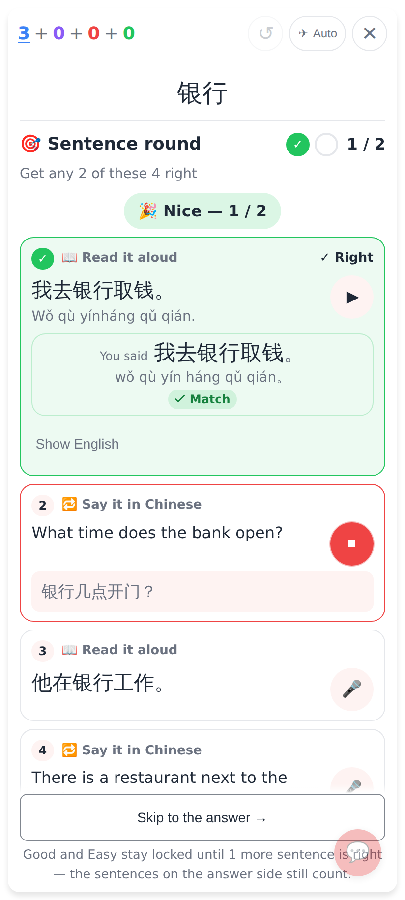
Say it in Chinese while listening: the live words under the English.

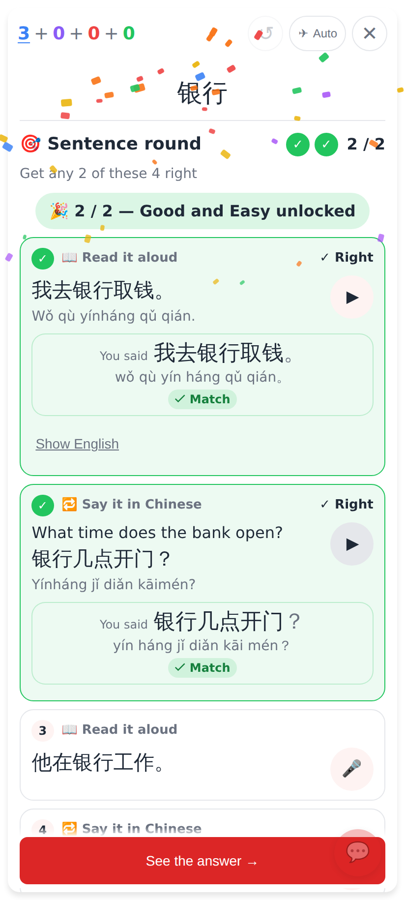
Two right: confetti, "🎉 2 / 2 — Good and Easy unlocked"; the translate exercise's Chinese + ▶ only now. The answer opens by itself.

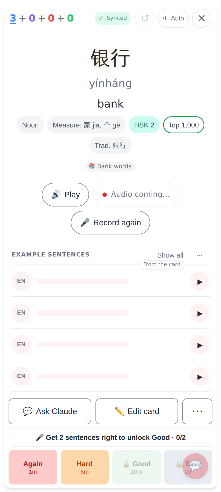
After Skip: the answer side with the gate still locked.

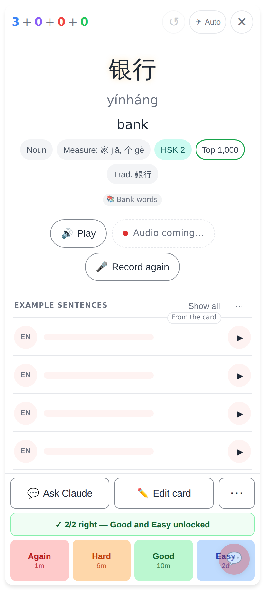
After the round: the answer side with Good / Easy already unlocked.

## Lab app

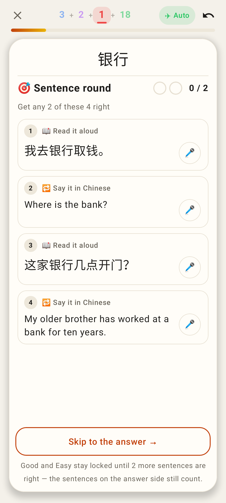
Reading card: the round.

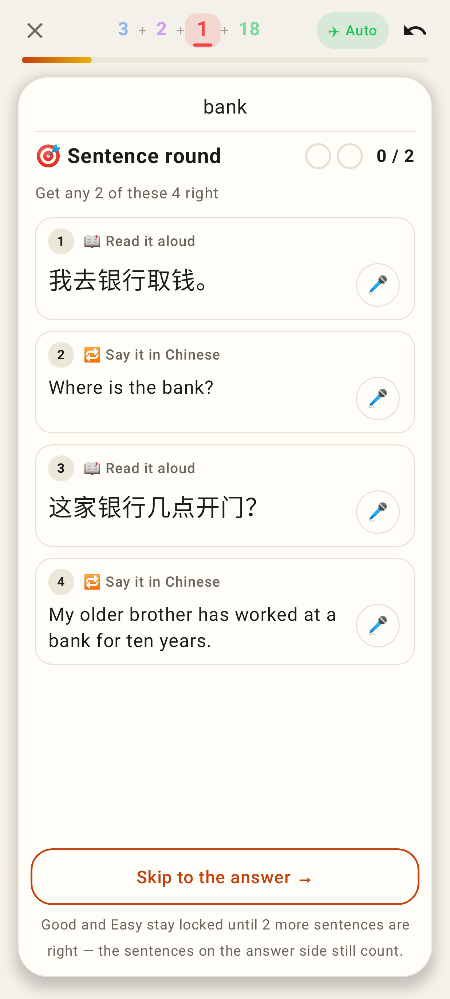
Meaning card: the English question at the top, the same round.

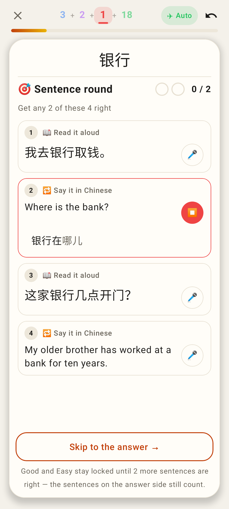
A take under way (live words).

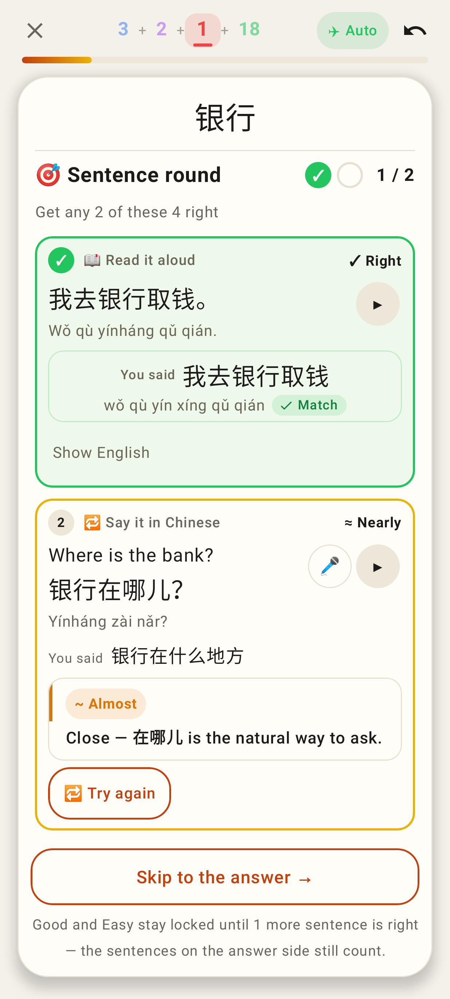
✓ Right (1 / 2) and ≈ Nearly with Claude's verdict + 🔁 Try again.

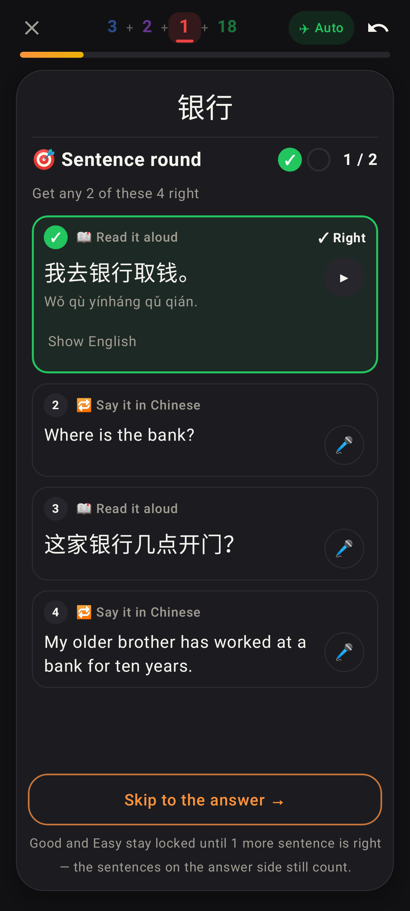
Dark mode.

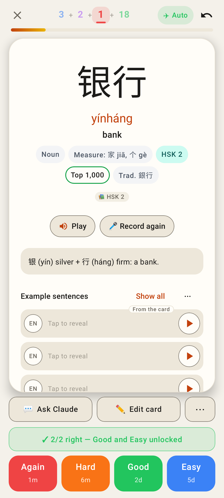
Two right → the answer with Good / Easy unlocked.

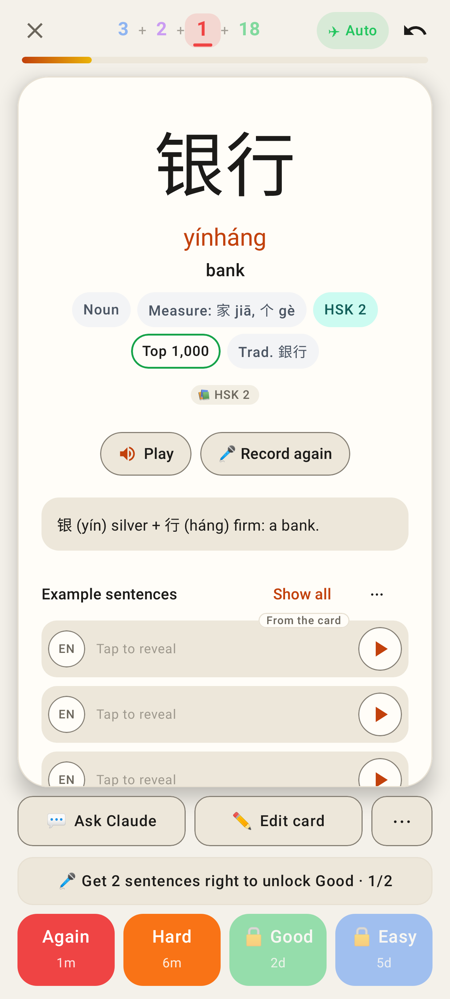
Skip → the answer with the gate at 1/2.
