# 🎤 on the example sentence rows + "Get two sentences right before Good / Easy"

Phone viewport (412×915). Web shots are the real app (a take's transcript stubbed); Lab shots are Roborazzi.

## Web

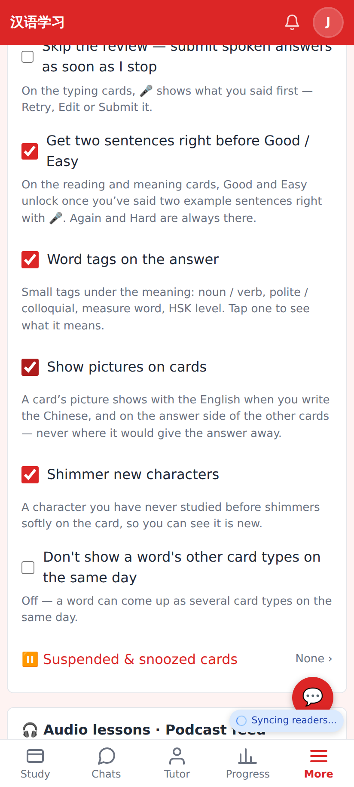
Settings → Study → "Get two sentences right before Good / Easy" (off by default, per device).

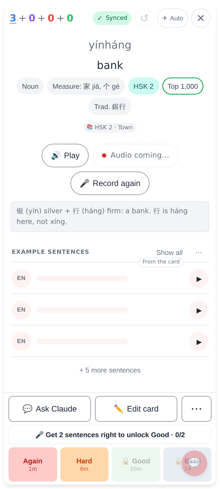
A reading card's answer side with the setting on: 🔒 Good / Easy, the line above the ratings says what unlocks them.

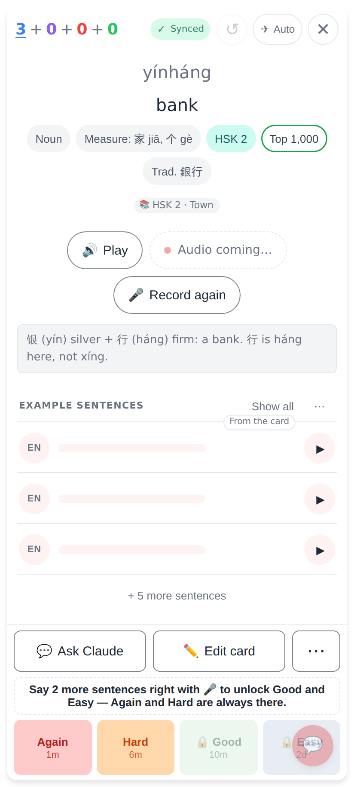
A tap on a locked Good rates nothing and says why.

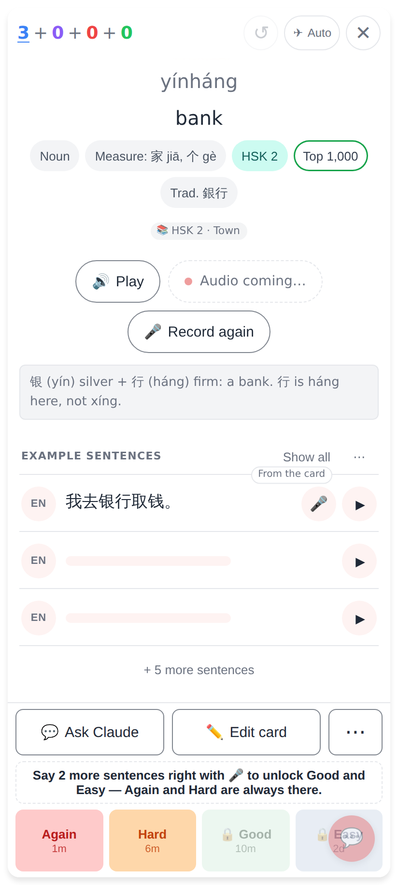
A row once its Chinese is up: 🎤 left of ▶ (blank rows have none).

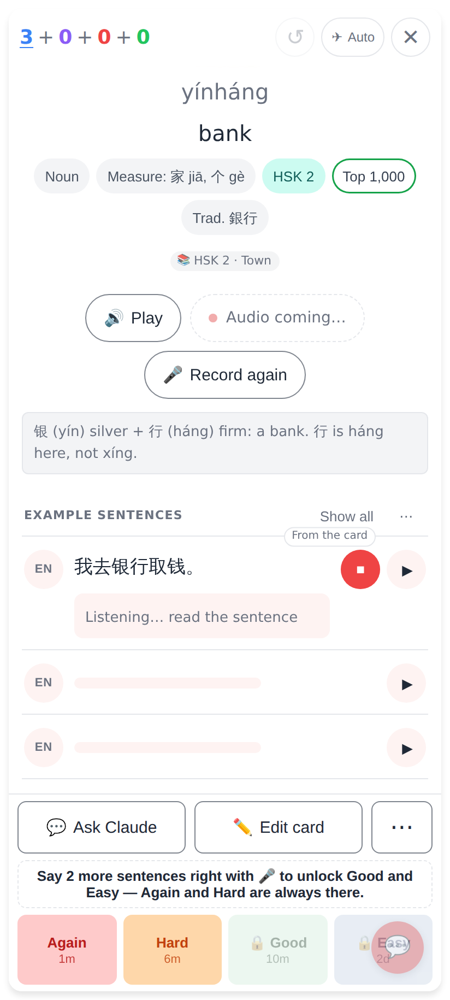
Recording: ⏹ red, the live words under the sentence.

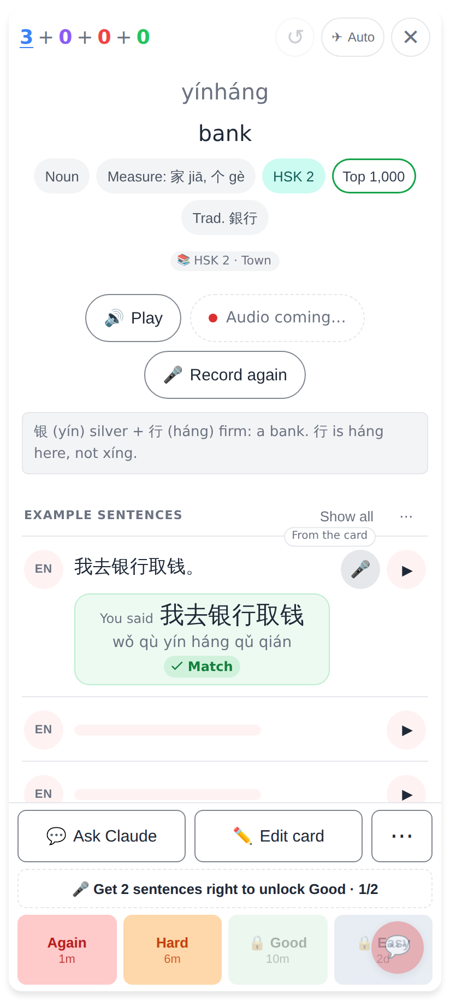
Read it aloud: "You said … ✓ Match" — 1 of 2.

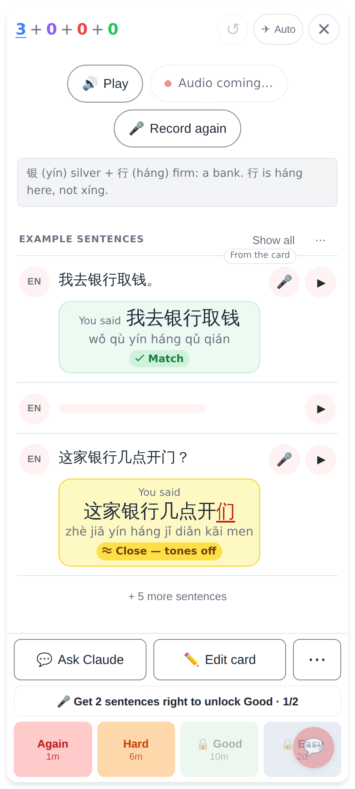
Another row: "≈ Close — tones off" doesn't count.

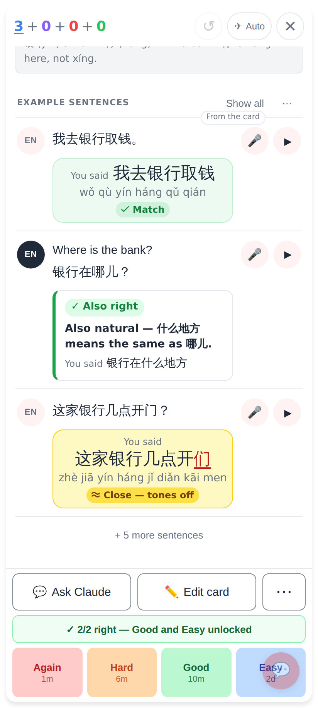
EN-first: said it another way in Chinese → Claude's check "✓ Also right", the row reveals its Chinese; 2/2 — Good and Easy unlocked.

## Lab app

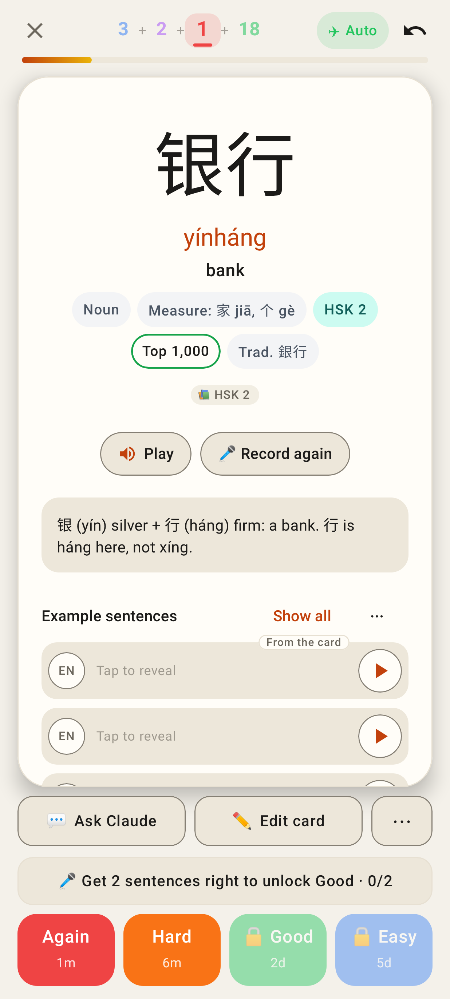
Locked: 🔒 Good / Easy and the line above the ratings.

One sentence right — 1/2.

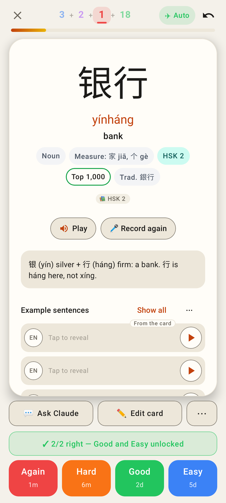
Two right — Good and Easy unlocked.

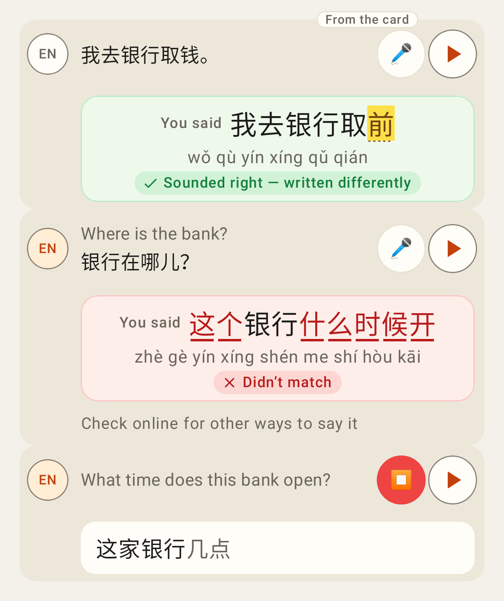
Rows: read "Sounded right" (homophone), translate offline → "Check online for other ways to say it", a take in progress.

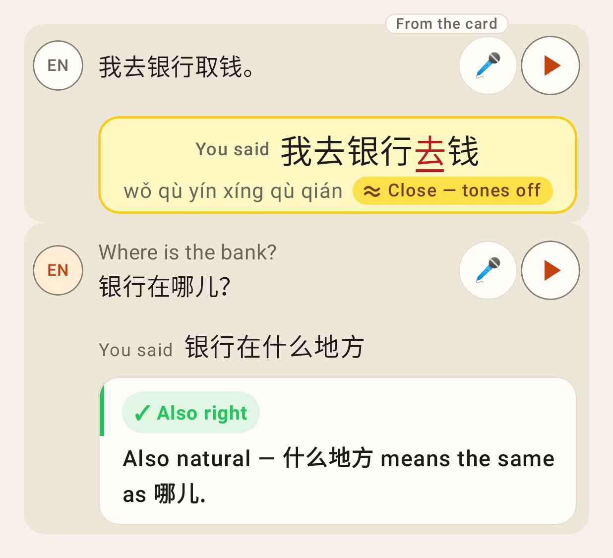
Read "Close — tones off"; translate judged by Claude "✓ Also right".

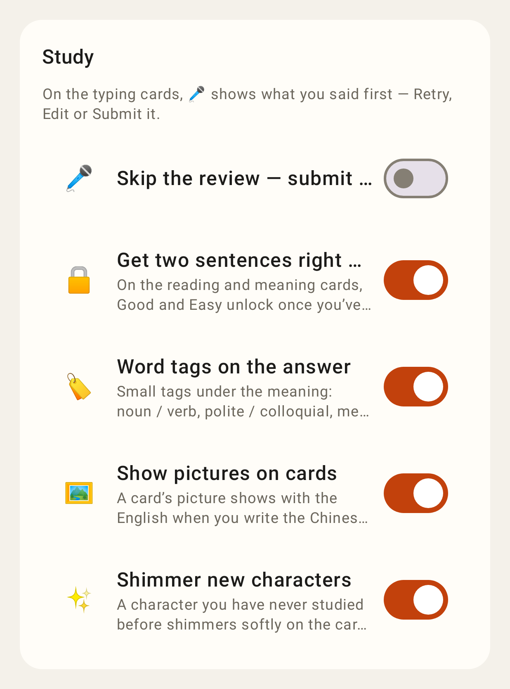
Settings → Study switch.
