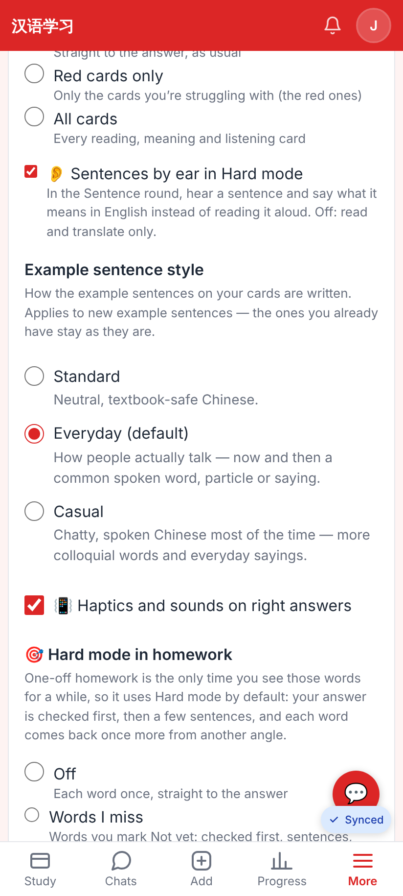
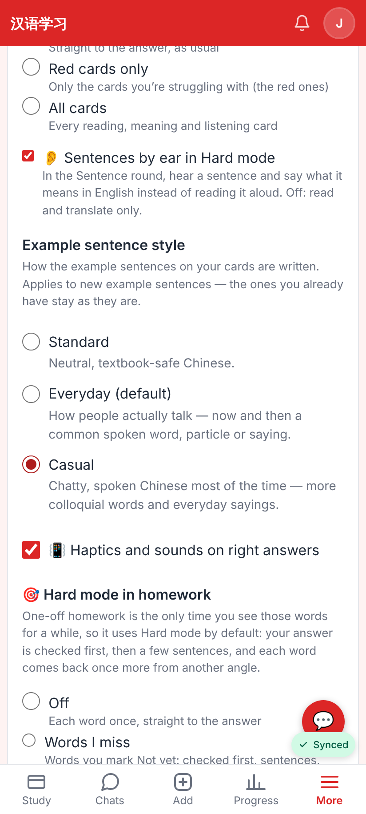
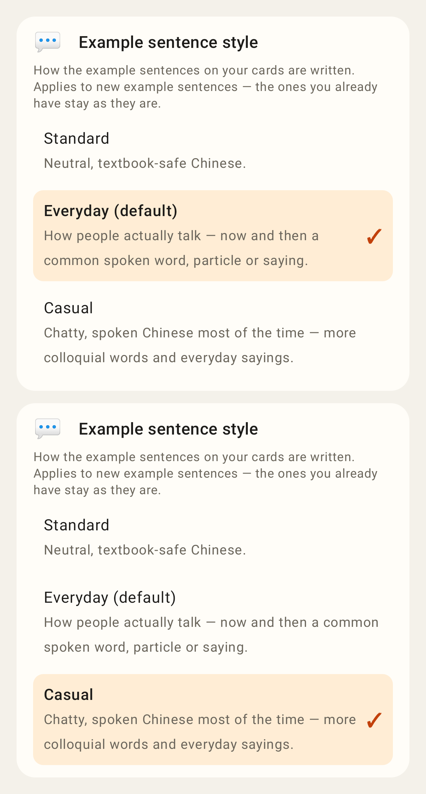

# Example sentence style — screenshots

Web, 412×915 @2×: Settings → Study → "Example sentence style", Everyday selected (the default).

Web: after choosing Casual (saved on the server; a reload keeps it).

Lab app (Roborazzi): the card in Settings → Study, Everyday (top) and Casual (bottom).
