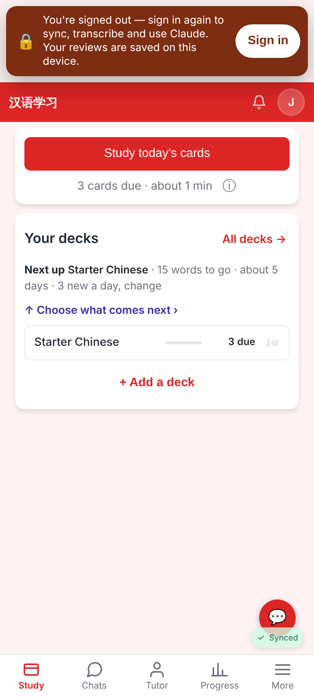
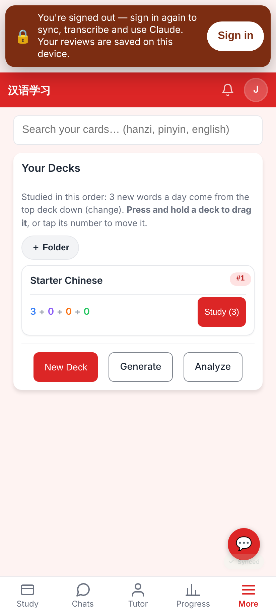
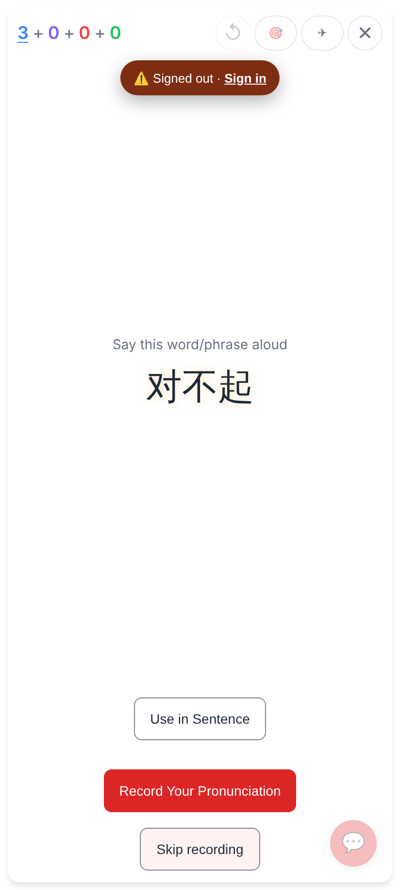
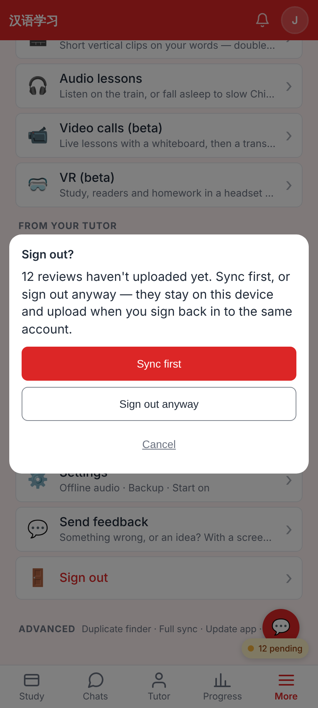
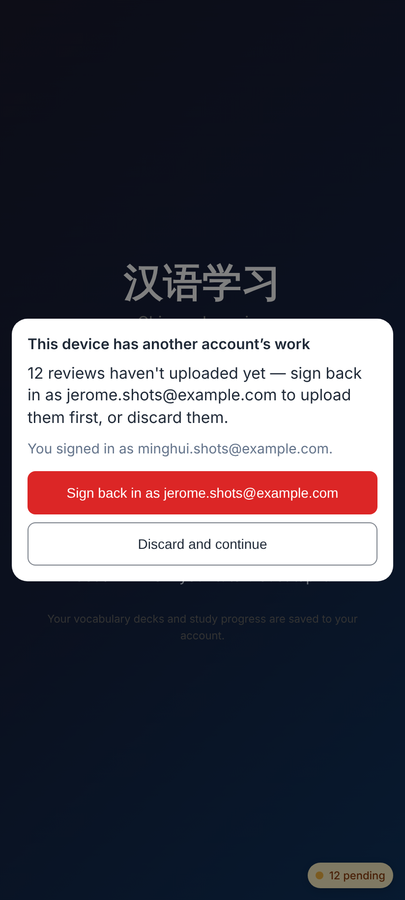
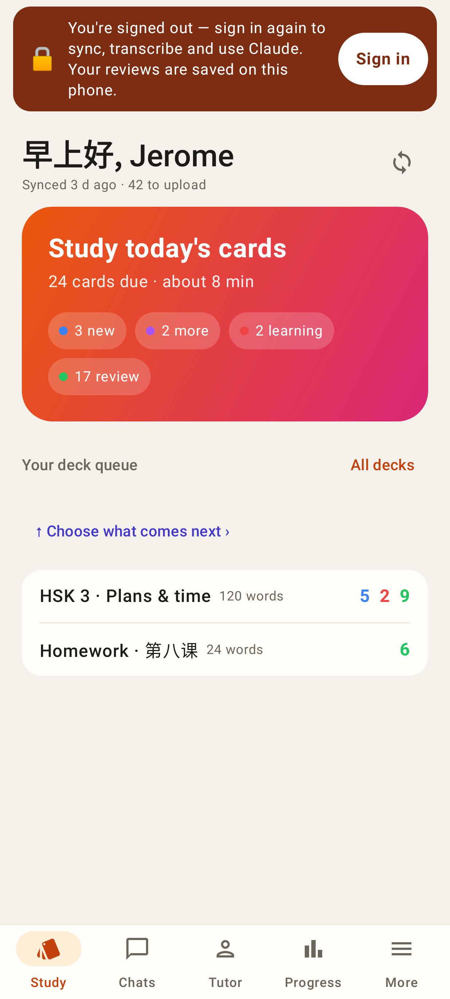
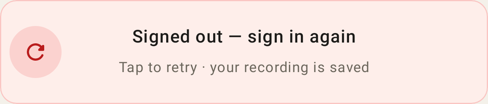
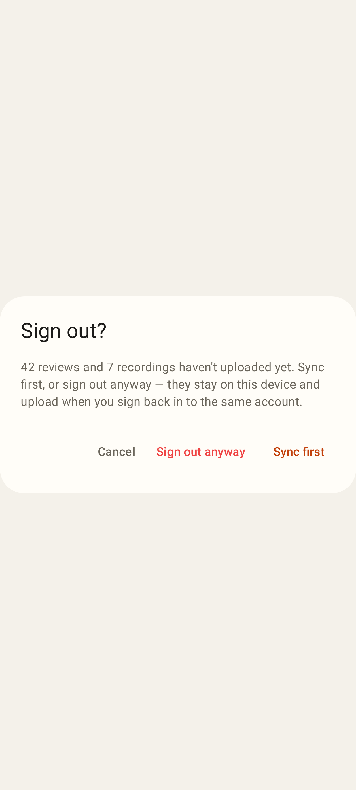
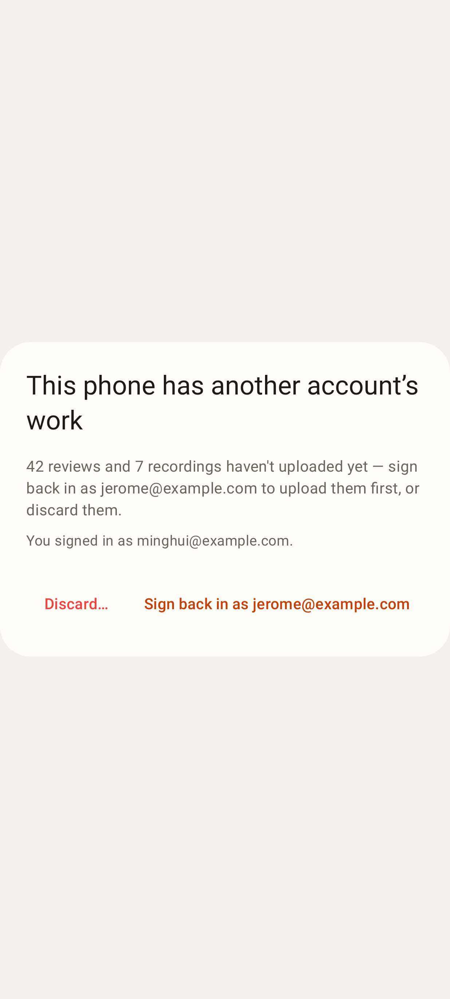

# Session renewal + signed-out state + safe sign-in

Web (412×915, 2×) — real local worker, the session revoked on the server:

Home after a 401: "You're signed out" first on the page, nothing covered; the cached user and local data stay.

Every normal page shows it.

A study session gets a compact pill under the top bar (clear of ✕ and the session's buttons).

Sign out with 12 reviews not uploaded: Sync first / Sign out anyway (deletes nothing).

Minghui signs in on a browser holding Jerome's unsent reviews: sign back in as Jerome first, or discard.

Lab app (Roborazzi, 412×915dp):

The banner above every screen (the shell's top slot), Home under it.

A take whose upload got 401: "Signed out — sign in again" instead of "Couldn't transcribe".

Settings / More → Sign out with 42 reviews + 7 recordings waiting: Sync first / Sign out anyway (keeps them).

Not dismissable: Sign back in as the previous account, or Discard (asks once more).
