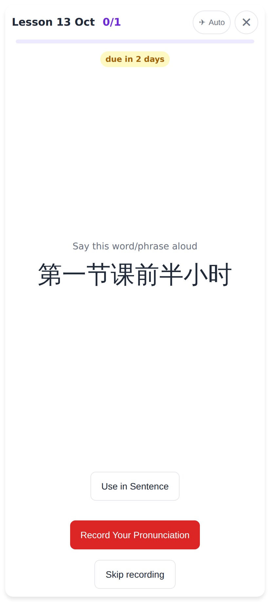
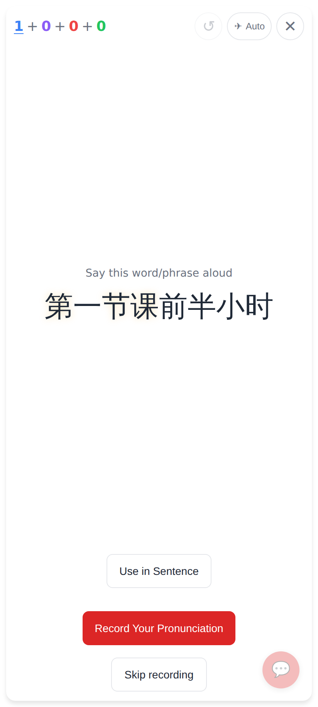

# New-character shimmer: flashcard session only

The student has reviewed 一个小时, 一半 and 前天 (so 一 小 时 半 前 are seen); his tutor sends 第一节课前半小时 as homework.

The one-off homework pass: no shimmer at all (it used to shimmer every character).

The same card in the flashcard study session: only 第, 节, 课 (never seen) shimmer.
