# The word's other cards in the study card's ⋯ menu

Phone viewport (412×915, 2×). Web light; Lab dark + one light.

## Lab app

Before — the ⋯ sheet had no status of the other cards, only "Practise this word other ways…":

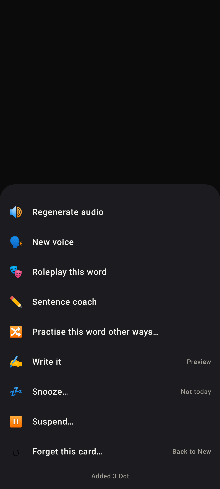

After — the top row: one tile per other card type (写 Write · Not started, 听 Listen · Known · next in 2mo, green bar):

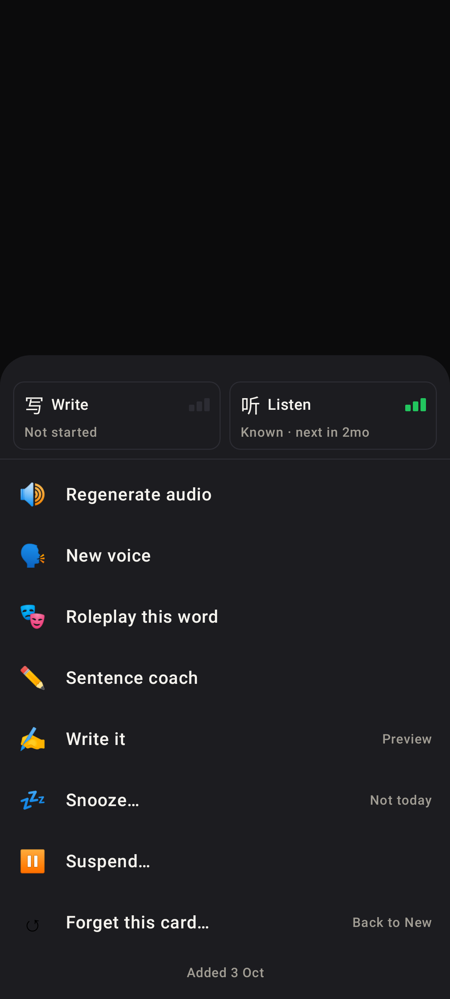

The same, light theme:

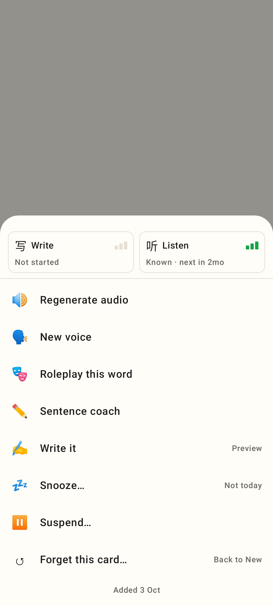

Other states — 写 Write in review (next in 12d), 听 Listen snoozed until 24 Nov:

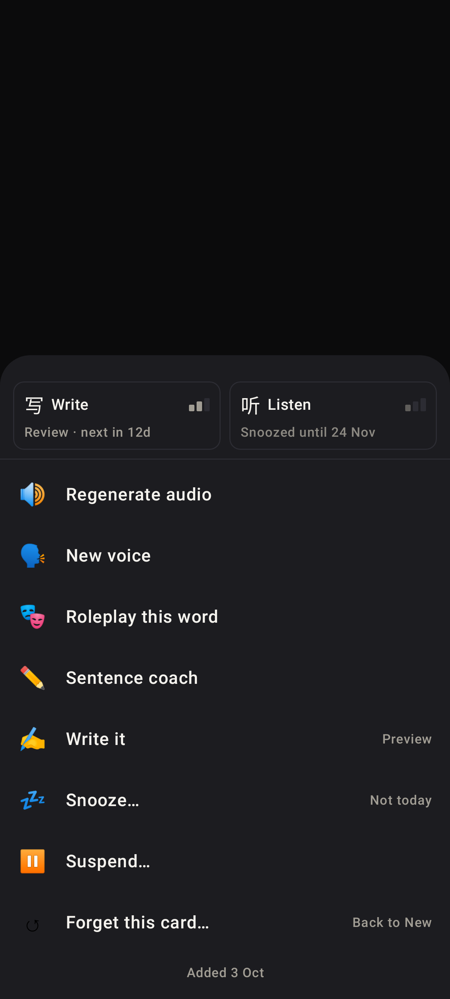

A tile's sheet — ⚡ Study it today · Snooze… · Suspend… · Open card details (a new card: nothing to forget):

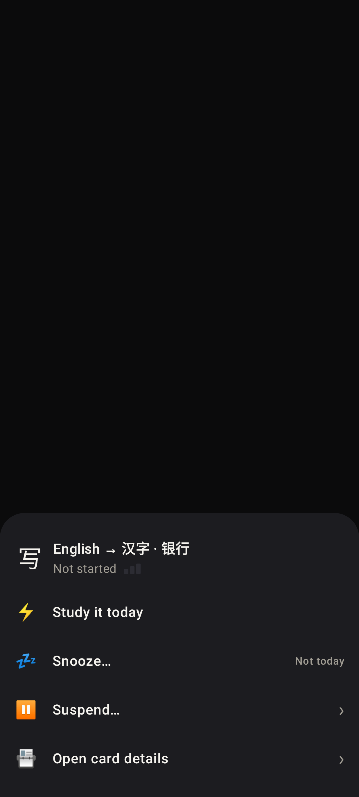

After ⚡:

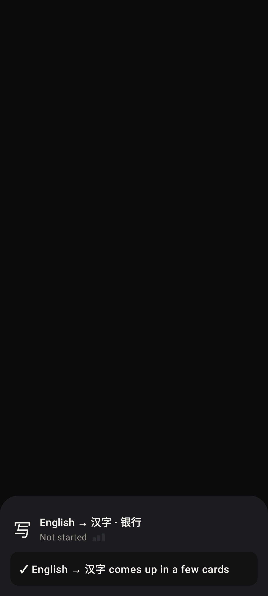

A known card's sheet — ⚡ reviews it early, Forget is offered:

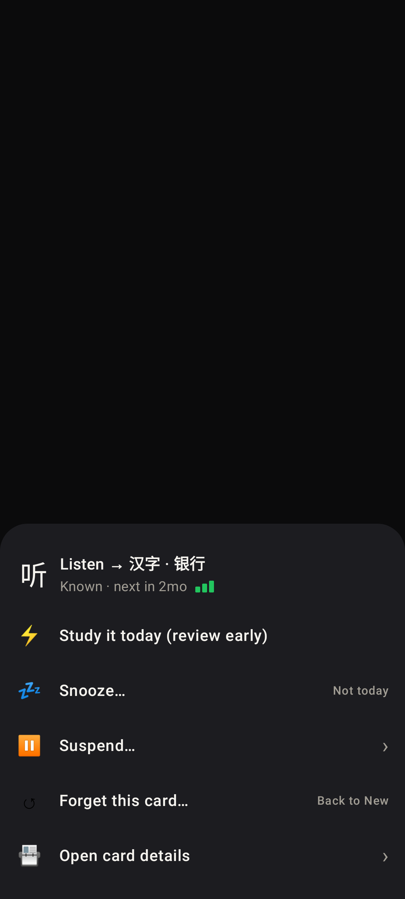

A word with no audio — no listening card (dashed, disabled tile):

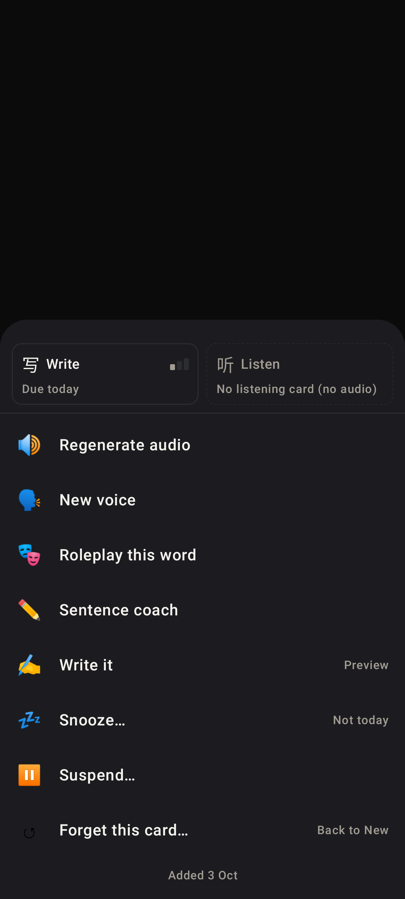

## Web app

The ⋯ menu on the answer side of a read card — two tiles, "Practise this word other ways…" gone:

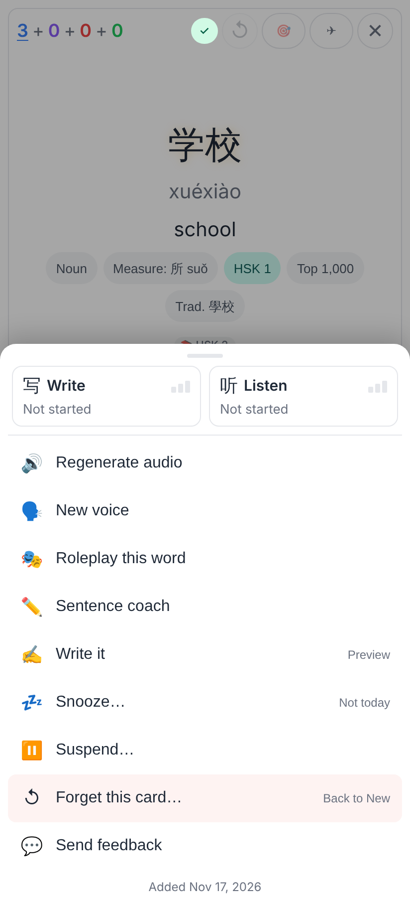

Tap 写 Write → its sheet:

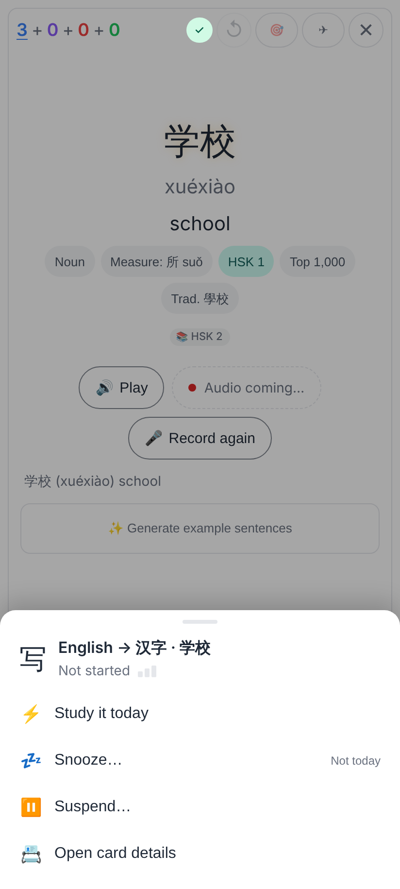

After ⚡ Study it today:

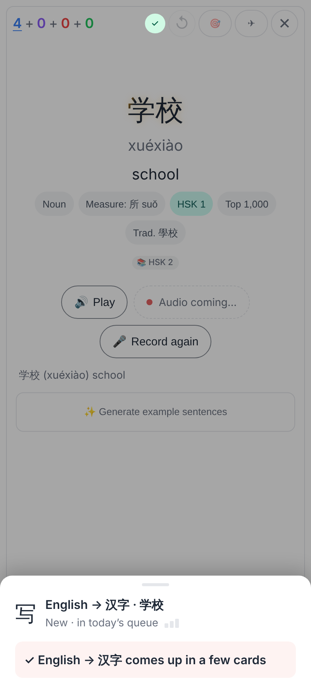

Back in ⋯ — the Write tile now says "New · in today’s queue":

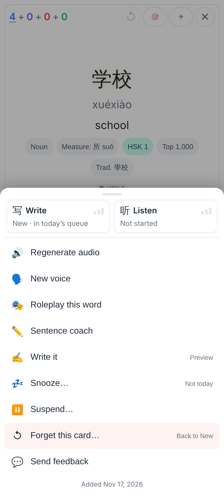

A few cards later the 写 card comes up in the same session with the ⚡ badge:

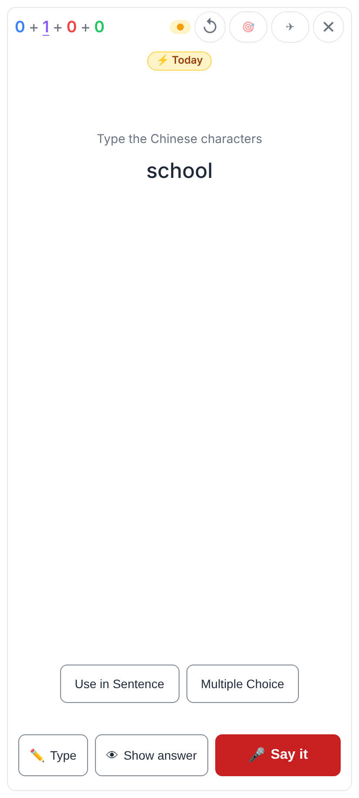
