# Slim answer feedback: one line and a diff

Every "how your answer differs" surface now shows ONE short line (what differs, in words) and his answer lined up
with the expected one: **wrong** = rose with a solid underline, **extra** = yellow in a solid amber box, **missing** =
the expected character muted in a dashed slot, **tone off** = a lemon wavy underline, a homophone that sounded right =
a quiet dotted line. No explanations, tips or reasons. Phone 412×915 @2×; the Lab shots are in the dark theme.

## Hard mode: a wrong take on a read card (web)

Before — the take and a "how I said it wrong" block:

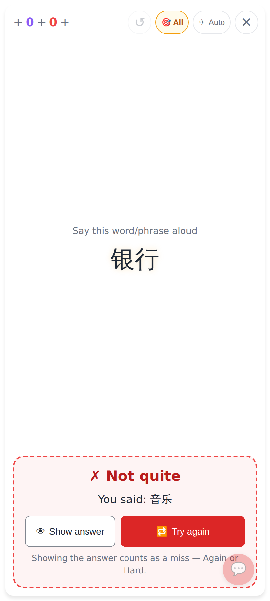

After — "✕ Not quite · 1 wrong character, 1 tone off", then 音 (tone off, wavy) 乐 (wrong, rose):

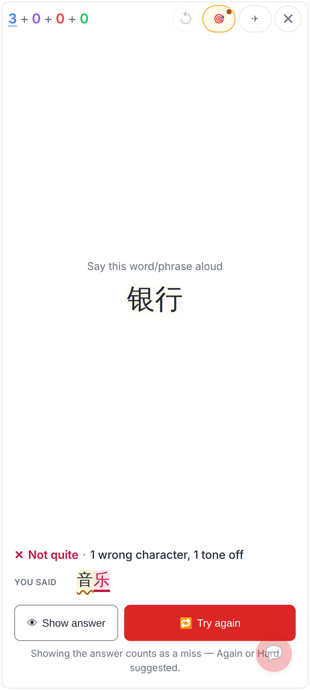

## Hard mode: Claude's check of a read take (web)

Before — Claude's card with its reason:

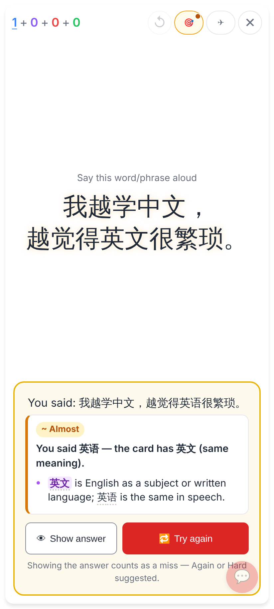

After — "≈ Almost · 语 instead of 文" and the take with 语 marked:

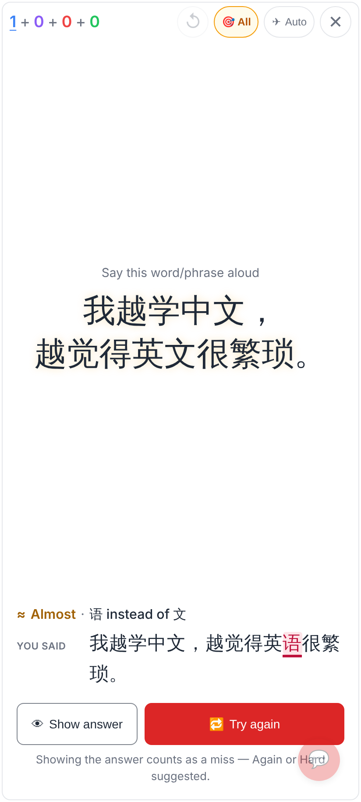

## Sentence check (web)

Before — the answer, the diff, Claude's verdict, "Your wording, fixed:" and tips:

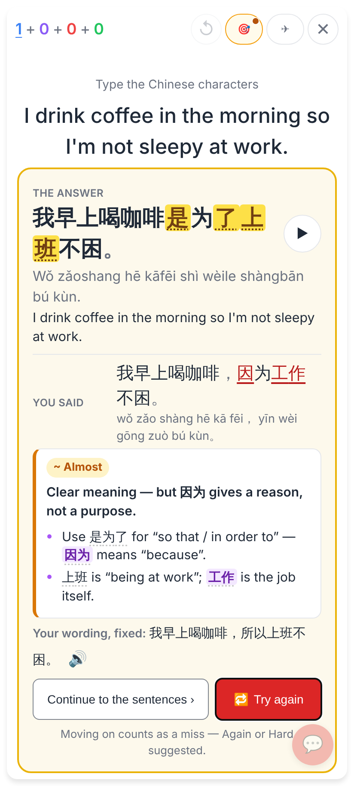

After — one line with Claude's chip, the answer once with ▶, and his sentence marked:

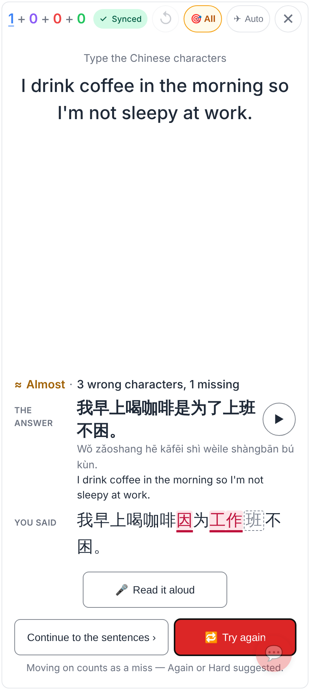

## Mini lesson: translate "Almost" (web)

Before — Claude's card: headline, corrected line, tips:

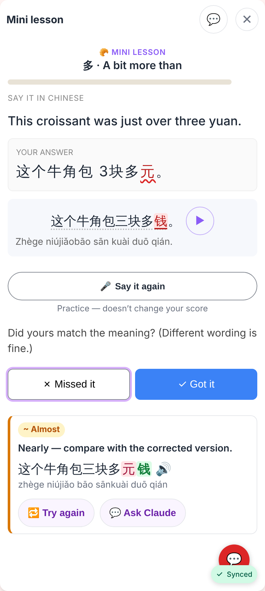

After — the chip and the first sentence of Claude's headline; his answer marked against the model answer:

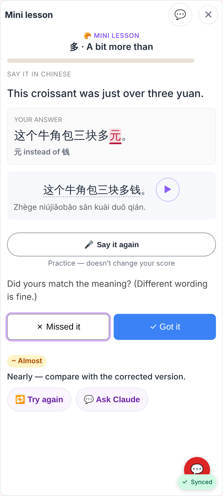

## Reader: 🎤 Read it aloud (web)

Before — a line plus difference rows with a reason per character:

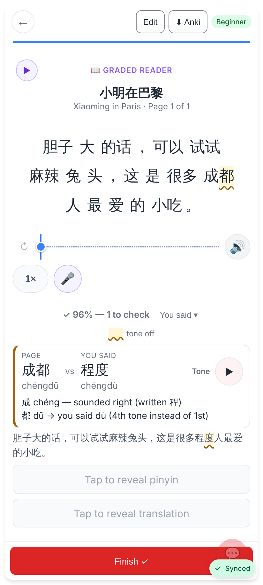

After — "✓ 96% — Tone off on 都", the page marked in place; the rows only behind "You said ▸":

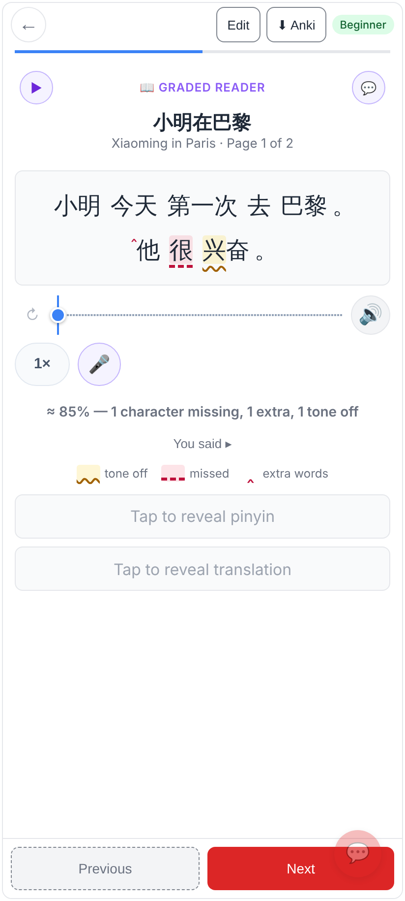

You said ▸ opened (no reasons in the rows):

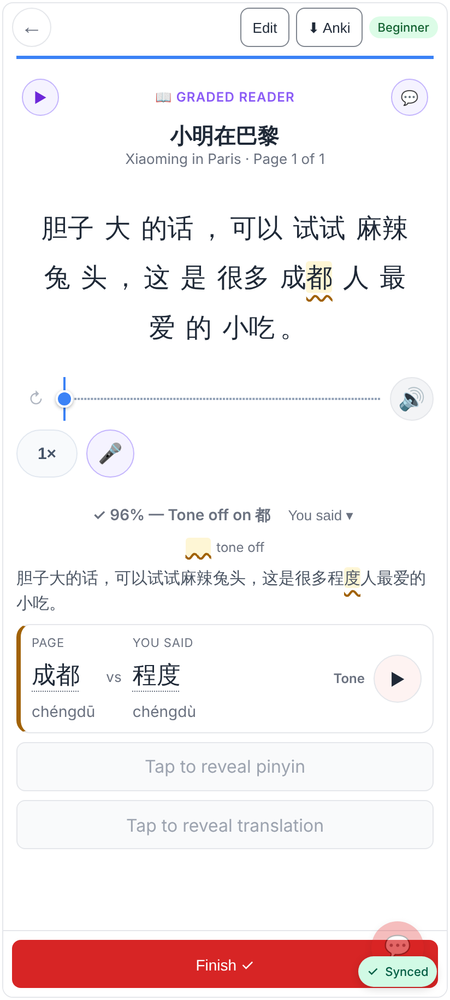

## Lab: Hard mode wrong (dark)

Before (light, the old block):

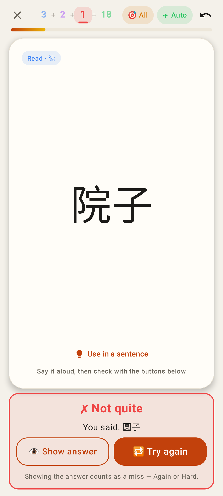

After — 圆 tone off, the extra 了 in an amber box ("1 extra character, 1 tone off"):

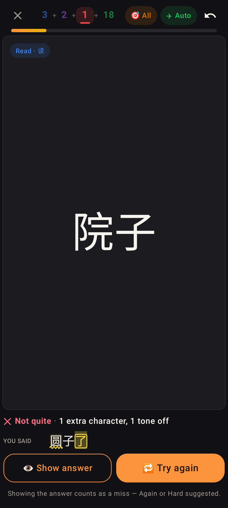

## Lab: homework pass sentence check (dark)

Before:

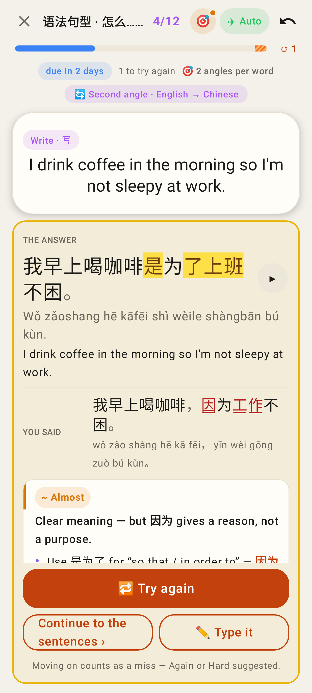

After — "≈ Almost · 3 wrong characters, 1 missing", the answer once, his sentence marked (missing 班 in a dashed slot):

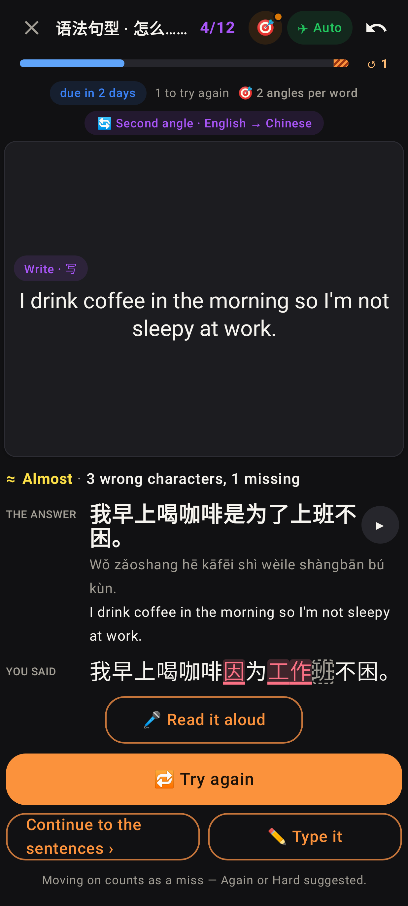

## Lab: reader read-aloud differences (dark)

Before:

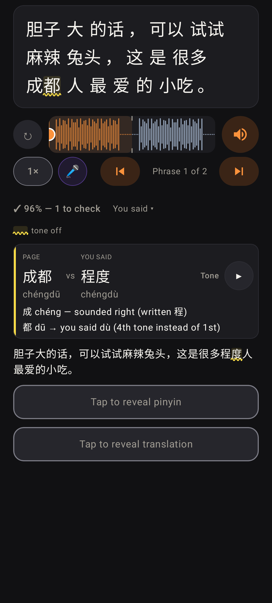

After:

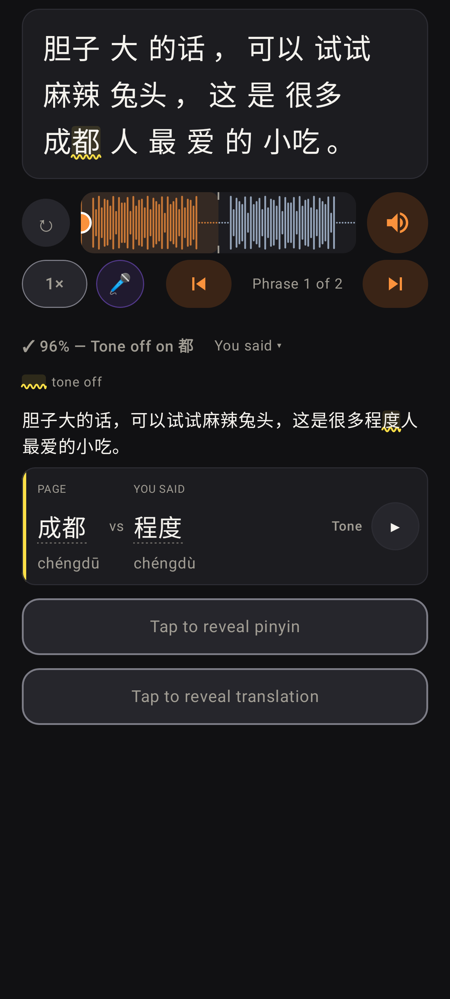

## Lab: 👁 Show answer after a take (dark)

"≈ Tone off on 院", the answer once with ▶, his take lined up under it:

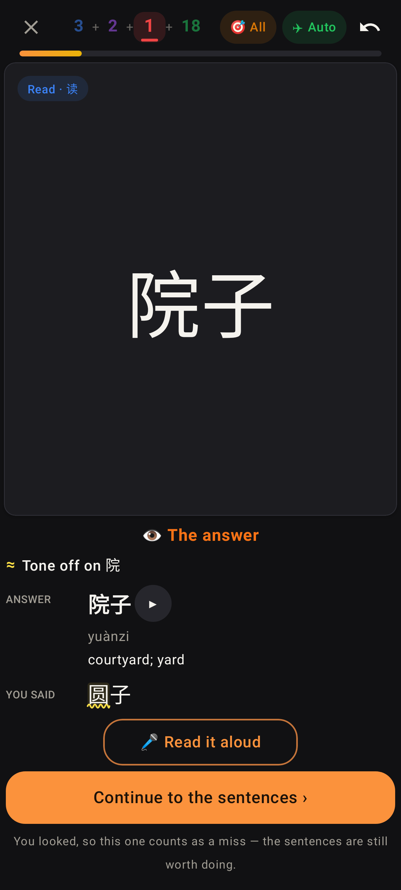
