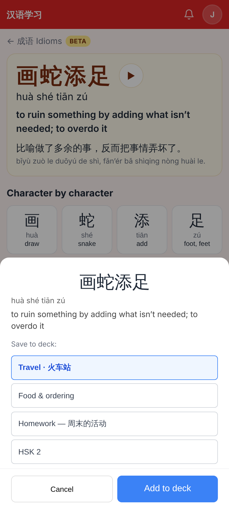
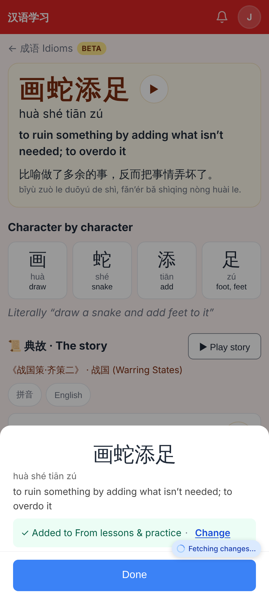
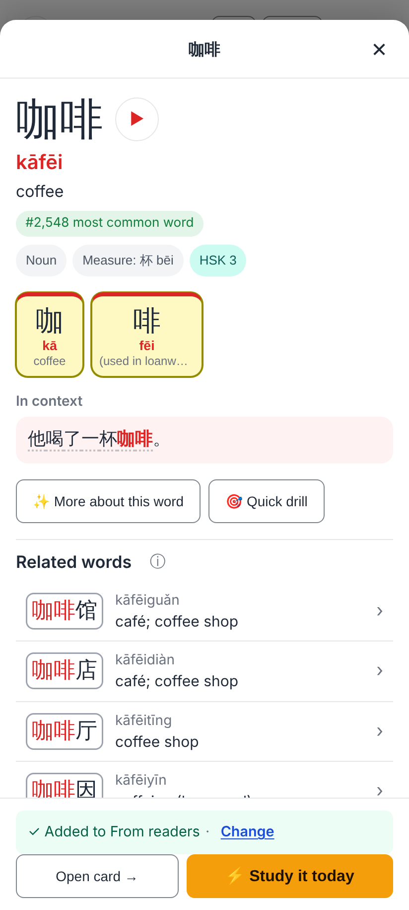
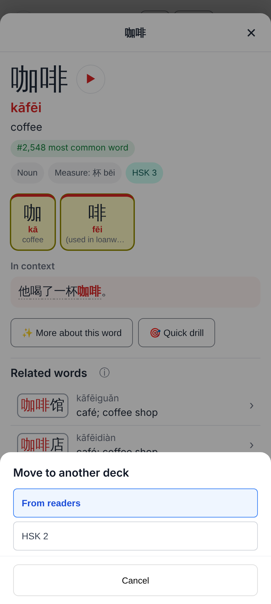
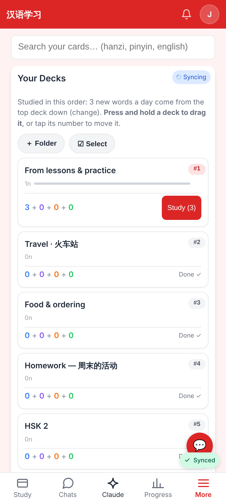
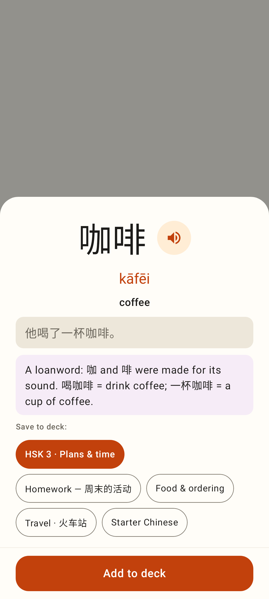
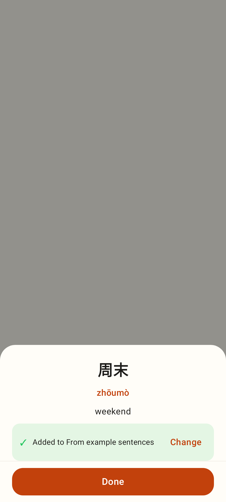
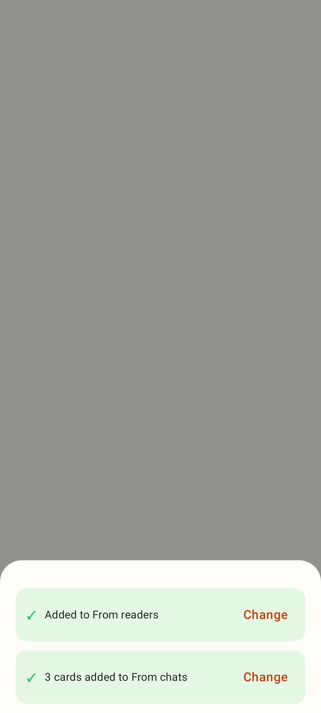
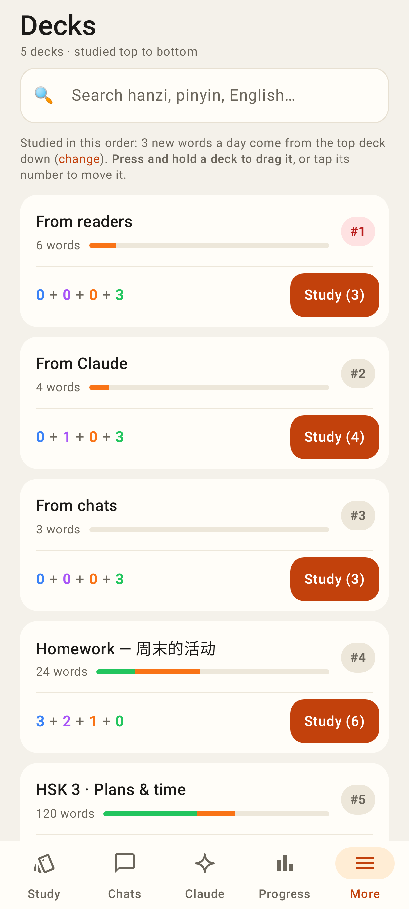

# Source decks — screenshots

Cards added from around the app go straight into a deck per source ("From readers", "From chats",
"From example sentences", "From Claude", "From the explorer", "From lessons & practice"). No deck
picker; the sheet says where the card went, with **Change** to move it.

## Web (412×915 @2×)

Before: "+ Add as card" on an idiom opened a deck list. You picked a deck, then tapped "Add to deck".

After: the same tap saves the card into "From lessons & practice". The sheet shows "✓ Added to … · Change" and a Done button.

A reader word in the language explorer. "+ Add as card" saves the card right there, into "From readers". There is no extra sheet.

Change lists the decks in study-queue order, with the current deck marked. Tapping a deck moves the note there.

The Decks list. A source deck is an ordinary deck: it can be renamed or moved, and it starts at the top of the queue.

## Lab app (Roborazzi, 412×915)

Before: the reader word sheet's deck chips.

After: the card is saved straight into "From example sentences". The sheet shows "✓ Added to … · Change" and a Done button.

The confirmation line for one card and for three cards.

The Decks tab, with three source decks among the other decks.
