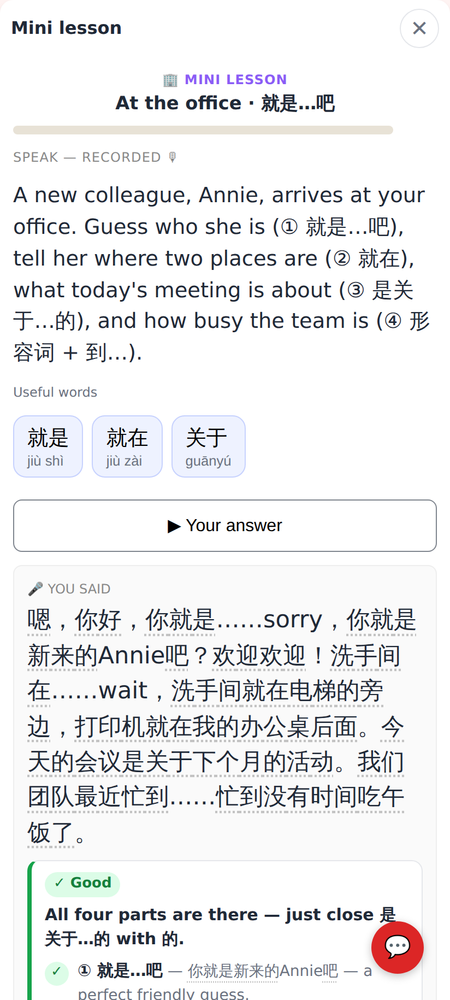
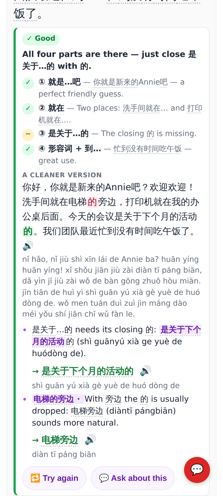
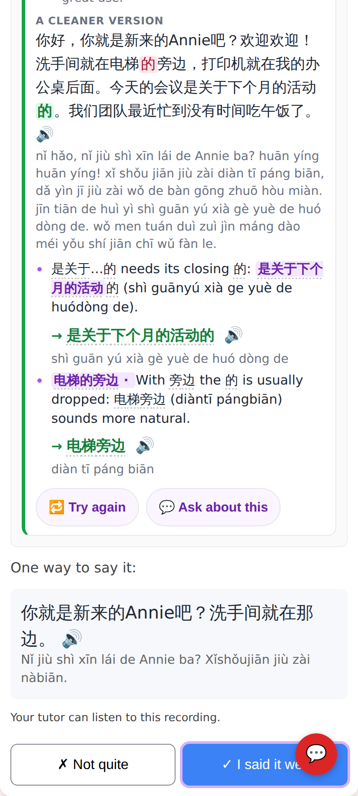
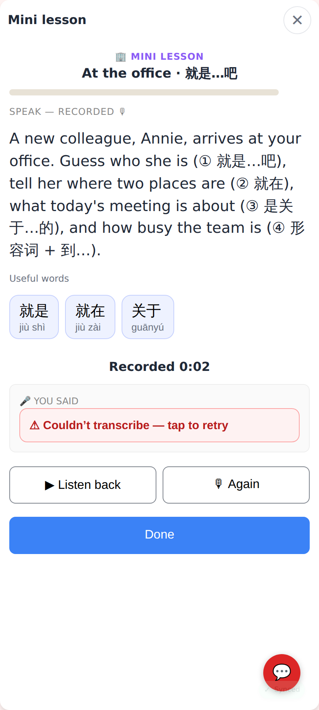
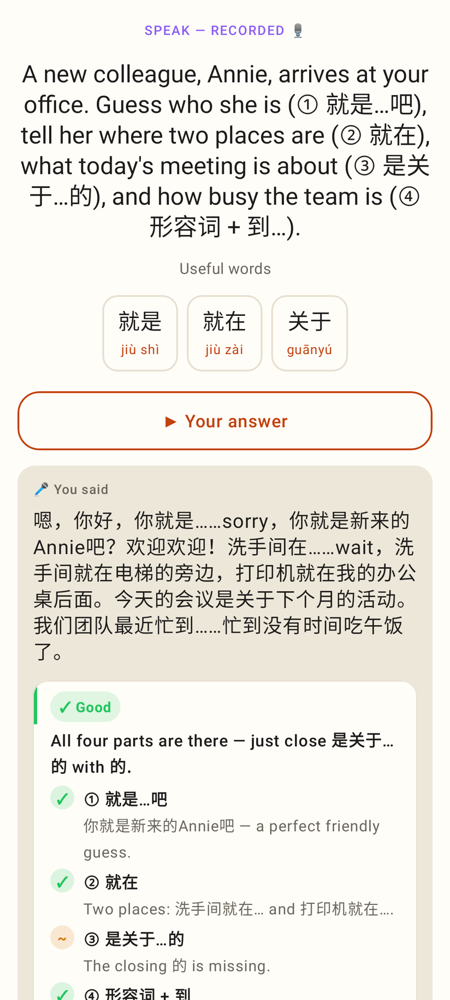
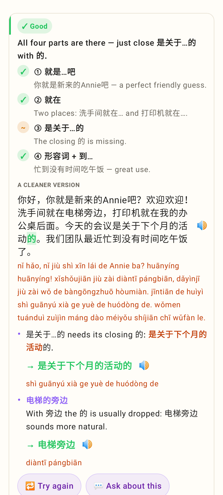
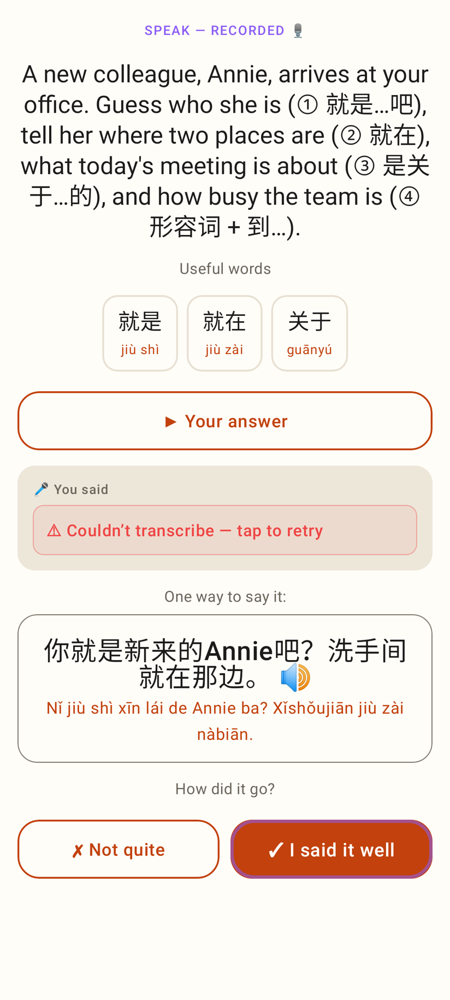

# Claude checks your speaking — screenshots

Jerome's real task: "Annie arrives at your office… (① 就是…吧) (② 就在) (③ 是关于…的) (④ 形容词 + 到…)",
answered with restarts, "sorry", "wait" and repeats (E2E fake checker). Phone 412×915 @2×.

**Web**

The take transcribed: "🎤 You said" with tappable Chinese, the check underneath once Done is pressed.

✓ Good · the task's four parts (③ ~ the closing 的 is missing) · a cleaner version (fixes in green, the false starts gone) + pinyin · tips quoting his words → the better words + pinyin.

🔁 Try again · 💬 Ask about this · One way to say it · ✓ I said it well ringed (the suggestion).

Live and upload both failed: "Couldn't transcribe — tap to retry" sends the same take again.

**Lab app** (Roborazzi)

The same transcript and parts in the native app.

A cleaner version with the fix in green, tips with → the better words 🔊 and pinyin.

"Couldn't transcribe — tap to retry".
