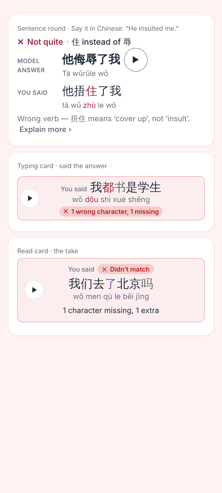
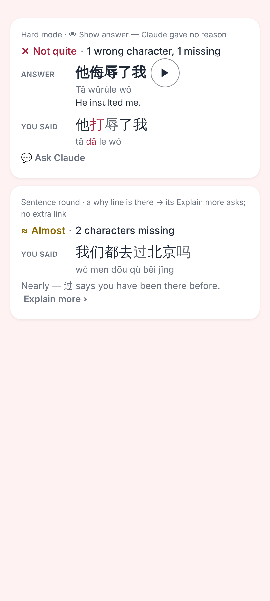
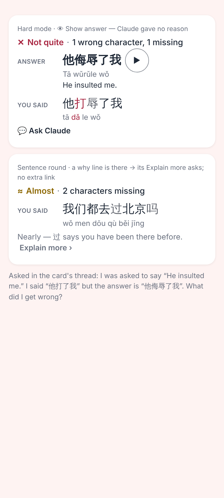
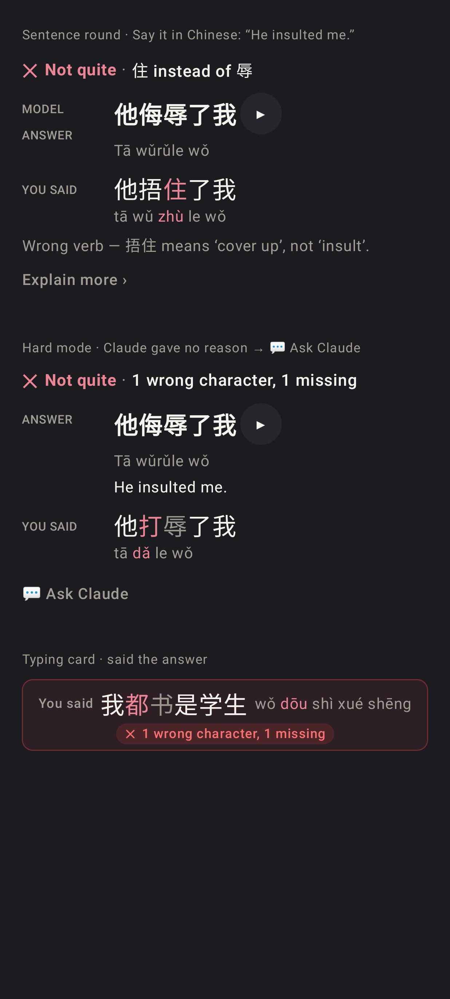
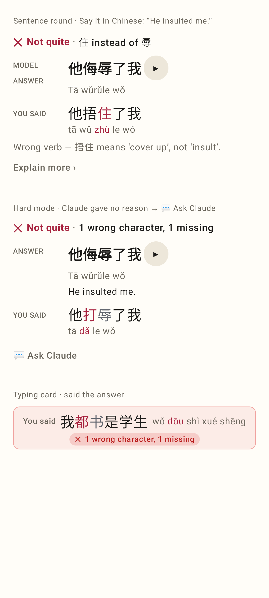

# Speech: punctuation never counts · his pinyin under "You said" · 💬 Ask Claude fallback

Phone viewport (412×915 at 2×). Web in light, the Lab app in dark and light (Roborazzi).

Web: the Sentence round's "Say it in Chinese" (他侮辱了我 → he said 他捂住了我) now shows HIS pinyin under "You said" —
`tā wǔ zhù le wǒ` with `zhù` in the same rose as 住, right under the model's `Tā wǔrǔle wǒ`. The typing card's compact
"You said" row and the read card's box mark their pinyin the same way (extra 了 → violet `le`).

Web: an answer judged ✕ with no reason from the check ends in ONE small muted "💬 Ask Claude" link. With a why line
(below it), there is no extra link — its "Explain more ›" asks instead.

Tapping it opens the card's Claude thread with the question sent (here echoed under the panel): "I was asked to say “He
insulted me.” I said “他打了我” but the answer is “他侮辱了我”. What did I get wrong?"

Lab app, dark: the same three cases (Sentence round with Claude's reason, Hard mode with no reason → 💬 Ask Claude, the
typing card's spoken row with its pinyin).

Lab app, light.
