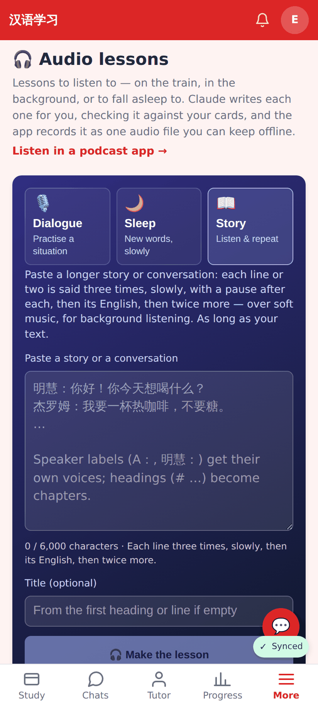
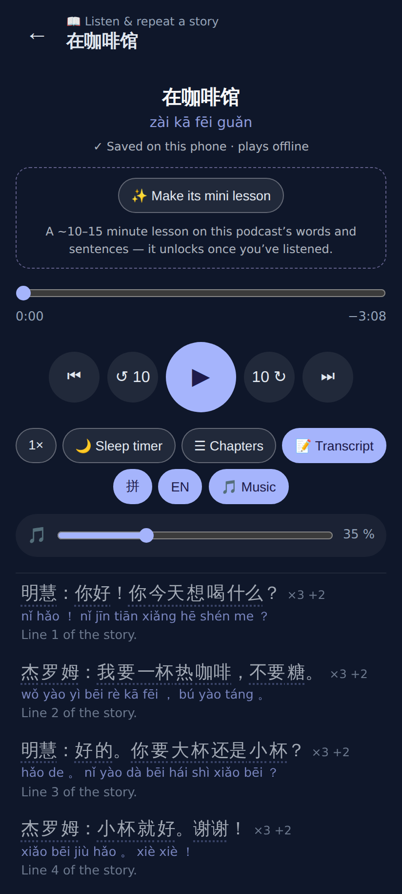
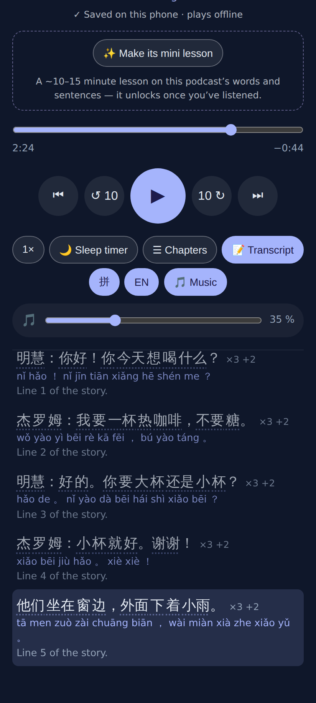

# Story format: ×3, the English, ×2 more

Phone viewport (412×915 @2×), E2E_TEST_MODE (fake translation + silent clips).

The Story choice: the blurb and the estimate line say "then its English, then twice more".

The player: each chunk is still ONE transcript row, now "×3 +2" (three times, the English, twice more).

Tap a row → it plays from there; the current-row highlight stays on that row through all five plays and the English.
