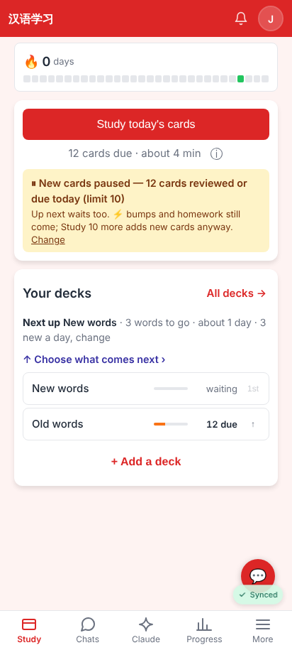
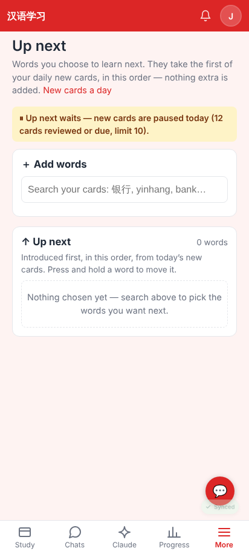
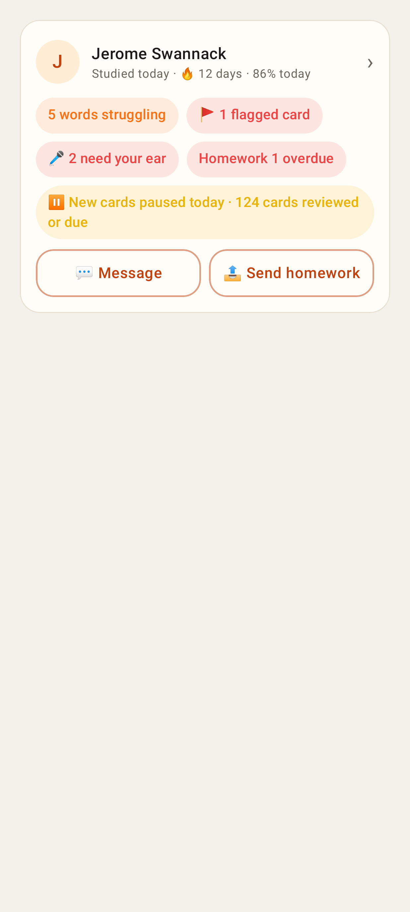

# Study day audit — screenshots

The only UI change is the wording of the "Pause new cards on heavy days" line: the load counts
CARDS (each once, the ones already reviewed today included), so it now says
"N cards reviewed or due today" instead of "N reviews due today" — which, beside Home's
"132 reviews today" (every rating), read as a contradiction. Before:
[../review-load-cap/02-home-paused.png](../review-load-cap/02-home-paused.png) (web),
[../review-load-cap/lab-02-home-paused.png](../review-load-cap/lab-02-home-paused.png) (Lab).

Web Home on a paused day: "New cards paused — 12 cards reviewed or due today (limit 10)".

Web Up next page while paused.

Lab Home on a paused day: "New cards paused — 124 cards reviewed or due today (limit 100)".

Lab tutor dashboard chip: "⏸ New cards paused today · 124 cards reviewed or due".
