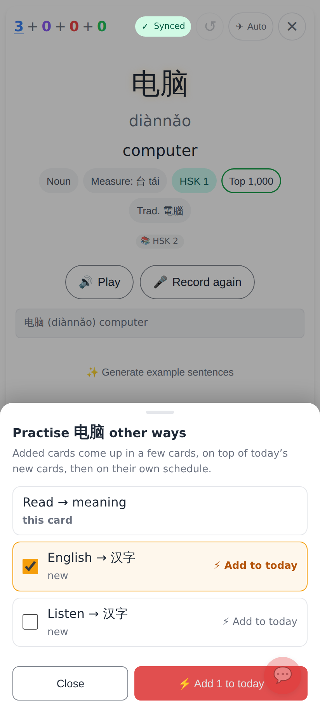
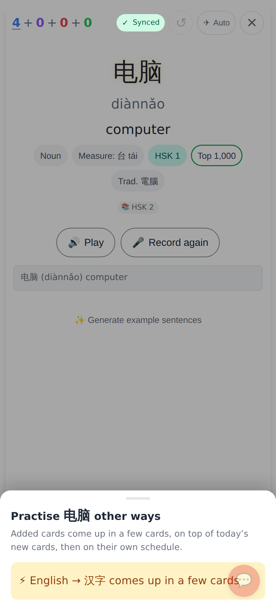
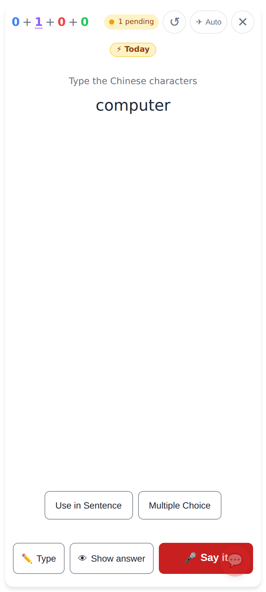
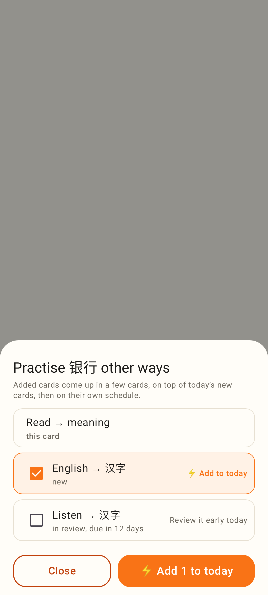
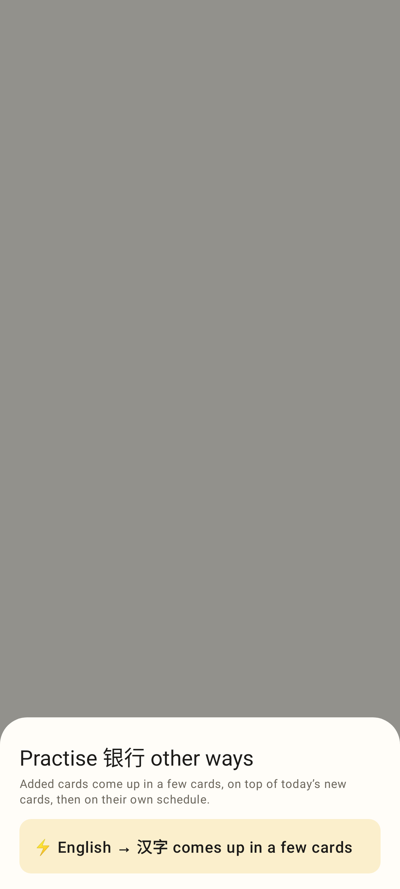

# "Practise this word other ways…" — screenshots

Web (412×915, 2×), from `e2e/tests/other-card-types.spec.ts` with `SHOTS=1`:

⋯ → Practise this word other ways… on a read card: English → 汉字 is new and ticked, Listen → 汉字 offered too.

After "⚡ Add 1 to today": the card-level bump is made; the sheet closes by itself.

A few cards later in the same session: the English → 汉字 card of that word, with the ⚡ Today badge (purple: a started word's new card).

Lab app (Roborazzi, Pixel Fold phone width):

The same sheet: this card · new (ticked) · in review, due in 12 days → Review it early today.

Both siblings ticked: "⚡ Add 2 to today".

After adding.
