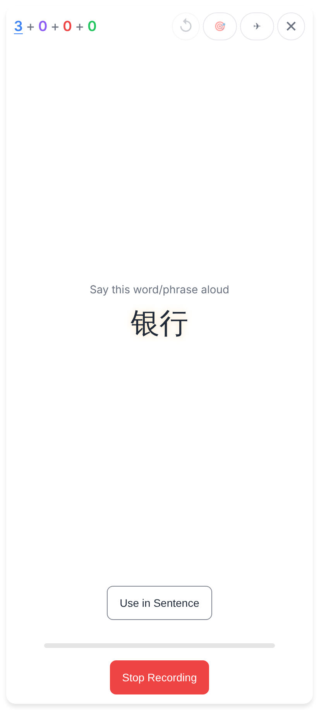
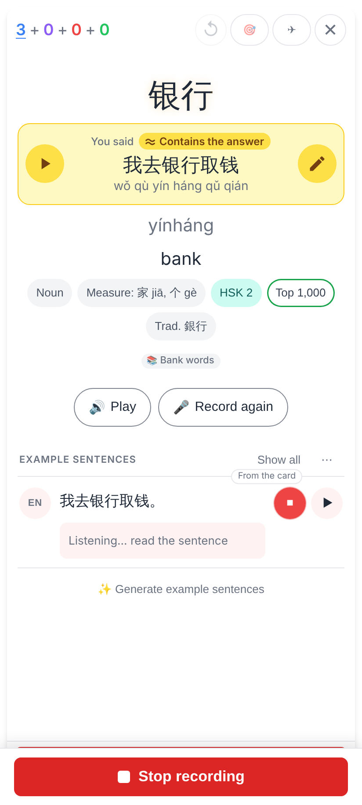
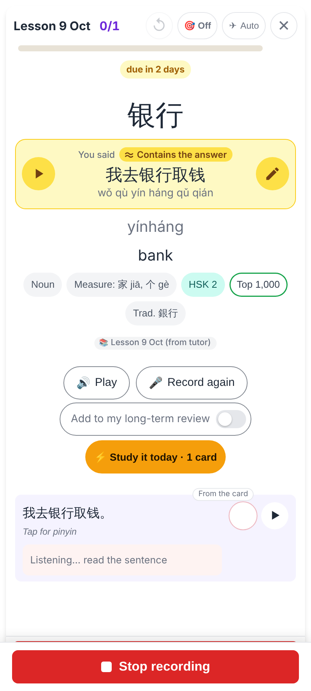
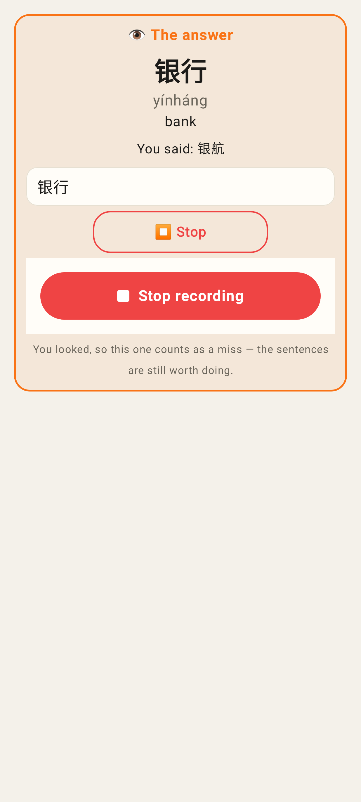
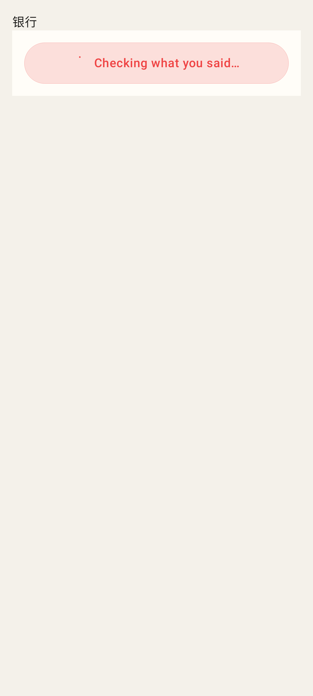

# The take lock — screenshots

While a voice take records, nothing on the screen advances, rates, closes or navigates: the footer's
primary action becomes ONE red "■ Stop recording" in the same place, ✕ / back stop the take first
(docs/STUDY_SESSION.md "While a take is recording"). Phone viewport 412×915 at 2×.

The read card's take on the question — ✕ (top right) now stops the take instead of leaving Study.

A sentence row's 🎤 on the answer side: the action row + Again / Hard / Good / Easy give way to ■ Stop recording — a thumb aimed at Good stops the take, nothing is rated.

The homework pass: Not yet / Got it give way to ■ Stop recording while a take records.

Lab app: Hard mode's answer in place while 🎤 Read it again records — Continue gives way to ■ Stop recording.

Lab app: the stopped take being checked — the footer holds "Checking what you said…" until the result.
