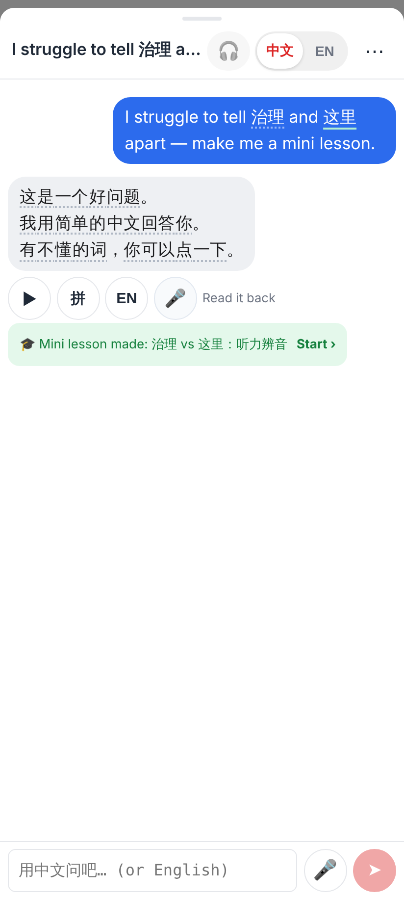
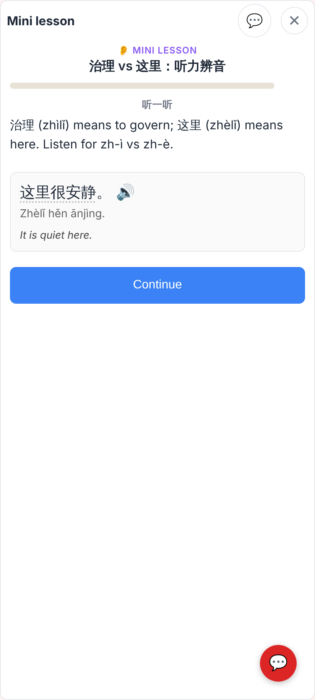
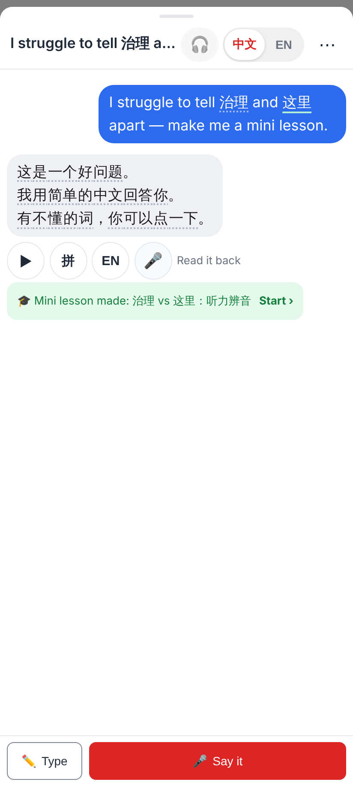
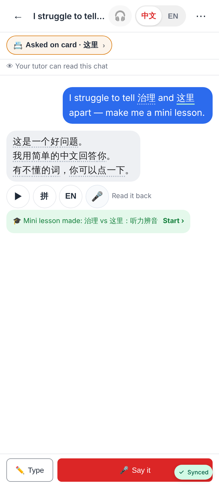
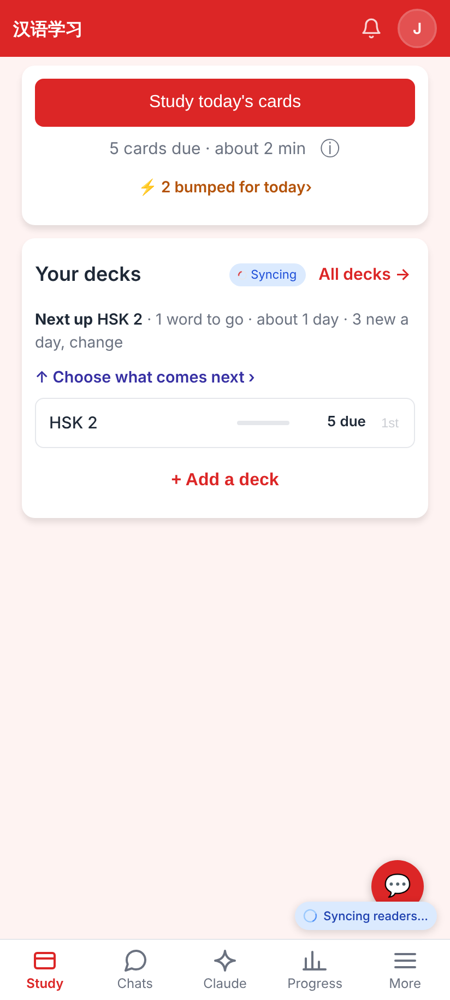
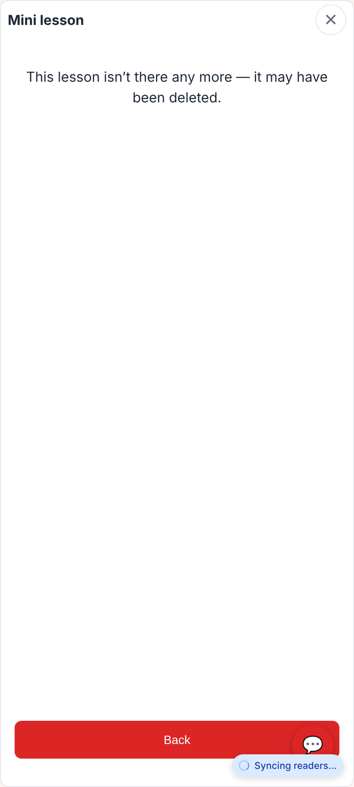
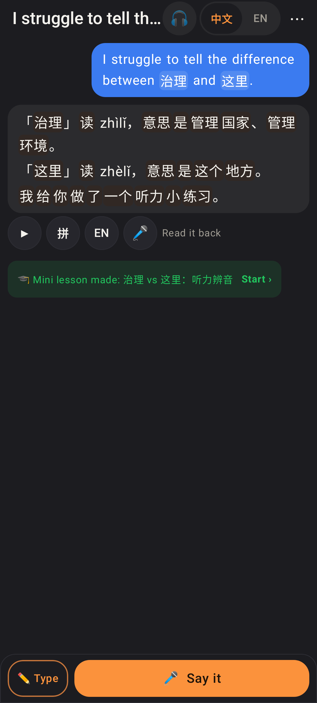
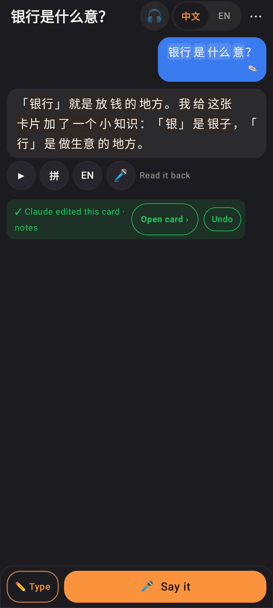
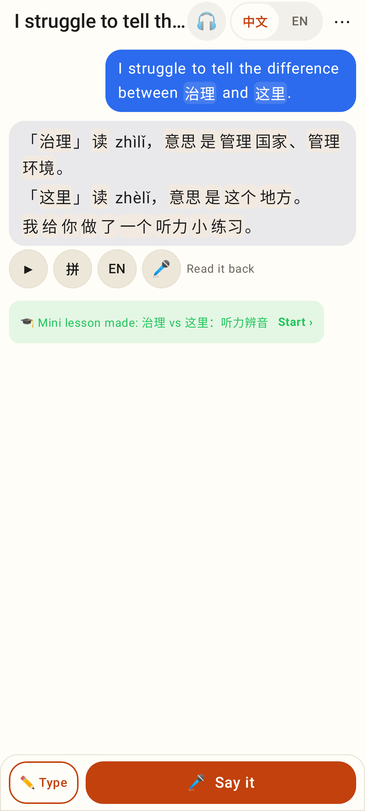

# Tool lines you can tap + flow audit

Phone viewport 412×915 @2×. Web (light) from `e2e/tests/claude-result-links.spec.ts` against the real worker and its E2E stand-in model.

## Web

The study card's Ask Claude sheet: the "Mini lesson made" line is now a button ending in **Start ›** (it no longer says "it's on your Mini Lessons page").

One tap opens the lesson in the player (`/lessons/:id/play?from=claude`).

✕ in the player goes back to the same study card with its Ask Claude sheet open on the same thread.

The same thread as a page from the Chats tab. The line is a link there too, and back from the lesson lands on this thread at the same scroll position.

Audit fix: Home's "⚡ 2 bumped for today ›" line is now tappable.

It opens Up next, where the ⚡ Today list shows the bumped words.

Audit fix: the player first fetches a lesson that isn't on the device. When the lesson is gone, the player says so instead of showing an empty screen.

## Lab app

Roborazzi, `ui/claude/ResultLinksTest.kt`. That test also checks that a tap opens the lesson's path and that the nav back stack brings the card's sheet back open.

Lab, dark: the "🎓 Mini lesson made" line is one tap target ending in **Start ›**.

Lab, dark: "✓ Claude edited this card" keeps Undo and gains an **Open card ›** pill.

Lab, light: the same lesson line.
