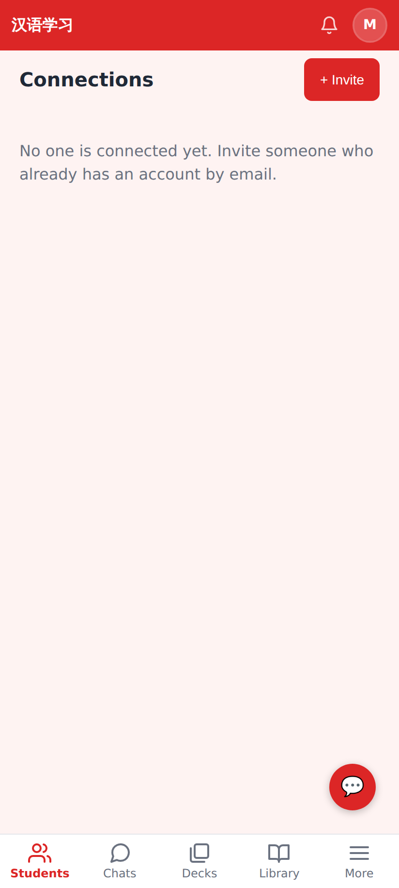
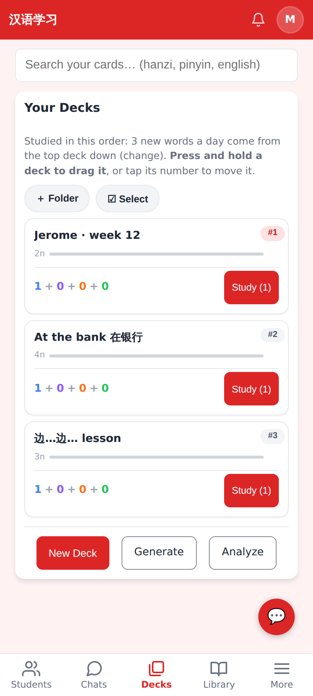
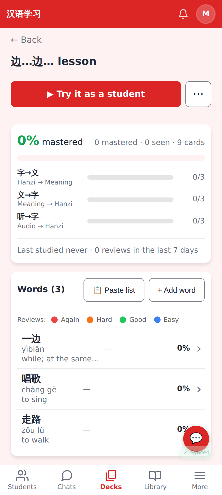
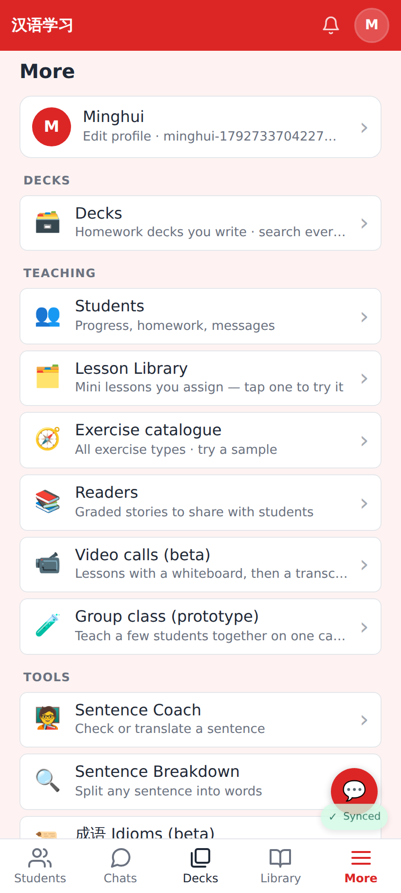
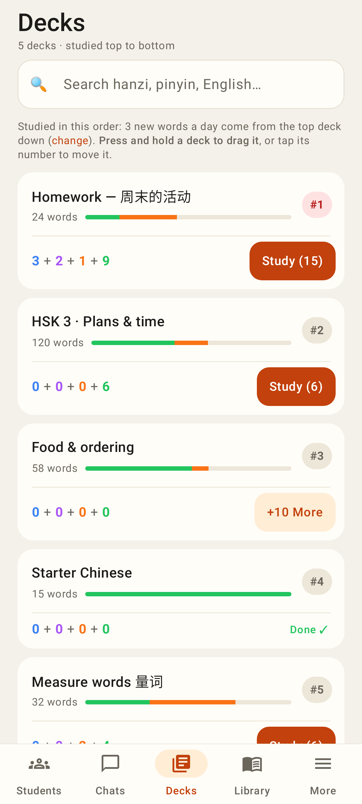

# Tutor accounts: a Decks tab

Web, phone viewport (412×915, 2×), a tutor account (users.role = 'tutor').

The tutor lands on Students; the bar now reads Students · Chats · Decks · Library · More.

Tapping Decks opens the deck list with the Decks tab lit.

A deck page lights Decks (it used to light More).

More still has Decks as its first row.

Lab app: the same tab set for a tutor account, Decks lit on the deck list.
