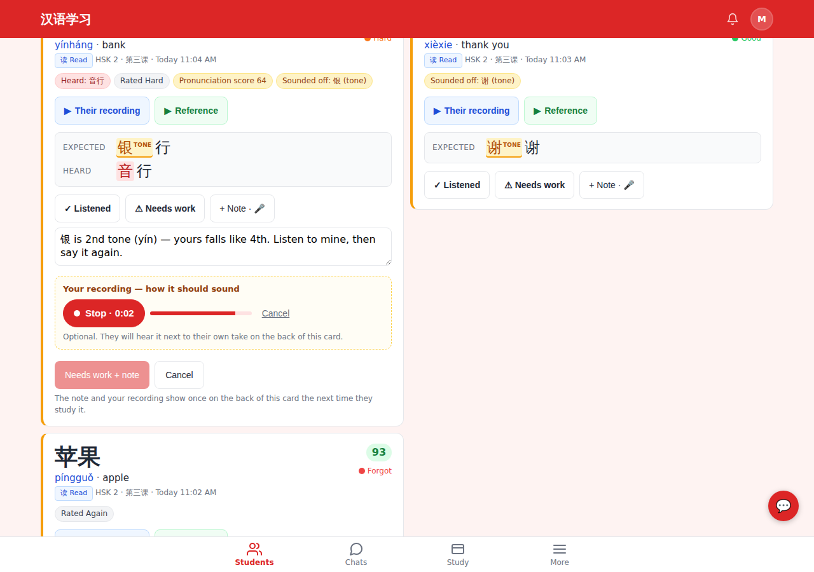
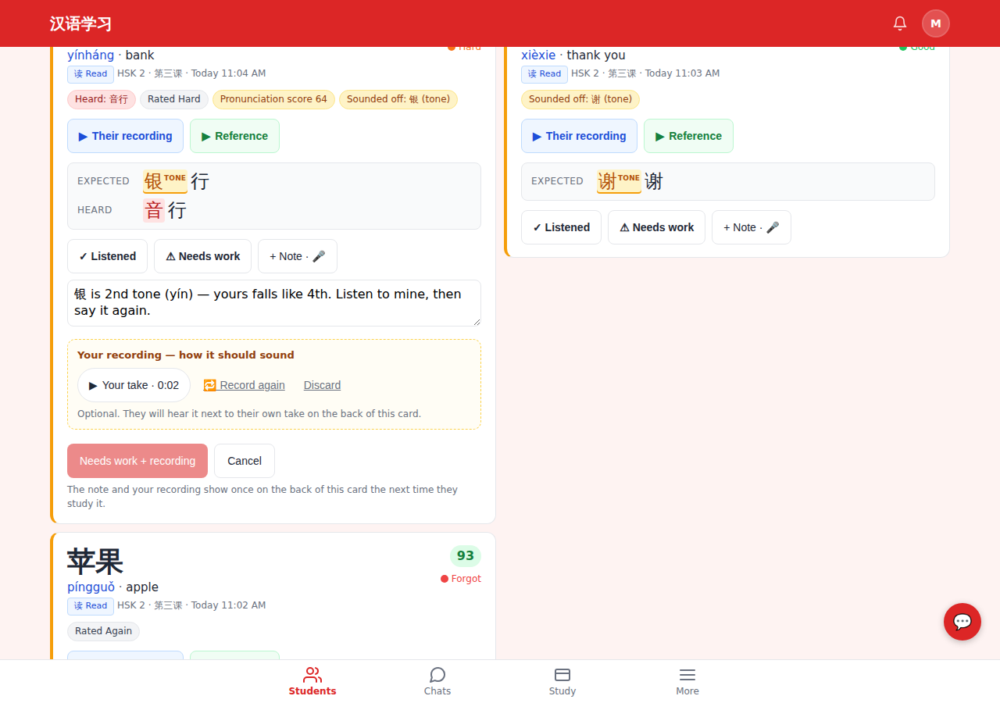
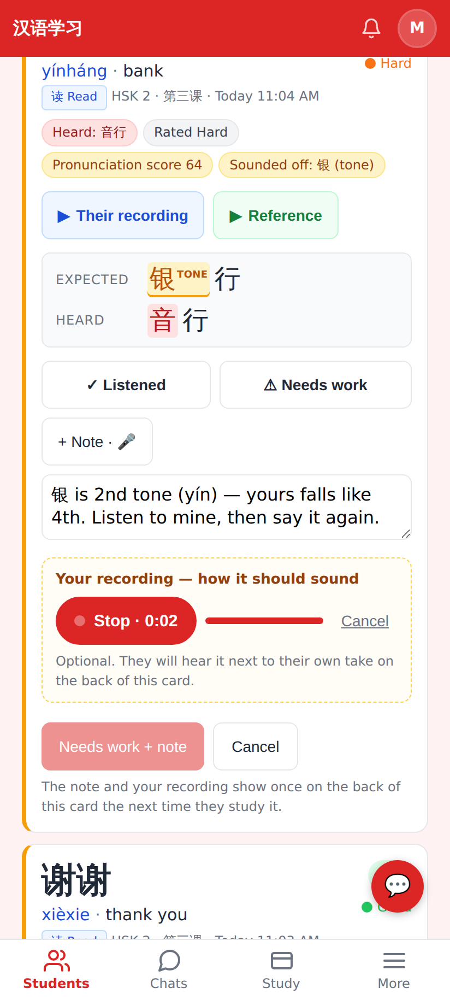
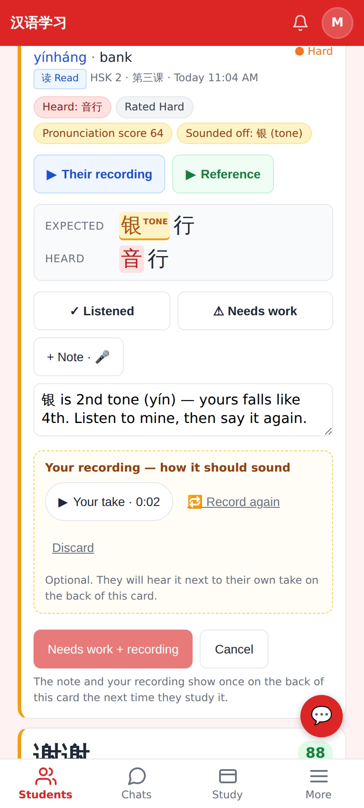
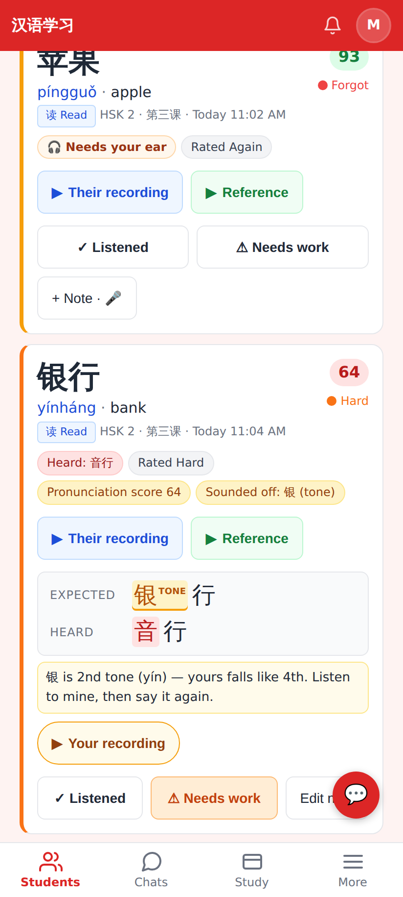
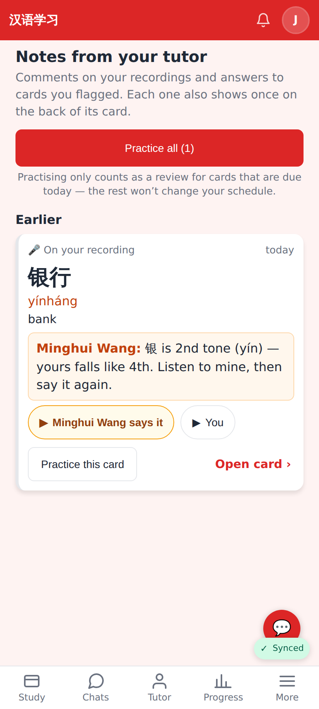
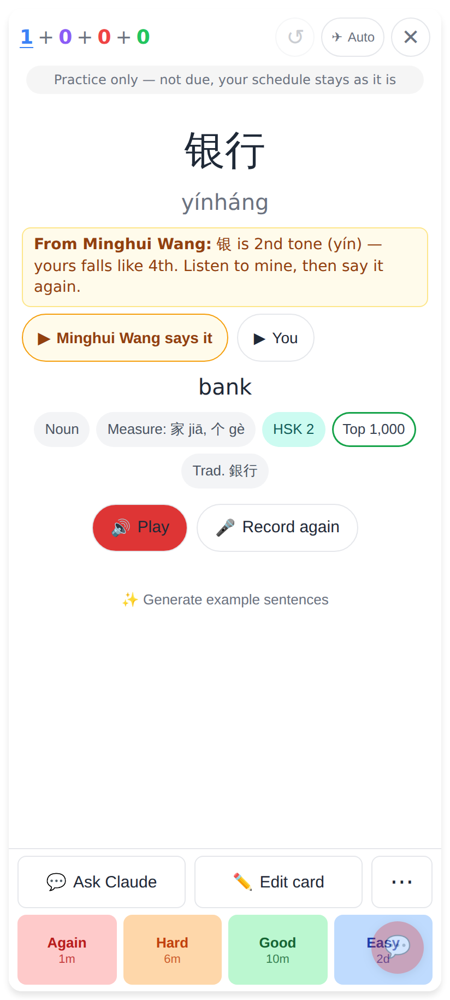

# Tutor model recordings — "how it should sound"

The tutor marks a pronunciation take **needs work** and records her own version; the student hears it
next to his own take. Phone shots are 412×915 @2×; the tutor's recordings page also at 1280 wide.

Tutor, desktop: "+ Note · 🎤" opens the note box — 🎤 Record it → ⏹ Stop · 0:02 with the level; Save waits until the take is in.

Tutor, desktop: ▶ Your take · 0:02, 🔁 Record again, Discard — then **Needs work + recording**.

Tutor, phone: recording.

Tutor, phone: the take before saving.

Tutor, All recordings: the saved needs-work mark shows the note and ▶ Your recording.

Student, Notes from your tutor: "▶ Minghui Wang says it" · "▶ You" under the note.

Student, the back of that card (Practice route): the note with both clips to compare.

Lab app (Roborazzi, `android-lab/app/screenshots/`): `teaching-23g/h/i` (the recorder: take, recording,
unfolded), `tutor-notes-08` (notes page), `tutor-notes-09` (card back).
