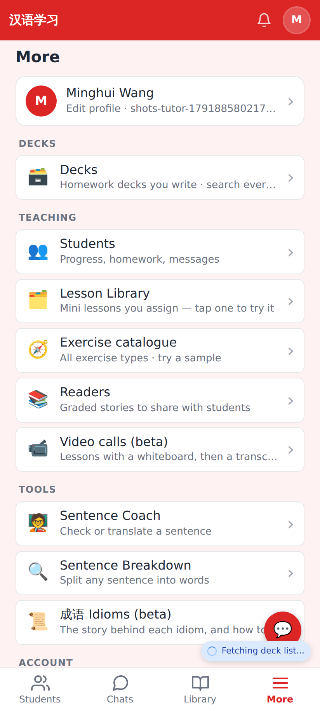
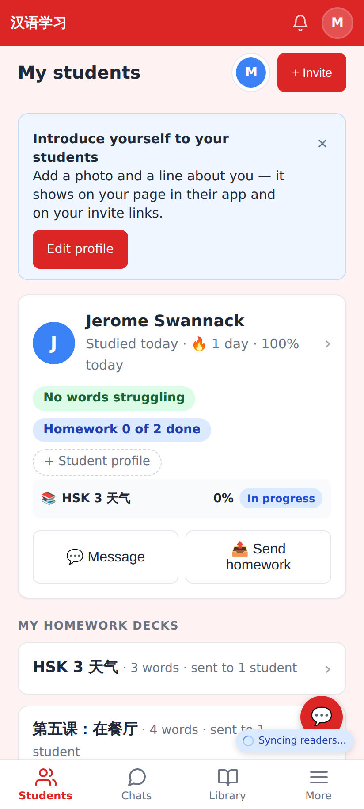
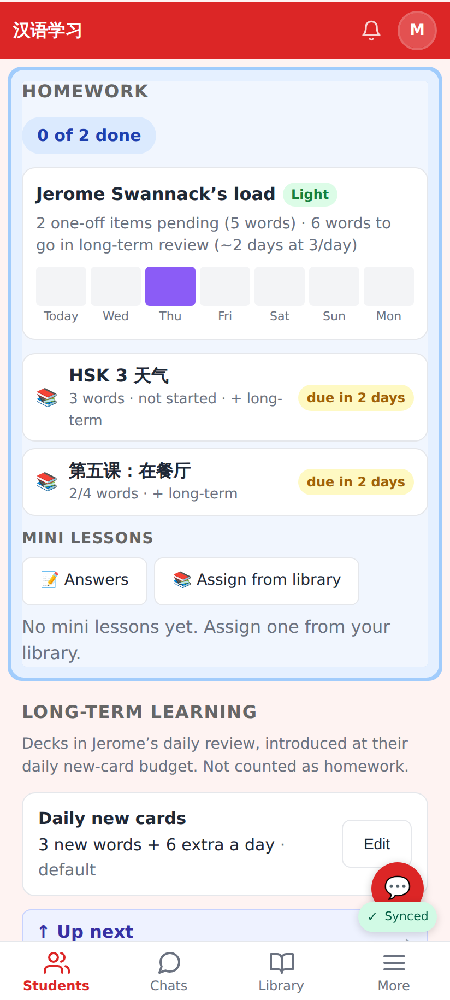
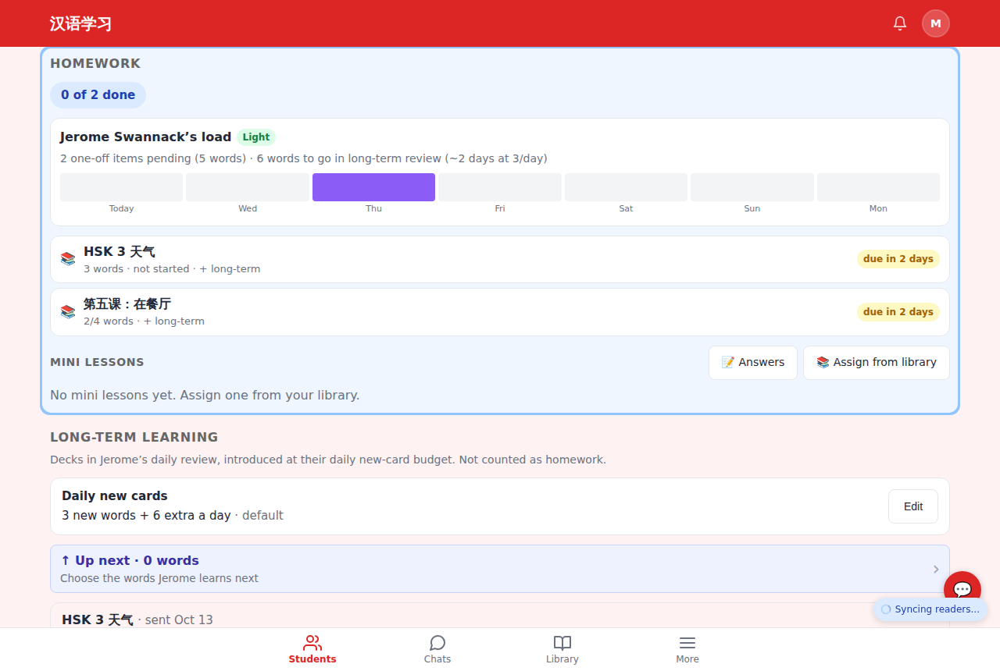

# Tutor UI tidy — menus + homework link

Web, 412×915 @2× (Pixel Fold folded) and 1280 desktop.

More → Teaching without "Homework library" or "Lesson materials".

The dashboard: no "Homework library ›" link; the homework pill and the recent-homework line open the student's Homework section.

Tapping "Homework 0 of 2 done" lands on the student page with the Homework section scrolled into view and flashed.

Desktop: "All homework ↓" on the Most recent homework card scrolls to the same section.
