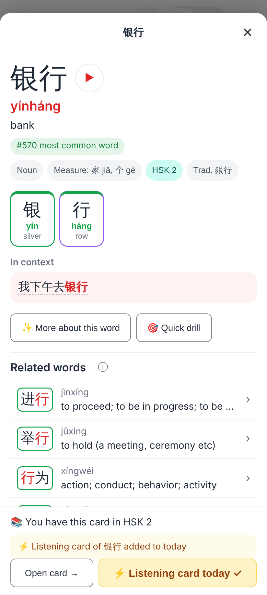
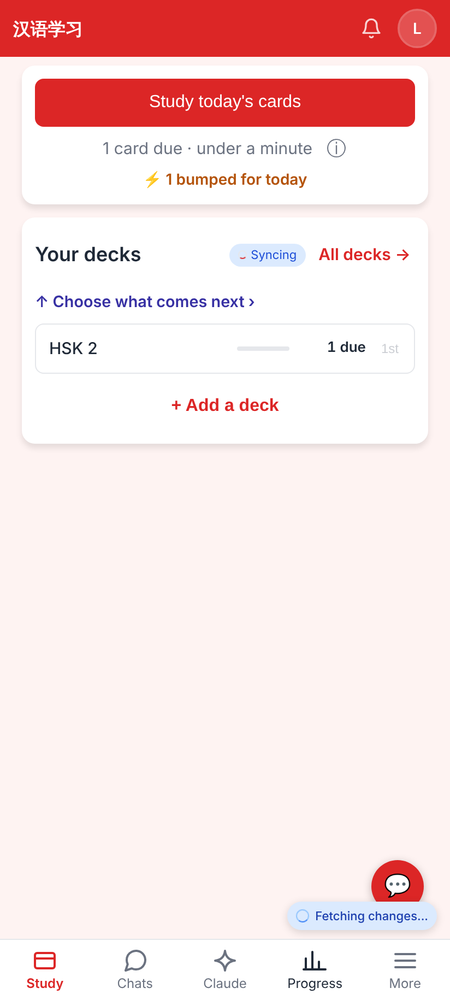

# ⚡ Study it today — one rule from everywhere

Phone viewport (412×915 @2x), captured by `e2e/tests/study-today-listening.spec.ts` with `SHOTS_DIR`.

The language explorer opened from the Coach (Chats box → 🔍 Explain → 银行): ⚡ Study it today on a word not started yet
now adds ONLY its listening card — "⚡ Listening card of 银行 added to today" and the button "⚡ Listening card today ✓"
(before: "⚡ 银行 will come first in today’s study" / "⚡ Today ✓", and all three cards went into today).

Home with a new-card budget of 0: one card due — the listening card — instead of the word's three cards.
