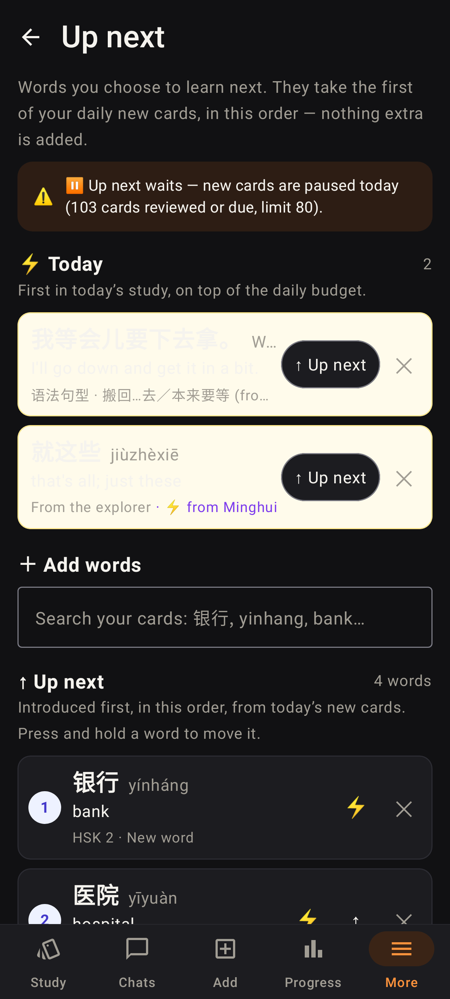
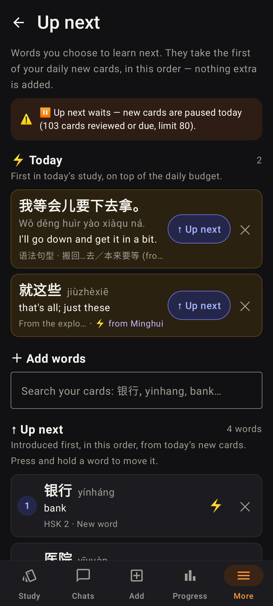
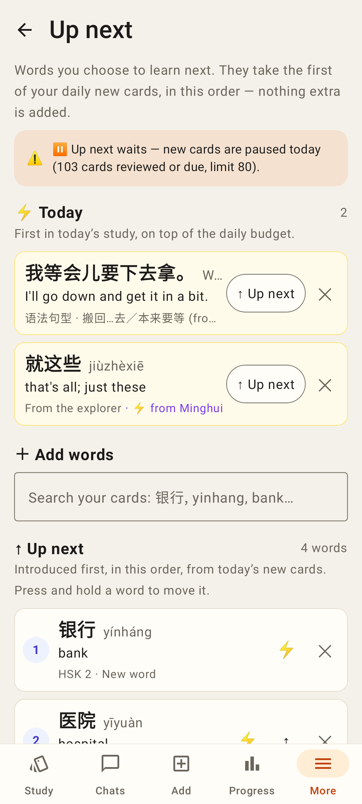
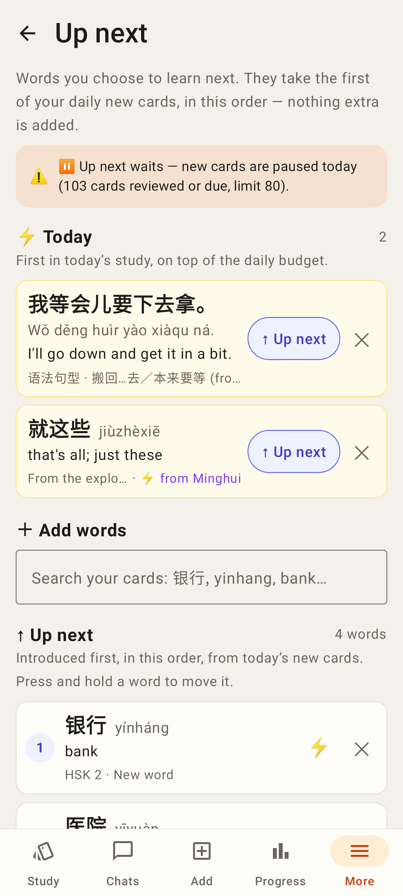
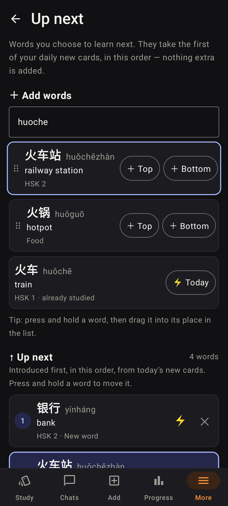
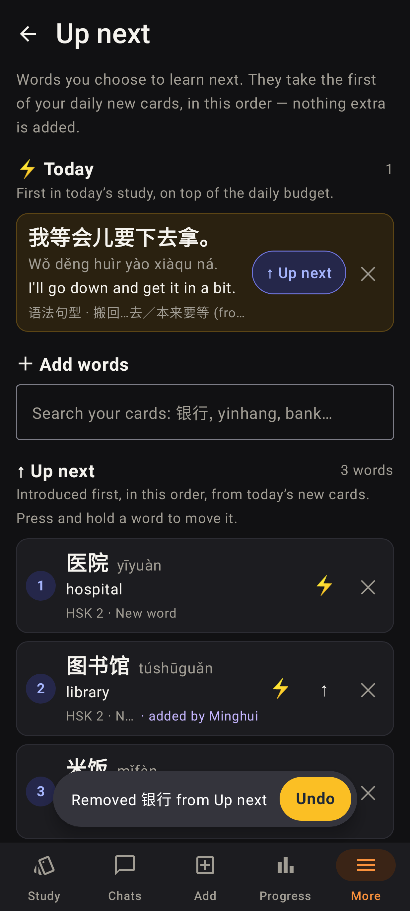
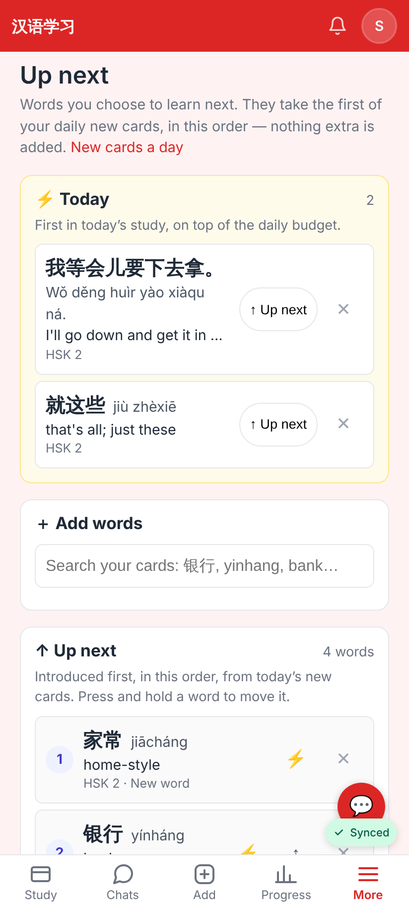
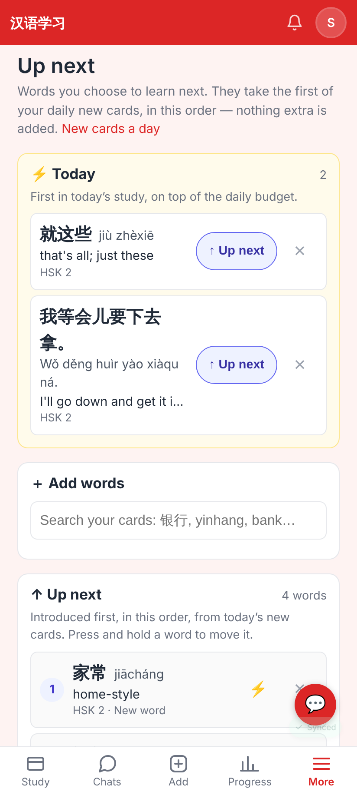

# Up next in dark mode

Phone, 412×915 at 2× (Lab: Roborazzi `UpNextScreenshots`; web: Playwright against the dev server). Sample data only.

## Lab app — dark (the bug)

Before: the ⚡ Today rows were a hard-coded cream card with the dark theme's near-white words on it (我等会儿要下去拿。 and its meaning nearly invisible), the "↑ Up next" pill a black blob, and the sentence's pinyin cut to "W…".

After: a warm amber-tinted dark row, the words in body ink, pinyin / source muted, a tonal indigo "↑ Up next" pill; a sentence's pinyin on its own line; the position badges a dark indigo.

## Lab app — light (unchanged look, same fixes)

Before (light).

After (light): same cream row, the tonal indigo pill, the sentence's pinyin shown.

## Lab app — other dark states

A search result lifted and dropped into the list: indigo edges and the drop-here row from the dark set.

The Undo toast on a lifted grey so it stands off the black page; "added by Minghui" in a light violet.

## Web

The web app is light-only today, so a dark OS setting shows the same light page; the Up next colours are now tokens with a dark set under `data-theme="dark"`, and the ⚡ Today row's "↑ Up next" is the same tonal indigo pill as the Lab's.

Before (light).

After (light): the tonal "↑ Up next" pill.

Before, browser set to dark.

After, browser set to dark: unchanged light page (no dark chips mixed in — `bumps.css` now follows the app theme, not the OS).
