# Up next — screenshots (phone 412×915, 2×)

## Web

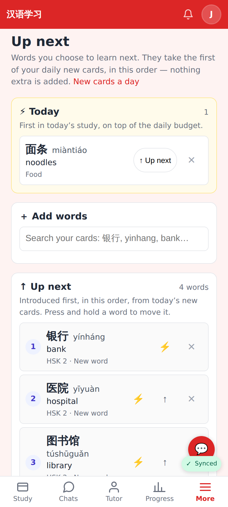
The page: ⚡ Today (the bump pocket, with "↑ Up next" to move a word there instead) above the search and the ordered list; 图书馆 was added by the tutor.

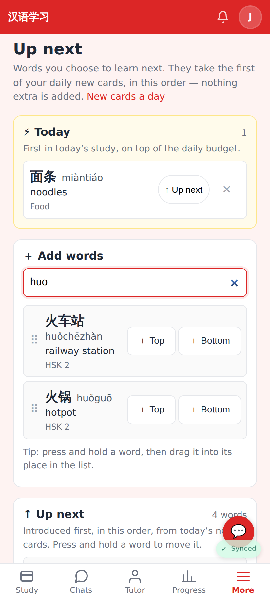
Search ("huo"): each result can go on the list at the top or the bottom, or be dragged into place.

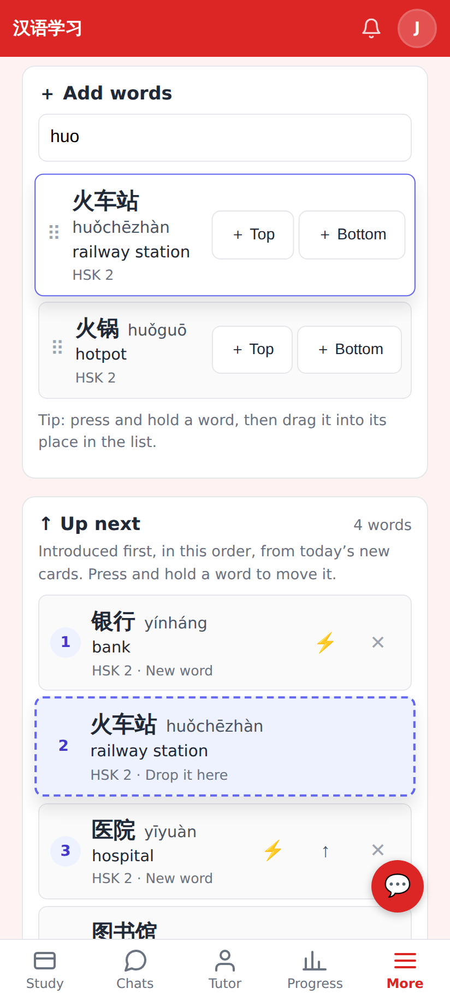
Press and hold 火车站 and drag it: a dashed placeholder shows where it will land (#2).

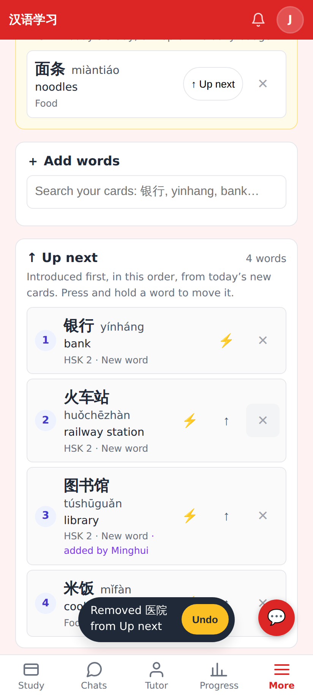
✕ takes a word off the list (the card is kept) and shows Undo.

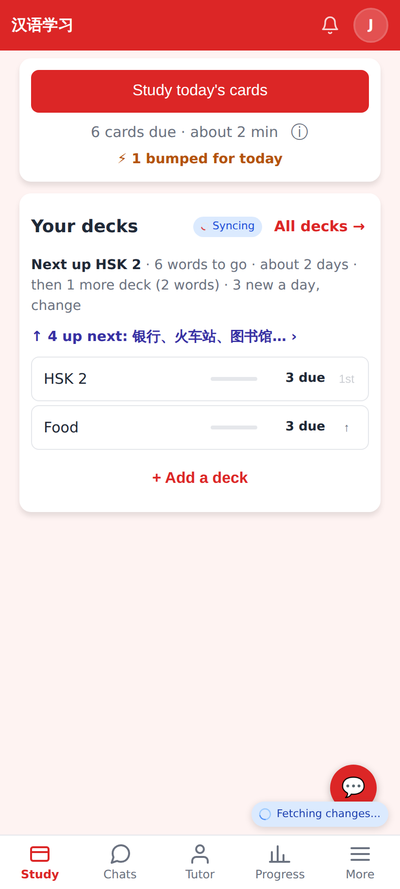
Home: "↑ 4 up next: 银行、火车站、图书馆… ›" under Next up. The 3 new words today are the first three on the list.

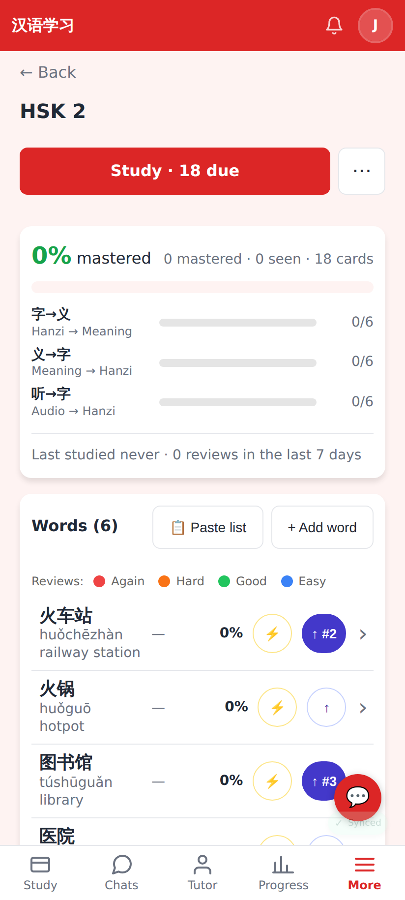
Deck page rows: ↑ puts a word on the list; a word already on it shows its place (↑ #2), and tapping it takes the word off.

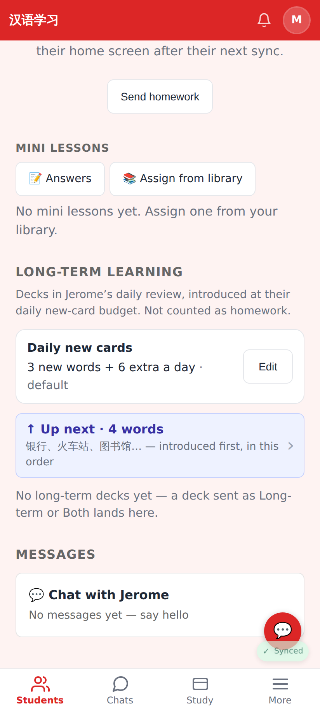
The tutor's student page → Long-term learning: "↑ Up next · 4 words", under the daily budget.

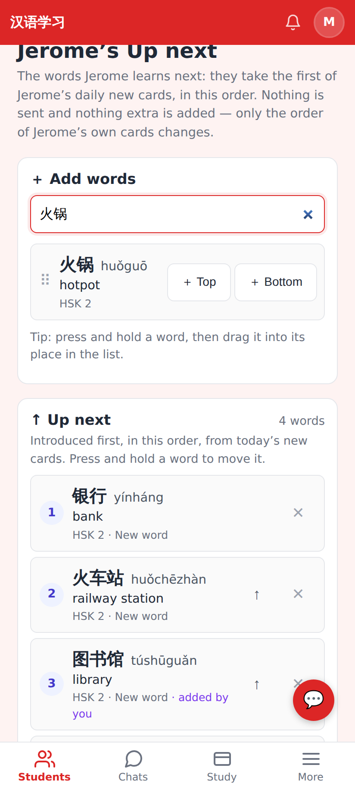
The tutor's view of the student's list: she searches the student's cards and adds, reorders and removes words.

## Lab app

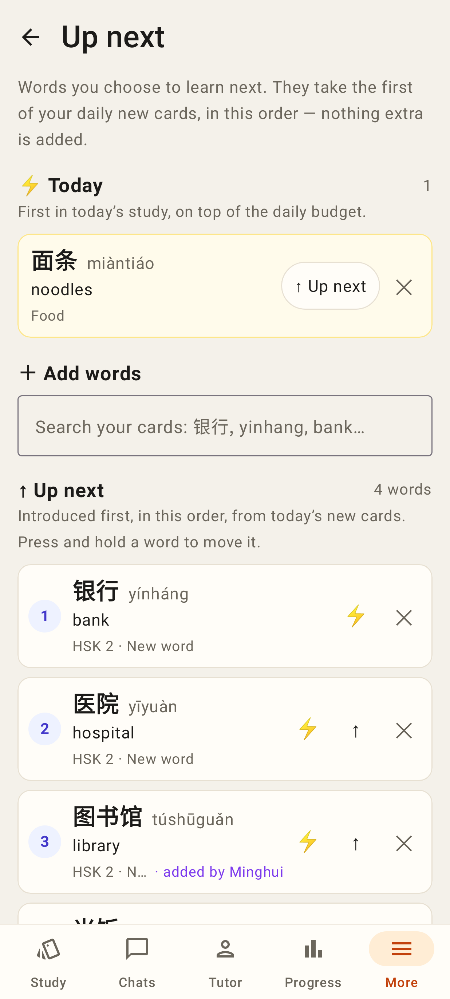
The same page natively: ⚡ Today, search, then the list (press and hold to drag, ⚡ / ↑ / ✕).

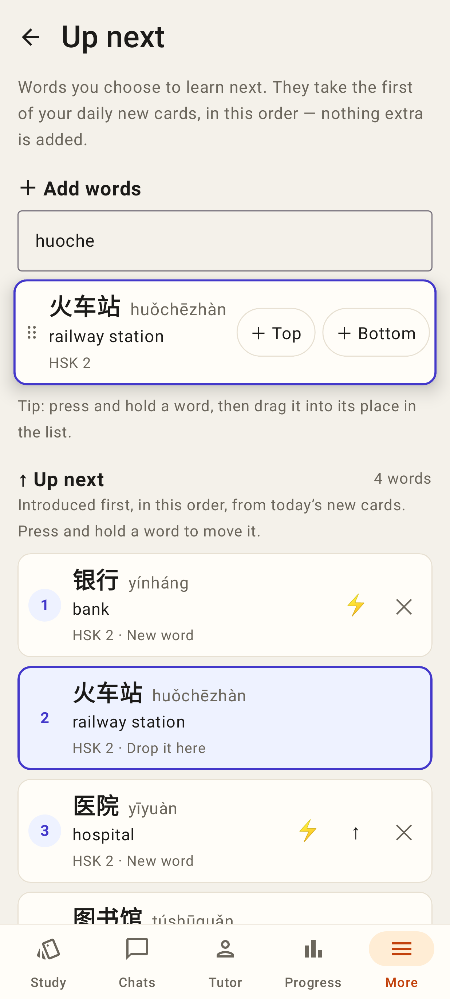
A search result dragged into the list, with its drop placeholder at #2.

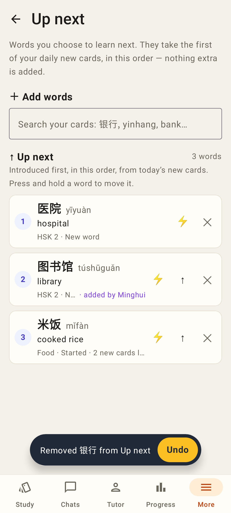
Taken off the list, with Undo.

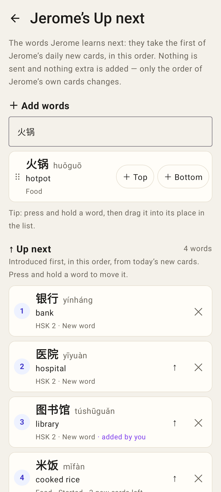
The tutor's view of a student's list (`/connections/:relId/up-next`).

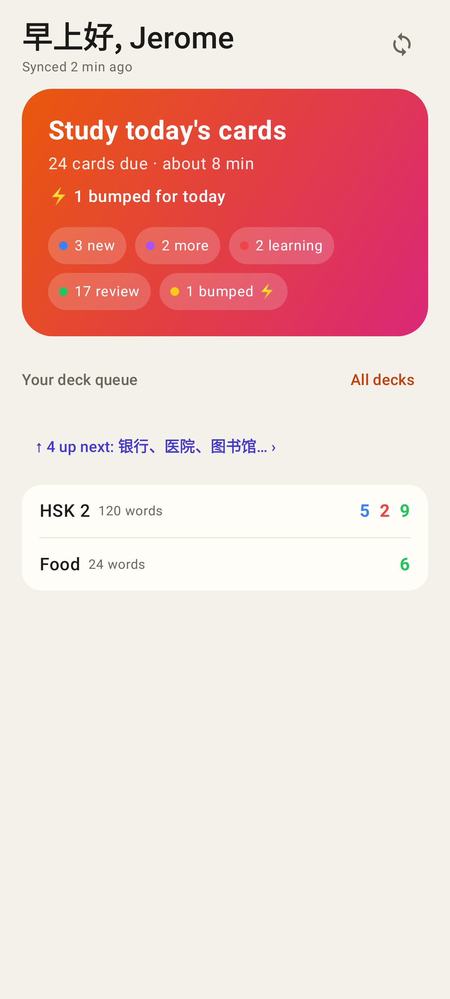
Home's "↑ 4 up next" line.

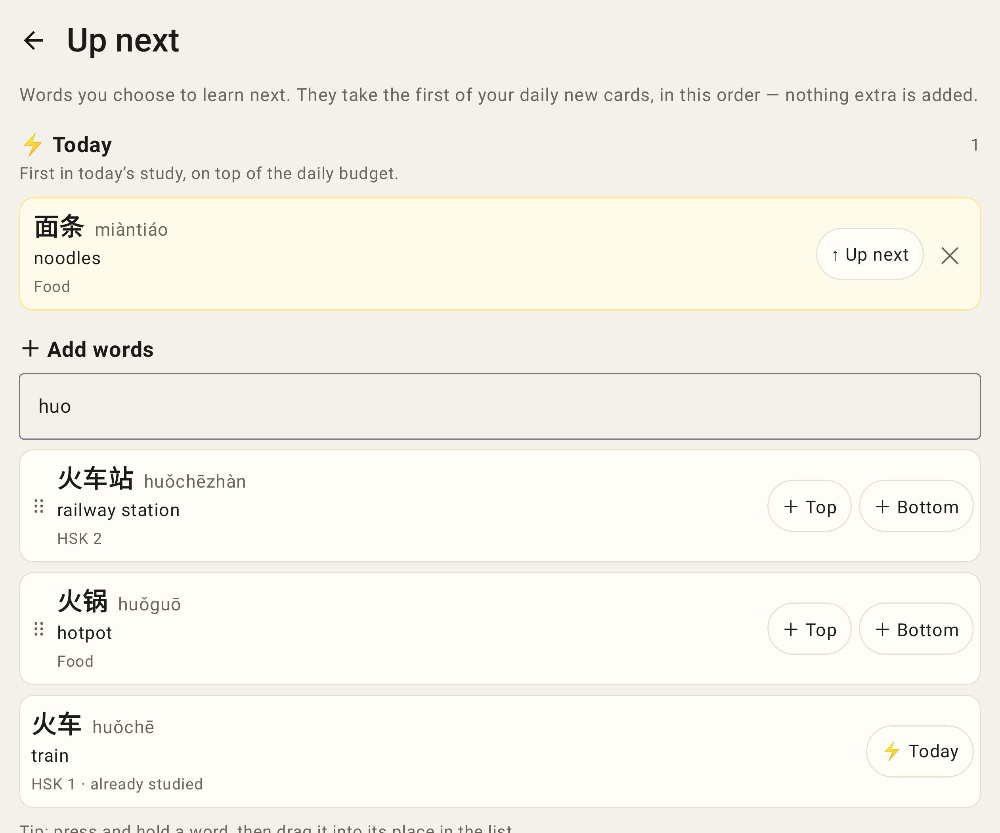
The unfolded Fold.
