# Voice first in the chat, the Coach and Ask Claude

Phone viewport (412×915, 2×). The live words in the "listening" shots come from a fake transcriber that
streams the sentence two characters at a time, the way the real one does.

## Chat composer (web)

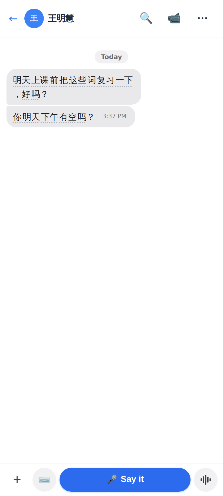
Idle: `+` · ⌨️ Type · the wide **🎤 Say it** (dictates a TEXT message) · the round **waveform** = hold to record a voice message (unchanged).

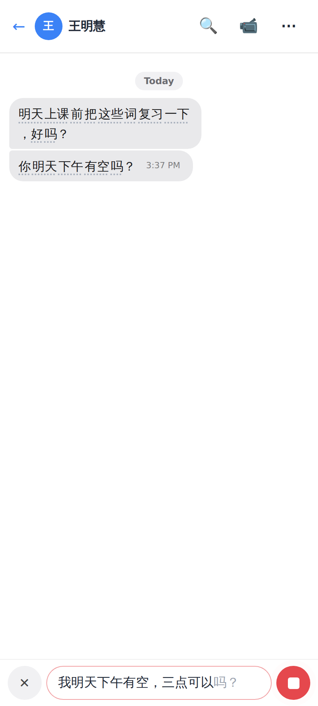
Dictating: ✕ Cancel · the words as they come (the provisional tail grey) · ⏹ Stop.

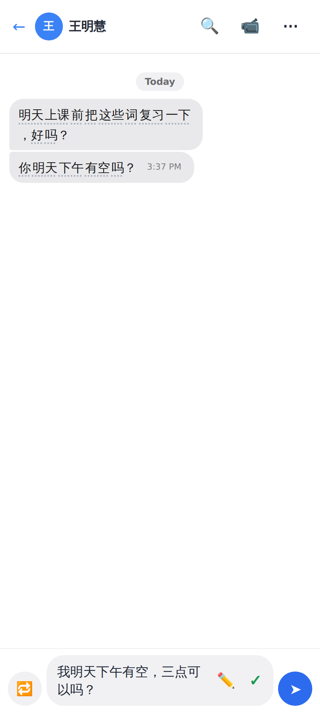
Review: 🔁 Say it again · the text (tap or ✏️ = edit) · ✓ Check my Chinese · ➤ Send.

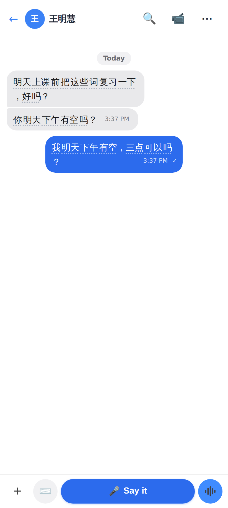
Sent as an ordinary text message; the composer is back on 🎤 Say it.

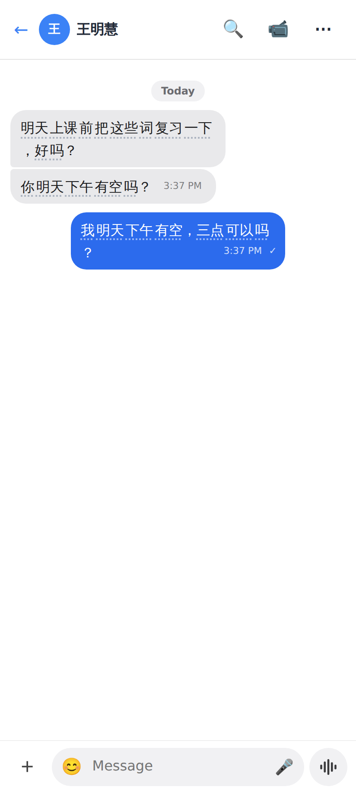
⌨️ Type: the old composer, with a 🎤 in the pill to go back to speaking.

## Sentence Coach (web)

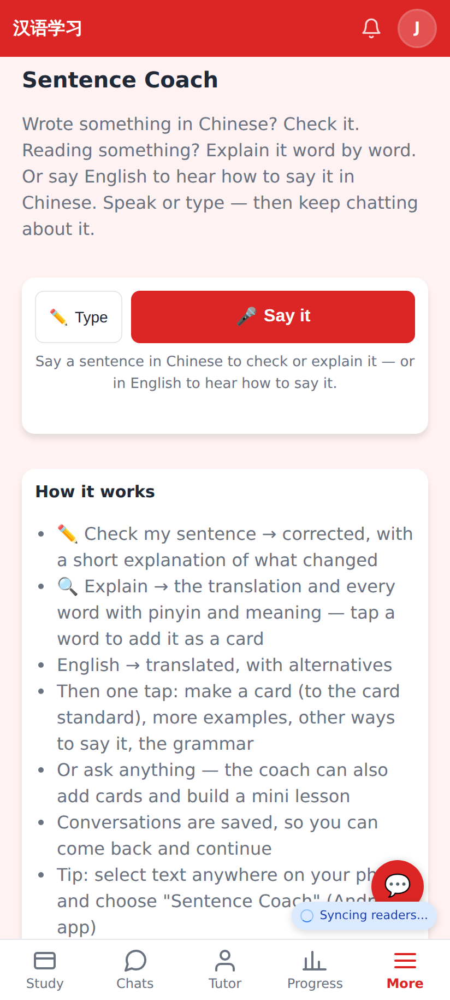
The sentence box opens on 🎤 Say it (✏️ Type beside it).

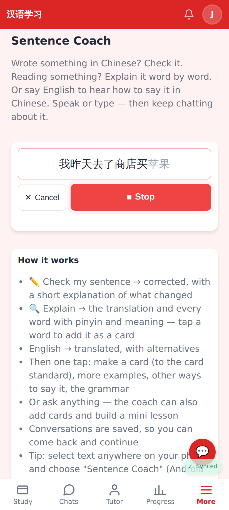
Listening, with the words streaming in.

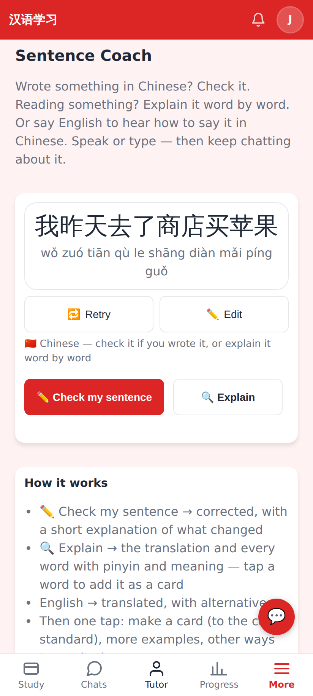
Review: what was said (with pinyin), 🔁 Retry · ✏️ Edit — and the Coach's own buttons act on it (Chinese → Check my sentence / Explain; English → Translate).

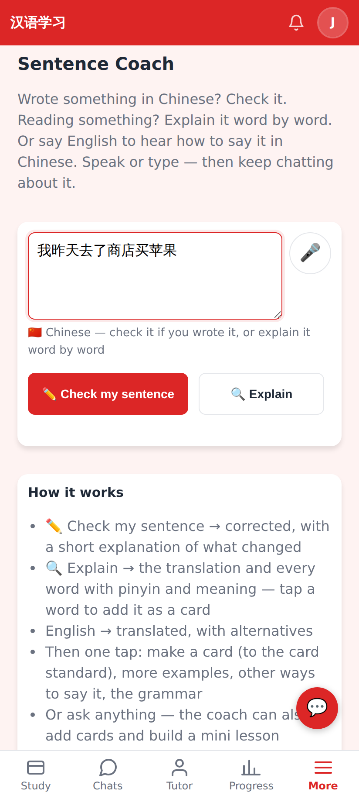
✏️ Edit puts it in the box with the keyboard up; the 🎤 goes back to speaking.

## Ask Claude (web)

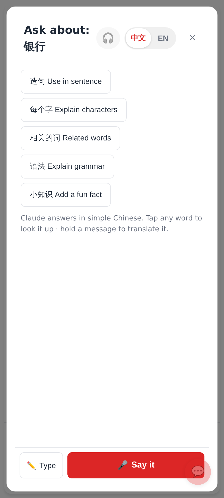
The question box under the quick chips: ✏️ Type · 🎤 Say it.

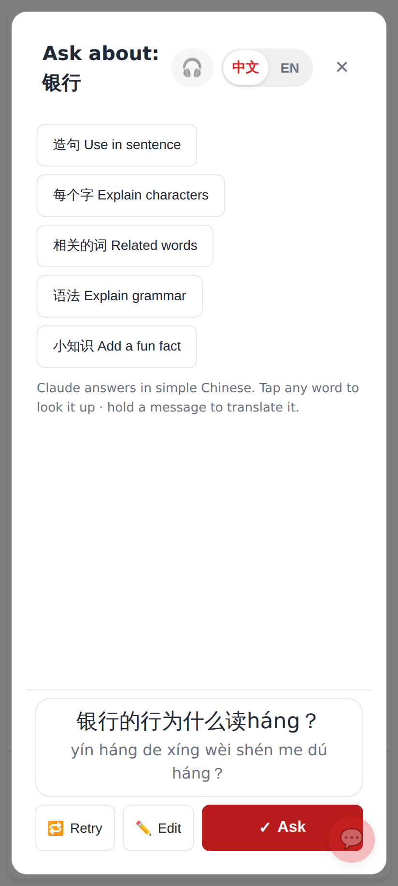
Review → ✓ Ask.

## Lab app

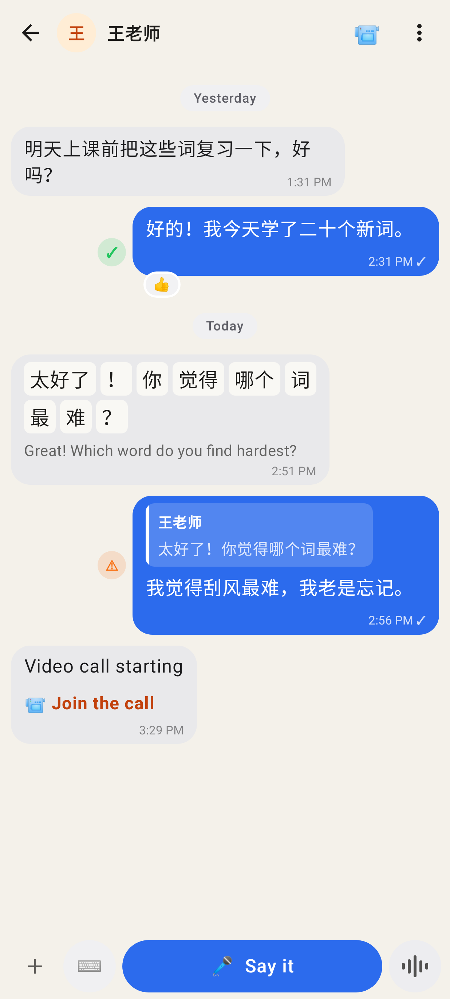
Chat idle — the same row: + · ⌨️ · 🎤 Say it · waveform (voice message).

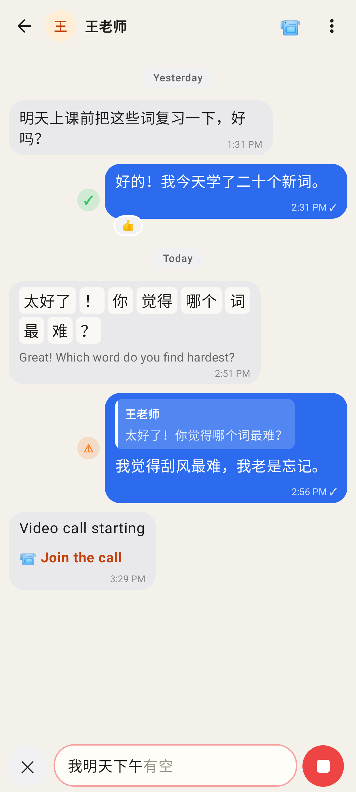
Dictating.

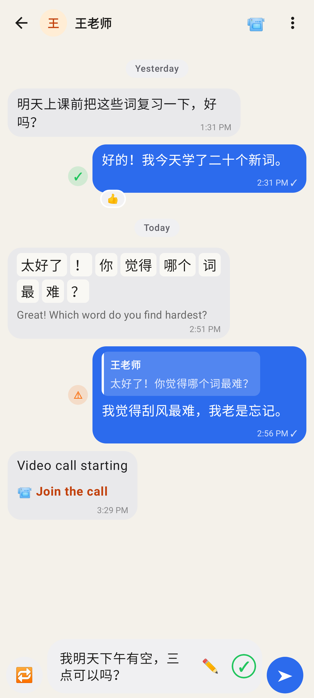
Review: 🔁 · text ✏️ ✓ · ➤.

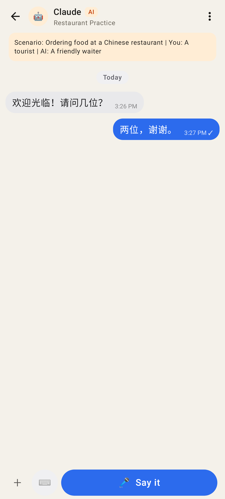
A Claude role-play chat: dictation only (no voice messages there).

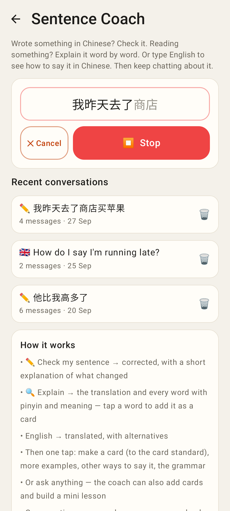
Coach, listening.

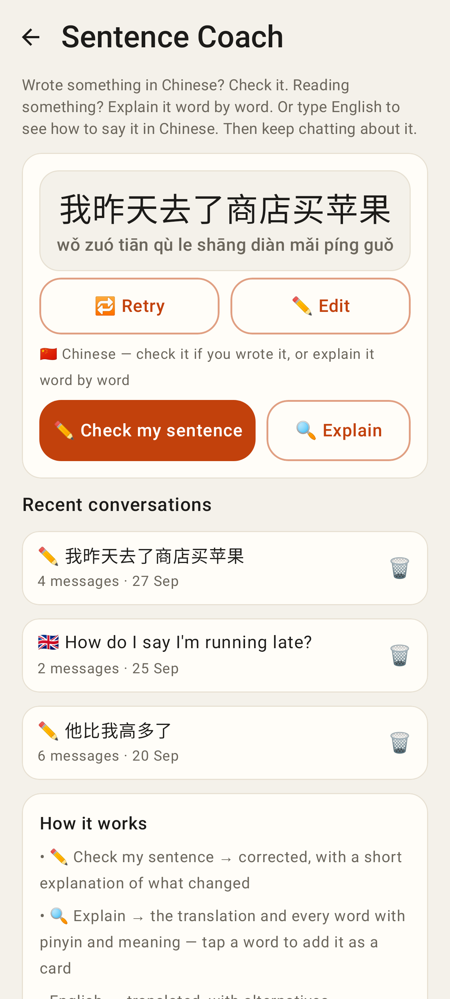
Coach review — Check my sentence / Explain act on what was said.

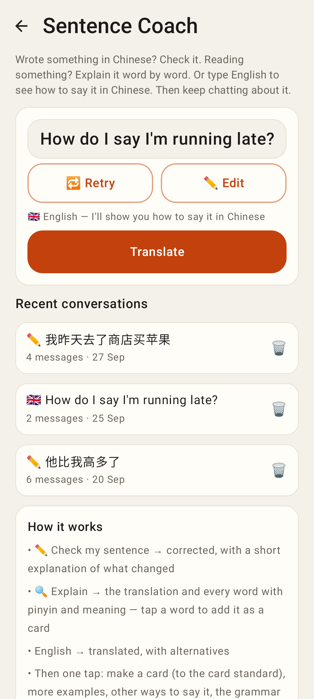
Said in English → Translate.

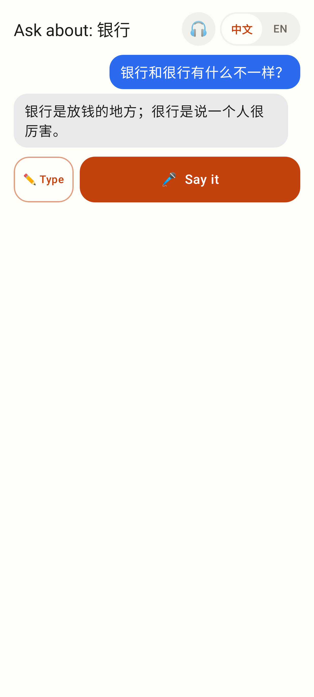
Ask Claude, idle.

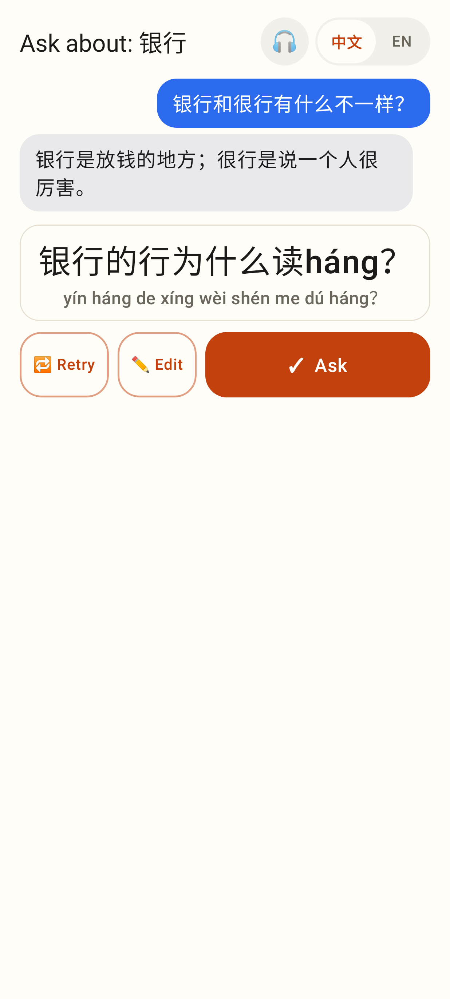
Ask Claude, review.
