# Voice-first text input — shared component (web + Lab)

The box shown in a "Translate into Chinese" frame (the mini lessons adopt it in the next PR). Phone viewport, 412 wide.

## Web (`components/voice/VoiceTextInput.tsx`)

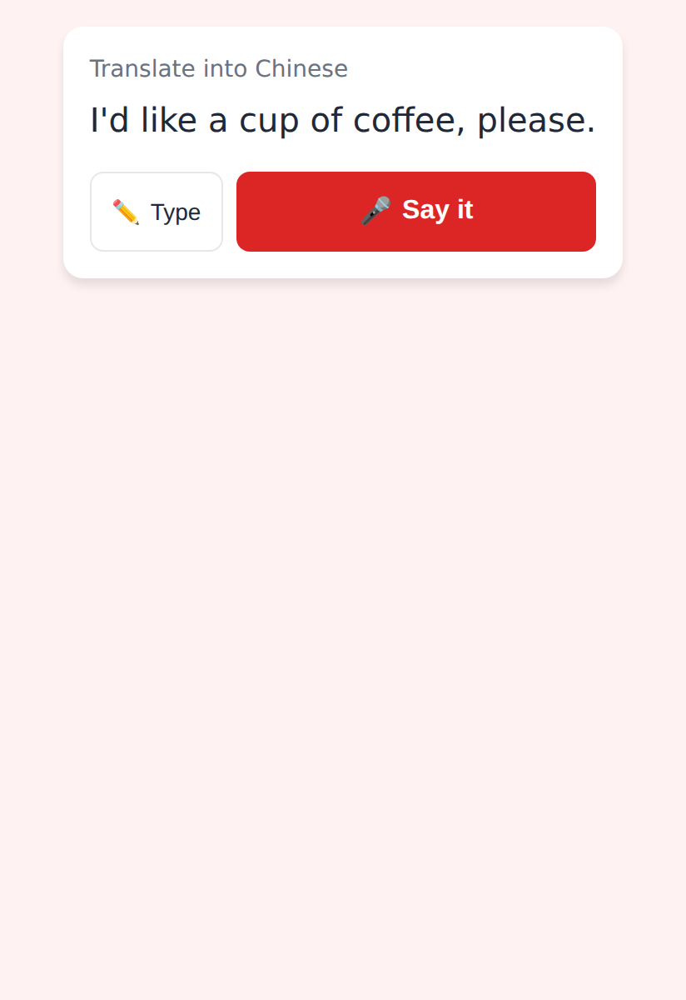
Idle: ✏️ Type · wide 🎤 Say it — no keyboard.

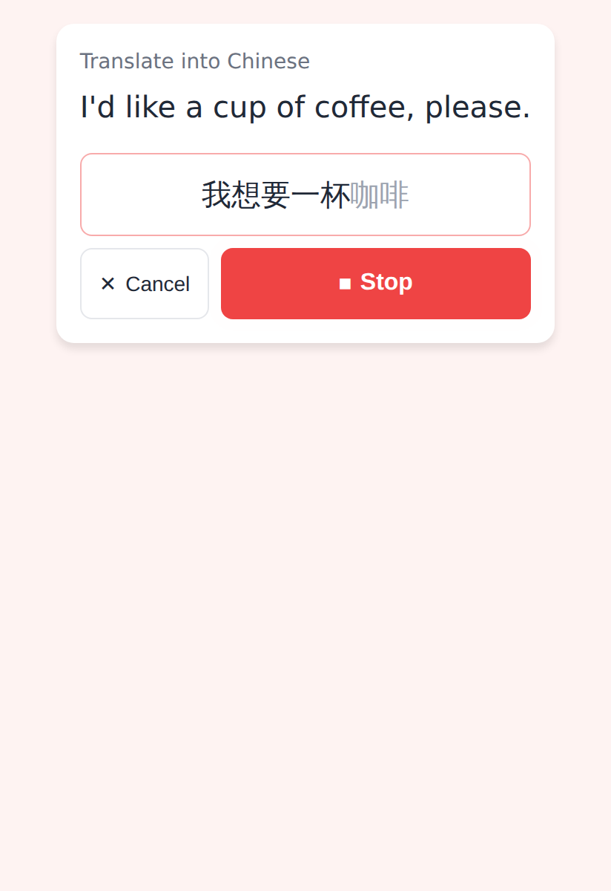
Listening: the words stream in (confirmed black, provisional grey), ✕ Cancel · ⏹ Stop.

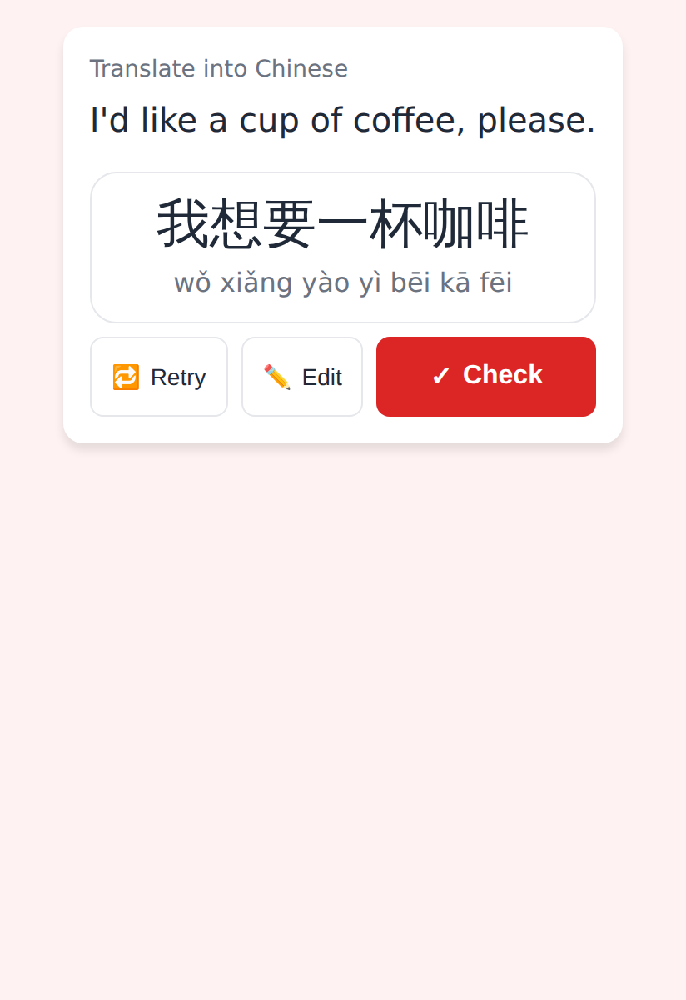
Review: what was heard with the device's pinyin, 🔁 Retry · ✏️ Edit · ✓ Check.

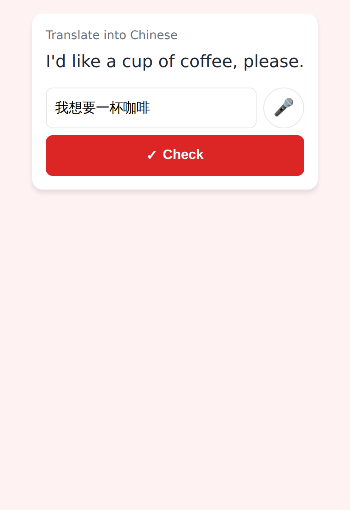
Typing (after ✏️ Type / ✏️ Edit): the box with a 🎤 to go back to speaking.

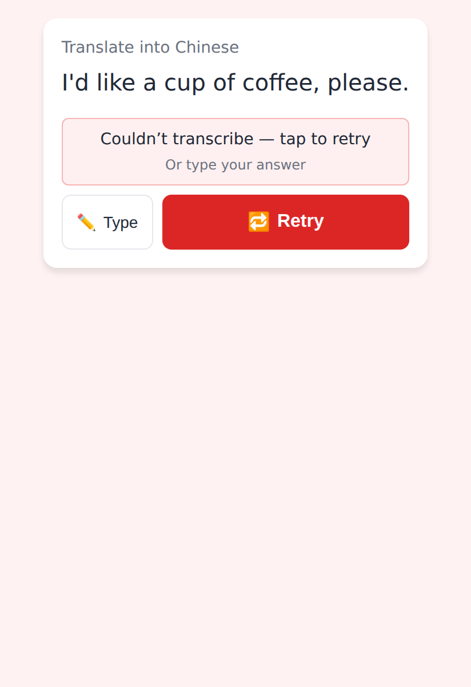
Never silent: "Couldn't transcribe — tap to retry" (the same take), ✏️ Type · 🔁 Retry.

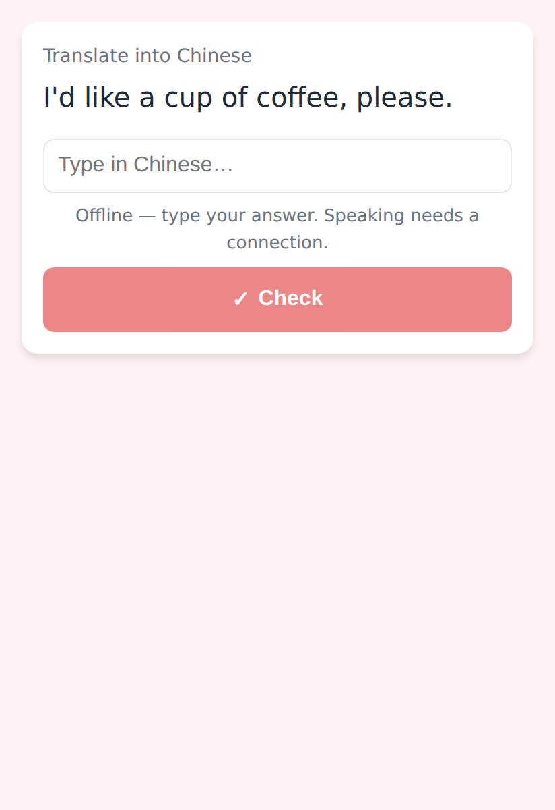
Offline: typing with the reason, no 🎤.

## Lab (`ui/kit/VoiceTextField.kt`)

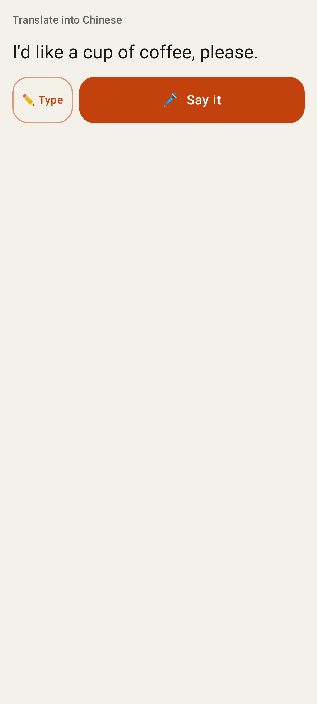
Idle.

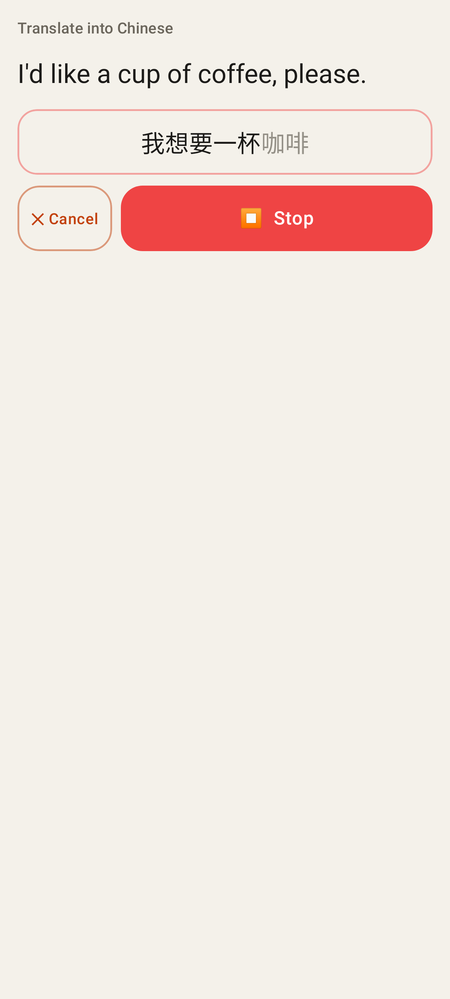
Listening with the live transcript.

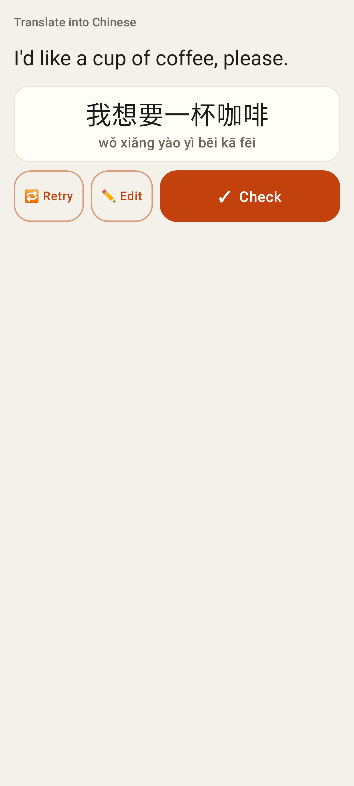
Review.

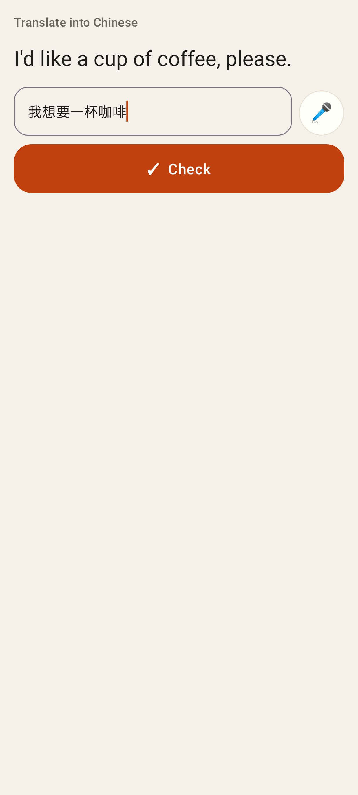
Typing with the 🎤.

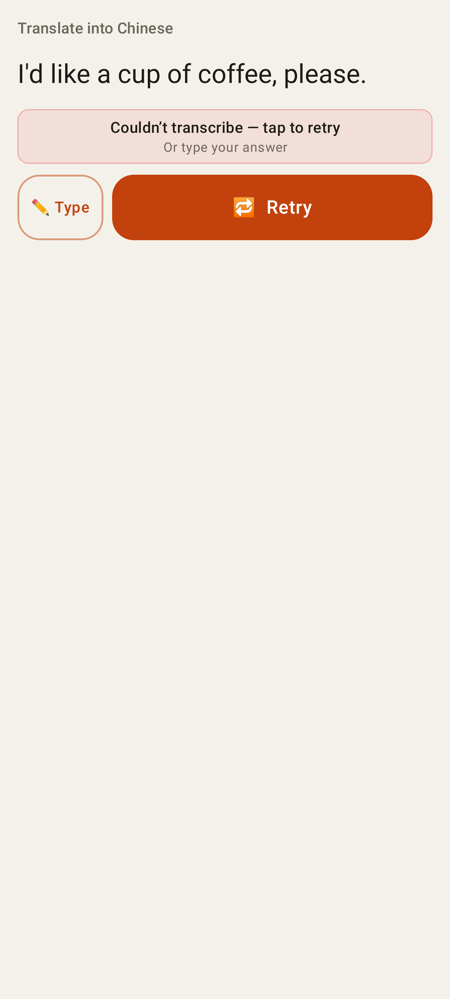
Couldn't transcribe.

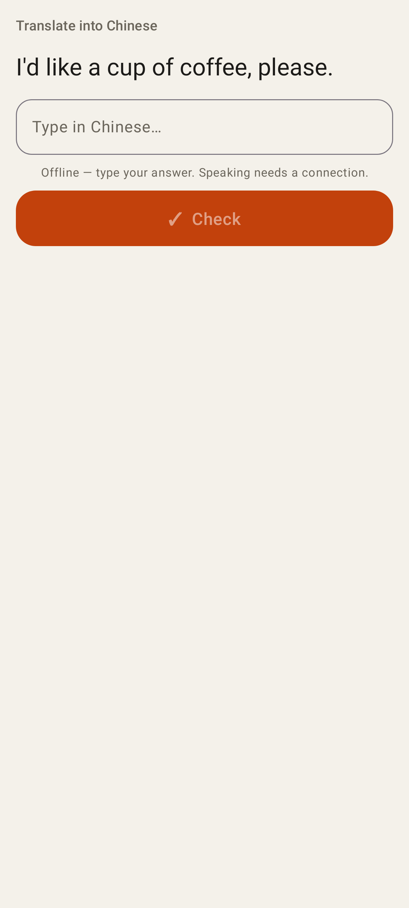
Offline.

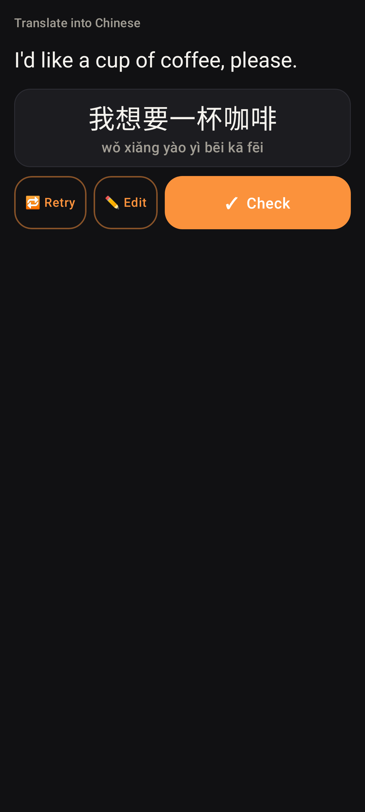
Review in dark mode.
